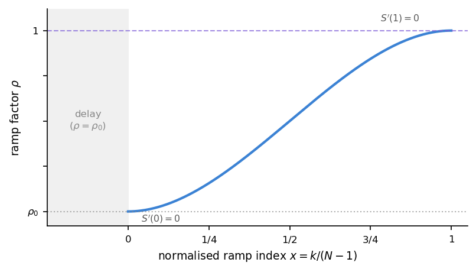

Solver algorithms
=================

.. |SNES| replace:: :math:`\text{SNES}`
.. |KSP| replace:: :math:`\text{KSP}`

This chapter documents the timestep driver and acceptance logic of the stereographic dynamic
integrator implemented in
:class:`~Zmag_bins.Zmag_dynamic_stereo_base.Z_sim_dynamic_stereo_base`
(demag and nodemag drivers). Configuration parameters are listed in :ref:`configuration`.

Notation
--------

The table lists symbols common to the timestep driver and to phases (A)–(C).

.. list-table::
   :header-rows: 1
   :widths: 24 76

   * - Symbol
     - Definition
   * - :math:`t^n`, :math:`\Delta t^\ast`
     - Physical time and non-dimensional timestep of the current attempt
   * - :math:`\mathbf{u}^n=(\mathbf{q}_A^n,\mathbf{q}_B^n)`; demag adds :math:`\varphi^n`
     - Accepted state at the beginning of the step (backup)
   * - :math:`\mathbf{u}^{\mathrm{trial}}`
     - State returned by the nonlinear solve prior to acceptance
   * - :math:`\mathbf{F}(\mathbf{u})`
     - |SNES| residual vector of the BDF-discretized LLG weak form (:doc:`theory_dynamics`)
   * - :math:`\|\mathbf{F}\|`
     - Euclidean norm of the |SNES| residual vector
   * - :math:`E_{\mathrm{split}}`, :math:`E_{\mathrm{phys}}`
     - Split stored energy (:eq:`eq:E_split_def`) and physical Cartesian energy (:eq:`eq:E_phys_def`)
   * - :math:`E_{\mathrm{gate}}`
     - Energy functional monitored by the thermodynamic gate (:eq:`eq:E_gate_def`)

.. _energy-functionals:

Energy functionals
------------------

Each acceptance criterion in phases (C)–(F) compares a scalar energy or its increment
step-over-step. The solver maintains two such scalars on every trial state:
:math:`E_{\mathrm{split}}` (``compute_energy``) and :math:`E_{\mathrm{phys}}``
(``_compute_energy_physical_cartesian``). Both integrate the same micromagnetic energy
densities over :math:`\Omega_{\mathrm{m}}`; they differ in how the magnetization field
entering those densities is constructed from the dual-chart state
:math:`(\mathbf{q}_A,\mathbf{q}_B)`.

Split stored energy
~~~~~~~~~~~~~~~~~~~

:math:`E_{\mathrm{split}}` is assembled directly from the stereographic chart fields.
For each chart :math:`\chi\in\{A,B\}`, let :math:`\mathbf{m}_\chi = \mathbf{m}_\chi(\mathbf{q}_\chi)`
denote the Cartesian magnetization recovered from that chart's inverse map, and let
:math:`W_\chi` denote the energy density evaluated on :math:`\mathbf{q}_\chi` (for exchange,
which uses stereographic gradients :math:`\nabla\mathbf{q}_\chi`) or on :math:`\mathbf{m}_\chi`
(for anisotropy, Zeeman, and demagnetization). With element-wise atlas weights
:math:`w_A`, :math:`w_B`,

.. math::
    :label: eq:E_split_def

    E_{\mathrm{split}}
    = \int_{\Omega_{\mathrm m}} \bigl(w_A\,W_A(\mathbf{q}_A) + w_B\,W_B(\mathbf{q}_B)\bigr)
      \,\mathrm{d}V^\ast
    = \mathcal{E}_{\mathrm{sol}}.

This is the functional whose Gateaux variation generates the |SNES| residual
:math:`\mathbf{F}` (:eq:`eq:Esol_variation`, :doc:`theory_dynamics`). Because exchange
in :math:`W_\chi` is expressed through stereographic gradients :math:`\nabla\mathbf{q}_\chi`
rather than :math:`\nabla\mathbf{m}`, :math:`E_{\mathrm{split}}` depends on the full
chart representation :math:`(\mathbf{q}_A,\mathbf{q}_B)` and not solely on the
magnetization direction.  ``compute_energy`` returns component integrals (exchange,
uniaxial anisotropy, cubic anisotropy, demagnetization, Zeeman) followed by
:math:`E_{\mathrm{split}}`.

Physical Cartesian energy
~~~~~~~~~~~~~~~~~~~~~~~~~

:math:`E_{\mathrm{phys}}` evaluates the same energy densities on a single Cartesian
field :math:`\mathbf{m}` constructed by normalizing the atlas-weighted blend of the two
chart reconstructions:

.. math::
    :label: eq:m_blend_def

    \mathbf{m}
    = \frac{w_A\,\mathbf{m}_A(\mathbf{q}_A) + w_B\,\mathbf{m}_B(\mathbf{q}_B)}
           {|w_A\,\mathbf{m}_A + w_B\,\mathbf{m}_B| + \varepsilon}.

Exchange in :math:`E_{\mathrm{phys}}` uses :math:`|\nabla\mathbf{m}|^2` of this blended field;
all other terms are evaluated identically to their counterparts in :math:`E_{\mathrm{split}}`.
Formally,

.. math::
    :label: eq:E_phys_def

    E_{\mathrm{phys}}
    = \int_{\Omega_{\mathrm m}}
    \Bigl(
        W_{\mathrm{ex}}(\mathbf{m})
        + W_{\mathrm{ani}}(\mathbf{m})
        + W_{\mathrm{d}}(\mathbf{m},\varphi)
        + W_{\mathrm{zee}}(\mathbf{m})
    \Bigr)\,\mathrm{d}V^\ast,

computed by ``_compute_energy_physical_cartesian``. Because :math:`\mathbf{m}` is constructed
from the blend without reference to individual chart gradients, :math:`E_{\mathrm{phys}}` is a
functional of the magnetization direction alone: it is insensitive to how the state
:math:`(\mathbf{q}_A,\mathbf{q}_B)` is distributed between the two charts, provided the
blended :math:`\mathbf{m}` is the same.

.. _functional-comparison:

Comparison and usage of the two functionals
~~~~~~~~~~~~~~~~~~~~~~~~~~~~~~~~~~~~~~~~~~~

**When the two functionals agree.**
In regions where a single chart dominates, both charts reconstruct essentially the same
magnetization direction, and the stereographic exchange gradient reduces to the physical
one via the conformal factor. In that regime :math:`E_{\mathrm{split}}` and
:math:`E_{\mathrm{phys}}` are numerically close.

**When they differ.**
The two values are not equal in two situations. First, in overlap regions where both
atlas weights are non-zero, each chart contributes independent stereographic gradients
to :math:`E_{\mathrm{split}}`; those gradients do not need to match the gradient of the
blended :math:`\mathbf{m}` used by :math:`E_{\mathrm{phys}}`. Second, atlas closure
(:ref:`phase-f`) adjusts the chart fields :math:`(\mathbf{q}_A,\mathbf{q}_B)` to restore
representation consistency without changing the physical magnetization, so
:math:`E_{\mathrm{phys}}` is unaffected while :math:`E_{\mathrm{split}}` may shift.

**Functional assignment by criterion.**
Each acceptance criterion uses exactly one of the two functionals:

.. list-table::
   :header-rows: 1
   :widths: 28 36 36

   * - Criterion
     - Functional
     - Rationale
   * - |SNES| residual / :math:`F`
     - :math:`E_{\mathrm{split}}`
     - Gateaux derivative of :eq:`eq:E_split_def`.
   * - Thermodynamic gate (:math:`E_{\mathrm{gate}}`, default)
     - :math:`E_{\mathrm{split}}`
     - Form-consistent with the dynamical variables :math:`\mathbf{q}_{A,B}` solved by |SNES|.
   * - Physical guard (optional, ``thermo_enable_physical_guard``)
     - :math:`E_{\mathrm{phys}}`
     - Secondary check that the blended-field energy has not grown; insensitive to chart
       redistribution inside the atlas.
   * - Atlas closure jump
     - :math:`E_{\mathrm{gate}}` (split or phys, per ``thermo_use_split_energy``)
     - Monitors the energy change caused by the representational repair in phase (F);
       a large jump signals an inconsistent closure.
   * - Steady-state stop
     - :math:`E_{\mathrm{phys}}`
     - Atlas closure can shift :math:`E_{\mathrm{split}}` without any physical change;
       :math:`E_{\mathrm{phys}}` avoids spurious early termination near equilibrium.

**Gate energy definition.**
The thermodynamic gate (phase E, :ref:`phase-e`) tests the increment
:math:`\Delta E_{\mathrm{gate}} = E_{\mathrm{gate}}^{\mathrm{trial}} - E_{\mathrm{gate}}^{n}`
between the backup state :math:`\mathbf{u}^n` and the trial state
:math:`\mathbf{u}^{\mathrm{trial}}`. Flag ``thermo_use_split_energy`` (default ``True``)
selects which functional plays the role of :math:`E_{\mathrm{gate}}`.
Let :math:`\chi` denote that flag; then:

.. math::
    :label: eq:E_gate_def

    E_{\mathrm{gate}}
    =
    \begin{cases}
        E_{\mathrm{split}} & \chi = \mathrm{True}, \\[0.4em]
        E_{\mathrm{phys}}  & \chi = \mathrm{False}.
    \end{cases}

- **Split stored energy** (default, ``thermo_use_split_energy = True``).
  The gate monitors :math:`E_{\mathrm{split}}`, the same functional whose Gateaux variation
  drives the |SNES| solve (:eq:`eq:E_split_def`, :eq:`eq:Esol_variation`). This keeps the
  energy test fully consistent with the dynamical degrees of freedom
  :math:`(\mathbf{q}_A,\mathbf{q}_B)` and with the functional differentiated in the
  nonlinear solve.

- **Physical Cartesian energy** (``thermo_use_split_energy = False``).
  The gate monitors :math:`E_{\mathrm{phys}}`, which depends only on the blended
  magnetization :math:`\mathbf{m}` (:eq:`eq:E_phys_def`). Because
  :math:`E_{\mathrm{phys}}` is insensitive to how the state is distributed between
  charts, this option eliminates representational variation from the energy test.
  It is appropriate when the thermodynamic criterion must be stated strictly in
  terms of the physical magnetization direction rather than the atlas decomposition.

.. _fig:solver_flow:

Structure of one timestep
-------------------------

At step index :math:`n`, ``solve_problem`` advances from the last accepted state
:math:`\mathbf{u}^n` at time :math:`t^n` to an accepted state at :math:`t^{n+1}=t^n+\Delta t^\ast`.
The routine nests several control levels; Figure 1 (:ref:`fig:solver_flow`) summarises the hierarchy.

**Timestep loop.**
Outer driver ``for step in range(step_start, step_end)`` over integer indices :math:`n`. Physical
time advances once per iteration, and only after a successful accept. Each iteration comprises
three sequential blocks:

#. **Preamble** (``_open_timestep``, ``_run_timestep_preamble``) — runs once before any retry at
   this :math:`n`. Updates demagnetization and Zeeman continuation ramps; when a ramp completes,
   transition guards may reduce :math:`\Delta t^\ast`, tighten growth caps, and rebase thermodynamic
   baselines (:ref:`continuation-ramps`).

#. **Δt-retry loop** (``while not accepted``) — repeated **acceptance attempts** at the current
   :math:`\Delta t^\ast`. The state :math:`\mathbf{u}^n` is backed up before each attempt. If an
   attempt fails, the backup is restored and :math:`\Delta t^\ast` may be reduced before retrying;
   the clock does not advance (:ref:`rejection-recovery`). Each pass through this loop executes
   phases (A)–(F) on a trial state :math:`\mathbf{u}^{\mathrm{trial}}` via
   ``_run_accept_attempt`` (:ref:`acceptance-phases`).

#. **Post-acceptance update** (``_finalize_accepted_step``) — runs once after accept. Advances
   :math:`t^n\to t^{n+1}`, updates BDF history, selects the next :math:`\Delta t^\ast`
   (:eq:`eq:dt_selection`), and writes I/O.

**Operator-split loop** (demag driver only).
Inside phase (A) of a single acceptance attempt, a fixed-point iteration couples |SNES| for
:math:`(\mathbf{q}_A,\mathbf{q}_B,\varphi)` with magnetostatic updates of :math:`\mathbf{H}_{\mathrm{d}}`
(:ref:`phase-a`). This loop is nested within one acceptance attempt; it is not part of the timestep
loop or the Δt-retry loop.

.. _acceptance-phases:

Acceptance phases
-----------------

Within one iteration of the Δt-retry loop, the trial state passes through six phases (A)–(F) in
order. Phases (A)–(E) operate on the dynamical chart fields; phase (F) repairs the stereographic
representation for storage and I/O.

**(A) Nonlinear solve** (:ref:`phase-a`).
Advance the LLG equation over :math:`[t^n,t^{n+1}]` with a BDF formula on the chart variables
:math:`(\mathbf{q}_A,\mathbf{q}_B)` (and :math:`\varphi` in the demag driver), producing a
**trial state** :math:`\mathbf{u}^{\mathrm{trial}}` and a |SNES| residual :math:`F`. In the
demag driver, magnetostatics and magnetization are coupled through an **operator-split loop**
nested inside this phase.

**(B) Algebraic validity** (:ref:`phase-b`).
Confirm that the nonlinear and linear algebra completed successfully: |SNES| and |KSP|
converged, and in the demag driver the operator-split fixed point reached its tolerance.
This phase does not evaluate physics; it only excludes diverged or incomplete solves.

**(C) Atlas radius guard** (:ref:`phase-c`).
Verify that the stereographic coordinates :math:`\mathbf{q}_A`, :math:`\mathbf{q}_B` remain
within a numerically safe range, and snapshot :math:`E_{\mathrm{split}}` and
:math:`E_{\mathrm{phys}}` for the downstream gates. The energy snapshot is also refreshed
whenever backtracking in phase (D) or (E) modifies the chart fields.

**(D) Residual gate** (:ref:`phase-d`).
Compare :math:`\|\mathbf{F}\|` against a history-adaptive threshold :math:`g_{\mathrm{res}}`.
If the test fails, three substages are tried in order: residual backtracking along the chord
between :math:`\mathbf{u}^n` and :math:`\mathbf{u}^{\mathrm{trial}}` (D1), merit acceptance
based on the contraction of :math:`\|\mathbf{F}\|` relative to the previous step (D2), or
continuation with a soft violation that caps subsequent timestep growth (D3).

**(E) Thermodynamic gate** (:ref:`phase-e`).
When active, verify that the energy increment :math:`\Delta E_{\mathrm{gate}}` is consistent
with Gilbert damping and external work (:eq:`eq:thermo_residual`). The gate is skipped during
field ramps, when the energy landscape itself is changing. On failure, optional backtracking
(E1) searches for a damped intermediate state that satisfies the inequality.

**(F) Atlas closure** (:ref:`phase-f`).
After all dynamical gates pass, reconcile the inactive chart degrees of freedom with the
blended magnetization :math:`\mathbf{m}` so the stored representation is atlas-consistent.
A large jump in :math:`E_{\mathrm{gate}}` across this purely representational step indicates
an inconsistent closure and triggers rejection.

.. _code-map:

The six labels map directly to private methods of
:class:`~Zmag_bins.Zmag_dynamic_stereo_base.Z_sim_dynamic_stereo_base`,
called in sequence by
:meth:`~Zmag_bins.Zmag_dynamic_stereo_base.Z_sim_dynamic_stereo_base._run_accept_attempt`:

.. list-table::
   :header-rows: 1
   :widths: 8 40 52

   * - Phase
     - Method
     - Role
   * - (A)
     - ``_run_nonlinear_solve``
     - BDF weak form, operator-split loop (demag); saves trial :math:`\mathbf{q}_A`, :math:`\mathbf{q}_B`
   * - (B)
     - ``_validate_algebraic_solve``
     - |SNES|/|KSP| convergence reasons; outer-split defect check (demag)
   * - (C)
     - ``_refresh_attempt_energies``
     - Atlas radius guard; :math:`E_{\mathrm{split}}` and :math:`E_{\mathrm{phys}}` snapshot
   * - (D)
     - ``_apply_residual_gate``
     - Substages D1 (``_residual_backtracking_search``), D2 (merit), D3 (soft violation)
   * - (E)
     - ``_apply_thermodynamic_gate``
     - Dissipation inequality (:eq:`eq:thermo_residual`); E1 via ``_thermo_backtracking_search``
   * - (F)
     - ``_apply_closure_gate``
     - Inactive-chart reconciliation; :math:`|\Delta E_{\mathrm{gate}}|` jump check

A ``RuntimeError`` from any phase is caught by
:meth:`~Zmag_bins.Zmag_dynamic_stereo_base.Z_sim_dynamic_stereo_base._handle_step_rejection`,
which restores the step backup :math:`\mathbf{u}^n` and may reduce :math:`\Delta t^\ast`.
On success,
:meth:`~Zmag_bins.Zmag_dynamic_stereo_base.Z_sim_dynamic_stereo_base._finalize_accepted_step`
advances time, updates the BDF history, selects the next :math:`\Delta t^\ast`, and writes I/O.

Figure 1 below shows the full timestep hierarchy — preamble, Δt-retry loop with phases (A)–(F),
and post-acceptance update. The outcome labels beside each phase box summarise what can happen;
full detail for each phase follows in the sections below.

.. include:: _includes/solver_flow_display.rst

.. _phase-a:

Nonlinear solve (phase A)
--------------------------

.. container:: solver-flow-figure-block

   .. raw:: html
      :file: _includes/solver_flow_phase_a.html

**Figure 2.** Phase (A): nonlinear solve, operator-split loop, and trial state.

Phase (A) (``_run_nonlinear_solve``) solves one **implicit timestep**: find chart fields at
:math:`t^{n+1}` such that the BDF-discretized LLG weak form (:doc:`theory_dynamics`,
:eq:`eq:bdf_approx`) is satisfied over :math:`[t^n,t^{n+1}]`. The result is the **trial state**
:math:`\mathbf{u}^{\mathrm{trial}}` for the acceptance gates. Phase (A) does not judge acceptance;
in the demag driver it returns split-convergence metadata in ``split_info``.

**Demag driver — hybrid FEM–BEM operator-split loop.** ``solve_weak_form`` advances one implicit
BDF step at :math:`t^{n+1}` for the mixed fields :math:`(\mathbf{q}_A,\mathbf{q}_B,\varphi)` while
coupling open-boundary magnetostatics through the Fredkin–Koehler FEM–BEM procedure
(:doc:`theory_magnetostatics`). A fully coupled Newton solve would require differentiating the dense
BEM operators with respect to the chart fields at every Newton step, which is prohibitively expensive.
The demag driver avoids that cost by a **two-level** scheme at each timestep: an **outer**
fixed-point loop over the magnetization–demagnetization split, and an **inner** |SNES|
Newton–Krylov solve at each outer iterate.

**Fields and notation.** The mixed vector ``u_mixed`` holds :math:`(\mathbf{q}_A,\mathbf{q}_B,\varphi)`.
The scalar :math:`\varphi` is the **FEM** magnetostatic unknown: |SNES| updates it, and the LLG
residuals use :math:`\mathbf{H}_{\mathrm{d}}=-\nabla\varphi`. The **BEM closure**
:math:`\varphi_{\mathrm{BEM}}` is the magnetostatic potential returned by ``demag_helper.compute_phi``
from blended :math:`\mathbf{m}(\mathbf{q}_A,\mathbf{q}_B)`; it is written to ``phi_computed_mixed``.
During outer iterate :math:`k`, the closure evaluated at the opening charts is frozen as
:math:`\varphi_{\mathrm{BEM}}^{k}` (pass-local copy ``phi_outer_ref``) and appears in the
:math:`\varphi` residual as :math:`\nabla(\varphi-\varphi_{\mathrm{BEM}}^{k})` without being
refreshed until the next outer iterate.

**Timestep setup.** At the entry of ``solve_weak_form``, accepted charts at :math:`t^n` and
:math:`t^{n-1}` are copied into ``qA_prev`` / ``qB_prev`` (and ``*_prev_prev`` for BDF2). They
enter the BDF time derivative and remain fixed for the entire outer loop. The outer loop updates only
the trial charts at :math:`t^{n+1}` in ``qA`` / ``qB``. The first outer iterate uses
:math:`\mathbf{q}^{0}=(\mathbf{q}_A^{0},\mathbf{q}_B^{0})` as an initial guess for
:math:`t^{n+1}`—typically the accepted charts at :math:`t^n` already present in ``qA`` / ``qB`` after
the history shift.

**Outer fixed-point loop.** Outer iterates are indexed :math:`k=0,1,\ldots` up to
``outer_split_max_iter``. At iterate :math:`k` the opening charts :math:`\mathbf{q}^{k}` are the
fields in ``qA`` / ``qB`` before the pass; the inner |SNES| returns updated charts
:math:`\mathbf{q}^{k+1}`. The goal of the outer loop is to reach a state where the BEM closure
computed from :math:`\mathbf{q}^{k+1}` agrees with the closure :math:`\varphi_{\mathrm{BEM}}^{k}`
that was frozen during the solve—so that the magnetization and the demagnetizing field are mutually
consistent at :math:`t^{n+1}`. Each pass executes:

1. **Atlas update.** ``_atlas_update_masks_from_qA`` rebuilds the element weights ``wA`` / ``wB`` from
   :math:`\mathbf{q}^{k}`.

2. **Magnetostatic freeze.** ``_refresh_demag_state_from_current_q`` forms
   :math:`\mathbf{m}(\mathbf{q}^{k})`, calls ``demag_helper.compute_phi`` to evaluate the BEM
   closure :math:`\varphi_{\mathrm{BEM}}^{k}`, stores it in ``phi_computed_mixed``, and copies it to
   ``phi_outer_ref``. The opening charts are saved as ``qA_outer_before`` / ``qB_outer_before``.

3. **Inner |SNES| solve.** |SNES| advances the BDF–LLG equations for
   :math:`(\mathbf{q}_A,\mathbf{q}_B,\varphi)` with :math:`\varphi_{\mathrm{BEM}}^{k}` held
   constant (see the inner-solve subsection below). The resulting charts written back to
   ``qA`` / ``qB`` are :math:`\mathbf{q}^{k+1}`; the resulting potential in ``u_mixed`` is
   :math:`\varphi^{k+1}`.

4. **Split-defect check and loop decision.** ``_refresh_demag_state_from_current_q`` re-evaluates the
   BEM closure from :math:`\mathbf{q}^{k+1}`, giving :math:`\varphi_{\mathrm{BEM}}^{k+1}`. Two
   defect norms (defined below) then measure how much the charts and the BEM closure changed across
   this pass. If both are within tolerance and the minimum pass count is met
   (``outer_split_min_iter_with_accel`` when Anderson is enabled), the outer loop stops. Otherwise
   iterate :math:`k+1` opens from :math:`\mathbf{q}^{k+1}`—optionally modified by Anderson
   acceleration—and returns to step 1.

**Inner |SNES| solve.** The key simplification of the two-level scheme is that, with
:math:`\varphi_{\mathrm{BEM}}^{k}` frozen, the Jacobian of :math:`\mathbf{F}` with respect to
:math:`(\mathbf{q}_A,\mathbf{q}_B,\varphi)` is sparse and can be assembled and factored without
touching the dense BEM operators. Concretely, |SNES| drives
:math:`\mathbf{F}(\mathbf{u})=\mathbf{0}` for
:math:`\mathbf{u}=(\mathbf{q}_A,\mathbf{q}_B,\varphi)`, initialized from :math:`\mathbf{q}^{k}`
(``_build_snes_forms``). The mixed residual
:math:`\mathbf{F}=(\mathbf{F}_{\mathbf{q}_A},\mathbf{F}_{\mathbf{q}_B},F_\varphi)` is assembled
from the weak forms (:doc:`theory_dynamics`). The chart residual blocks are

.. math::
    :label: eq:snes_chart_block

    \mathbf{F}_{\mathbf{q}_\chi}
    = \int_{\Omega_{\mathrm m}}
      w_\chi\, M_{\mathrm s}^\ast
      \bigl(\mathcal{L}_\chi(\mathbf{q}_\chi)\cdot\dot{\mathbf{q}}_\chi\bigr)\cdot\mathbf{v}_\chi
      \,\mathrm{d}V^\ast
    + \mathbf{F}_\chi^{\mathrm{ex}}
    + \mathbf{F}_\chi^{\mathrm{ani}}
    + \mathbf{F}_\chi^{\mathrm{zee}}
    + \mathbf{F}_\chi^{\mathrm{d}},
    \quad \chi \in \{A, B\},

where :math:`\dot{\mathbf{q}}_\chi` is the BDF approximation :eq:`eq:bdf_approx`,
:math:`\mathcal{L}_\chi` is the chart-specific stereographic damping matrix
(:doc:`theory_dynamics`), and
:math:`\mathbf{F}_\chi^{\mathrm{ex}},\mathbf{F}_\chi^{\mathrm{ani}},\mathbf{F}_\chi^{\mathrm{zee}},\mathbf{F}_\chi^{\mathrm{d}}`
collect the exchange, anisotropy, Zeeman, and demagnetization Gateaux variations. The
demagnetization block is

.. math::

    \mathbf{F}_\chi^{\mathrm{d}}
    = \int_{\Omega_{\mathrm m}}
      w_\chi\, M_{\mathrm s}^\ast
      \bigl(\mathcal{A}_\chi(\mathbf{q}_\chi)^\mathrm{T}\cdot\nabla\varphi\bigr)\cdot\mathbf{v}_\chi
      \,\mathrm{d}V^\ast,

where :math:`\mathcal{A}_\chi=\partial\mathbf{m}_\chi/\partial\mathbf{q}_\chi` is the
chart Jacobian ``A_mu_i_chart``. This term couples :math:`\mathbf{q}_\chi` to :math:`\varphi`
through a sparse local operator.

The third block of the monolithic residual enforces the magnetostatic constraint
:math:`\varphi=\varphi_{\mathrm{BEM}}(\mathbf{q}_A,\mathbf{q}_B)`. In the full coupled
system this block depends on the chart fields through :math:`\varphi_{\mathrm{BEM}}`; freezing
the closure as :math:`\varphi_{\mathrm{BEM}}^{k}` at the start of the outer iterate makes it a
constant, so the constraint reduces to a standard Poisson equation for :math:`\varphi`:

.. math::
    :label: eq:snes_phi_block

    F_\varphi = \int_{\Omega_{\mathrm m}}
    \nabla(\varphi-\varphi_{\mathrm{BEM}}^{k})\cdot\nabla v_\varphi\, \mathrm{d}V^\ast,

with :math:`\varphi_{\mathrm{BEM}}^{k}` held constant for every Newton step inside the call.
Its unique minimum is :math:`\varphi=\varphi_{\mathrm{BEM}}^{k}`, so the |SNES| solution
satisfies :math:`\varphi^{k+1}=\varphi_{\mathrm{BEM}}^{k}` up to boundary conditions.

Because :math:`F_\varphi` is linear in :math:`\varphi` and independent of
:math:`(\mathbf{q}_A,\mathbf{q}_B)` once :math:`\varphi_{\mathrm{BEM}}^{k}` is frozen,
the inner Jacobian :math:`\mathbf{J}^{\mathrm{inner}}=\partial\mathbf{F}/\partial\mathbf{u}` has
the block structure

.. math::
    :label: eq:snes_jacobian

    \mathbf{J}^{\mathrm{inner}} =
    \begin{pmatrix}
      \mathbf{J}_{\mathbf{q}_A,\mathbf{q}_A} & \mathbf{J}_{\mathbf{q}_A,\mathbf{q}_B} & \mathbf{J}_{\mathbf{q}_A,\varphi} \\[3pt]
      \mathbf{J}_{\mathbf{q}_B,\mathbf{q}_A} & \mathbf{J}_{\mathbf{q}_B,\mathbf{q}_B} & \mathbf{J}_{\mathbf{q}_B,\varphi} \\[3pt]
      \mathbf{0} & \mathbf{0} & \mathbf{J}_{\varphi,\varphi}
    \end{pmatrix}.

The zero blocks in the bottom row reflect the decoupling of :math:`F_\varphi` from the chart
fields when :math:`\varphi_{\mathrm{BEM}}^{k}` is frozen. The diagonal chart blocks contain
atlas-weighted contributions from damping, exchange, anisotropy, and Zeeman terms.
The off-diagonal blocks :math:`\mathbf{J}_{\mathbf{q}_A,\mathbf{q}_B}` and
:math:`\mathbf{J}_{\mathbf{q}_B,\mathbf{q}_A}` are typically small because atlas weighting
suppresses simultaneous chart activity in the same region.
The right-column blocks :math:`\mathbf{J}_{\mathbf{q}_\chi,\varphi}` capture the sensitivity
of the LLG dynamics to the demagnetizing field :math:`\mathbf{H}_{\mathrm{d}}=-\nabla\varphi`.
The Jacobian is computed by automatic differentiation (UFL ``ufl.derivative``). Each Newton
step solves :math:`\mathbf{J}^{\mathrm{inner}}\delta\mathbf{u}=-\mathbf{F}` with GMRES and
a block-Jacobi preconditioner. Intermediate Newton iterates are internal to |SNES|;
only :math:`\mathbf{q}^{k}` and the final :math:`\mathbf{q}^{k+1}` enter the split-defect
tests.

**Split-defect tests.** Let :math:`\Delta\mathbf{q}^{k}=\mathbf{q}^{k+1}-\mathbf{q}^{k}`. The chart
defects are

.. math::
    :label: eq:outer_q_defect

    \delta_q^{k} =
    \sqrt{
    \frac{
    \sum_i \bigl(|\Delta\mathbf{q}_{A,i}^{k}|^2+|\Delta\mathbf{q}_{B,i}^{k}|^2\bigr)
    }{
    \sum_i \bigl(|\mathbf{q}_{A,i}^{k}|^2+|\mathbf{q}_{B,i}^{k}|^2\bigr)
    }},
    \qquad
    \delta_q^{k,\mathrm{abs}} =
    \sqrt{\frac{
    \sum_i \bigl(|\Delta\mathbf{q}_{A,i}^{k}|^2+|\Delta\mathbf{q}_{B,i}^{k}|^2\bigr)
    }{N_q}},

with :math:`N_q` the global chart-DOF count. After |SNES|, ``_refresh_demag_state_from_current_q``
builds :math:`\varphi_{\mathrm{BEM}}^{k+1}` from :math:`\mathbf{q}^{k+1}`. The magnetostatic defects
are

.. math::
    :label: eq:outer_phi_defect

    \delta_\varphi^{k} =
    \sqrt{
    \frac{
    \sum_j \bigl|\varphi_{\mathrm{BEM},j}^{k+1}-\varphi_{\mathrm{BEM},j}^{k}\bigr|^2
    }{
    \sum_j \bigl|\varphi_{\mathrm{BEM},j}^{k}\bigr|^2
    }},
    \qquad
    \delta_\varphi^{k,\mathrm{abs}} =
    \sqrt{\frac{
    \sum_j \bigl|\varphi_{\mathrm{BEM},j}^{k+1}-\varphi_{\mathrm{BEM},j}^{k}\bigr|^2
    }{N_\varphi}}.

The outer iterate passes when

.. math::

    (\delta_q^{k}\leq\tau_q \lor \delta_q^{k,\mathrm{abs}}\leq\tau_q^{\mathrm{abs}})
    \land
    (\delta_\varphi^{k}\leq\tau_\varphi \lor \delta_\varphi^{k,\mathrm{abs}}\leq\tau_\varphi^{\mathrm{abs}}),

using ``outer_split_tol_q``, ``outer_split_tol_q_abs``, ``outer_split_tol_phi``, and
``outer_split_tol_phi_abs``. The relative norms divide by the opening chart magnitude and by
:math:`\|\varphi_{\mathrm{BEM}}^{k}\|`; when those scales are small, the absolute norms supply a
per-DOF floor on the increments.

Note that :math:`\mathbf{q}^{k+1}\neq\mathbf{q}^{k}` in general even when the defects are small:
:math:`\delta_q^k` measures how much the charts changed compared to the *opening guess at iterate*
:math:`k`, not compared to the accepted charts at :math:`t^n`. A small :math:`\delta_q^k` does not
mean the magnetization barely moved over the timestep; it means that freezing
:math:`\varphi_{\mathrm{BEM}}` from :math:`\mathbf{q}^{k}` and then solving the inner BDF–LLG
system led back to essentially the same charts :math:`\mathbf{q}^{k+1}\approx\mathbf{q}^{k}`.
Similarly, a small :math:`\delta_\varphi^k` confirms that re-evaluating the BEM closure at those
new charts gives :math:`\varphi_{\mathrm{BEM}}^{k+1}\approx\varphi_{\mathrm{BEM}}^{k}`. Together
the two tests certify that :math:`\mathbf{q}^{k+1}` satisfies the BDF–LLG equations and that the
demagnetizing field in those equations is the one the BEM assigns to :math:`\mathbf{q}^{k+1}`
itself.

**Anderson acceleration** (``outer_split_anderson_enable``). When the defects fail, the charts for
outer iterate :math:`k+1` can be extrapolated from a short history of packed pairs
:math:`(\mathbf{x}^{i},\mathbf{x}^{i+1})` with :math:`\mathbf{x}=(\mathbf{q}_A,\mathbf{q}_B)`,
:math:`i=0,\ldots,k` (history depth ``outer_split_anderson_depth``, starting from iterate
``outer_split_anderson_start_iter``). The accelerated point :math:`\mathbf{x}_{\mathrm{acc}}` is
obtained by combining the stored iterates with coefficients :math:`\alpha_i` that minimize the
residual norm:

.. math::
    :label: eq:anderson_mix

    \mathbf{x}_{\mathrm{acc}} = \sum_i \alpha_i\,\mathbf{x}^{i+1},
    \qquad
    \min_{\alpha_i}\;\Bigl\|
    \sum_i \alpha_i\bigl(\mathbf{x}^{i+1}-\mathbf{x}^{i}\bigr)
    \Bigr\|
    \quad\text{s.t.}\quad \sum_i \alpha_i = 1,

computed by ``_outer_split_anderson_candidate``. The next opening state damps the accelerated point
against the last |SNES| result:

.. math::
    :label: eq:anderson_damp

    \mathbf{x}^{k+1}_{\mathrm{open}} \leftarrow
    (1-\omega)\,\mathbf{x}^{k+1} + \omega\,\mathbf{x}_{\mathrm{acc}},

with :math:`\omega` from ``outer_split_anderson_damping``. Only :math:`(\mathbf{q}_A,\mathbf{q}_B)` are
overwritten; :math:`\varphi` is set by the next |SNES| call.

Convergence metadata (``iters``, ``q_defect``, ``phi_defect``, ``converged``, …) is returned in
``split_info`` for phase (B).

**Nodemag driver.**
Only :math:`(\mathbf{q}_A,\mathbf{q}_B)` are advanced; there is no :math:`\varphi` unknown,
no BEM step, and no :math:`\delta_\varphi`. The outer loop still runs the same
:math:`\delta_q` / :math:`\delta_q^{\mathrm{abs}}` defect check, acting as a convergence
guard on the atlas-weight update (step 1) rather than on a magnetostatic split.
In the typical nodemag case ``outer_split_max_iter`` is set to 1, so the loop executes
a single SNES solve with no iteration.

After ``solve_weak_form`` returns, ``_run_nonlinear_solve`` copies the chart trial
(:math:`\mathbf{q}_A^{\mathrm{trial}}`, :math:`\mathbf{q}_B^{\mathrm{trial}}`) into the attempt
record and calls ``_prepare_state_for_acceptance(apply_closure=False)`` to refresh :math:`\dot{\mathbf{q}}`,
the mixed finite-element vector, and (demag) :math:`\varphi` without atlas closure. The |SNES|
residual :math:`\mathbf{F}(\mathbf{u})` and :math:`\|\mathbf{F}\|` are available for phases (D) and (E) and are
recomputed whenever backtracking modifies :math:`\mathbf{u}`.

- **Completion**: ``solve_weak_form`` returns; the trial charts and ``split_info`` are passed to
  phase (B). Algebraic validity is not checked in phase (A).

- **Outer split not converged**: the loop exhausted all allowed outer iterations but
  ``split_info["converged"]`` is false because :math:`\delta_q` or :math:`\delta_\varphi`
  still exceed their tolerances. Phase (A) returns the last iterate regardless.
  When ``enforce_outer_split_acceptance`` is true, phase (B) raises a ``RuntimeError`` and
  ``_handle_step_rejection`` takes over. Before cutting :math:`\Delta t^\ast`, the handler
  checks whether ``retry.outer_retry_count`` is still within ``outer_split_retry_before_dt_cut``
  *and* whether ``retry.outer_iter_cap`` has not yet reached ``outer_split_max_iter_hard``.
  If both conditions hold, it increments ``retry.outer_iter_cap`` by ``outer_split_iter_escalation``,
  rolls back to the step-start backup :math:`\mathbf{u}^n`, and re-runs the entire outer loop with
  the higher iteration budget—keeping :math:`\Delta t^\ast` unchanged. Only once the retry budget
  is exhausted or the hard cap is reached does the handler halve :math:`\Delta t^\ast` and continue
  the Δt-retry loop.

.. _phase-b:

Algebraic validity (phase B)
-----------------------------

.. container:: solver-flow-figure-block

   .. raw:: html
      :file: _includes/solver_flow_phase_b.html

**Figure 3.** Phase (B): algebraic validity — SNES/KSP convergence and outer-split check.

Phase (B) (``_validate_algebraic_solve``) confirms that the nonlinear and linear algebra completed
successfully. It does not evaluate physics—only whether |SNES| and |KSP| terminated without
divergence and, in the demag driver, whether the operator-split loop converged.

**Checks performed.** ``_validate_algebraic_solve`` reads the |SNES| and |KSP| converged-reason
codes and the ``split_info`` dict returned by phase (A).

1. **|SNES|/|KSP| reason check.** Both |SNES| and |KSP| must report non-negative converged reasons.
   A negative reason indicates divergence of the nonlinear or linear solve. The method takes
   ``min(snes_reason, ksp_reason)``; any negative value immediately raises ``RuntimeError``.

2. **Outer-split check (demag driver, when** ``enforce_outer_split_acceptance`` **is true).**
   ``split_info["converged"]`` must be true, i.e. the final :math:`\delta_q` (and
   :math:`\delta_\varphi` in the demag driver) from phase (A) must satisfy their paired tolerances
   (:eq:`eq:outer_q_defect`–:eq:`eq:outer_phi_defect`). When ``enforce_outer_split_acceptance``
   is false an unconverged split is allowed through; later gates may still reject the step.

- **Success**: both checks pass. ``_validate_algebraic_solve`` computes :math:`\|\mathbf{F}\|`
  (``_compute_residual_norm``), stores :math:`\|\mathbf{F}\|`, |SNES| iteration count, and |KSP|
  iteration count on the attempt record, and the trial proceeds to phase (C).

- **Failure (|SNES|/|KSP| divergence)**: a negative converged reason raises ``RuntimeError``;
  ``_handle_step_rejection`` restores :math:`\mathbf{u}^n`, switches between ``newtonls``
  (Newton with line search, the default) and ``newtontr`` (Newton with trust-region
  globalisation) according to a reason-aware policy (``_set_snes_globalization_mode``),
  and halves :math:`\Delta t^\ast` on the nonthermo rejection path.

- **Failure (outer split)**: ``split_info["converged"]`` is false with
  ``enforce_outer_split_acceptance`` true; raises ``RuntimeError`` (``Outer split not converged``).
  Recovery proceeds as described in the phase (A) outcomes: the handler first attempts to escalate
  ``retry.outer_iter_cap`` before cutting :math:`\Delta t^\ast`.

.. _phase-c:

Atlas guard (phase C)
---------------------

.. container:: solver-flow-figure-block

   .. raw:: html
      :file: _includes/solver_flow_phase_c.html

**Figure 4.** Phase (C): atlas radius guard and energy snapshot.

Phase (C) (``_refresh_attempt_energies``) performs two operations on the |SNES| trial state: it
enforces the atlas radius guard, and it snapshots the energies required by the later gates.

**Atlas radius guard** (``_enforce_atlas_radius_guard``).
Each stereographic chart :math:`\chi\in\{A,B\}` maps a unit vector :math:`\mathbf{m}` to a planar
coordinate :math:`\mathbf{q}_\chi\in\mathbb{R}^2`. The conformal factor
:math:`\sigma_\chi^2=(2/(1+|\mathbf{q}_\chi|^2))^2` (:eq:`eq:metric_tensor`) decreases as
:math:`|\mathbf{q}_\chi|` grows and vanishes as :math:`\mathbf{m}` approaches the projection pole
of chart :math:`\chi`; large :math:`|\mathbf{q}_\chi|` therefore signals numerical
ill-conditioning in that chart. For an exact point :math:`\mathbf{m}\in\mathcal{S}^2`, the
two-chart atlas with antipodal poles guarantees that at least one chart radius remains bounded.
This guarantee, however, applies only to geometrically consistent states. During the |SNES|
solve, :math:`\mathbf{q}_A` and :math:`\mathbf{q}_B` are independent finite-element DOFs;
Newton iterates do not enforce mutual chart consistency—that is deferred to atlas closure in phase
(F). A Newton step that overshoots significantly in chart space can therefore drive both
:math:`|\mathbf{q}_{A,i}|` and :math:`|\mathbf{q}_{B,i}|` large at the same node
simultaneously—even when |SNES| reports a positive converged reason—producing a trial state that
is algebraically valid in the weak form but not geometrically consistent on :math:`\mathcal{S}^2`.
Phase (C) detects this on the mesh.

``check_q_magnitude`` evaluates, at each node :math:`i`, the minimum chart radius
:math:`r_i=\min(|\mathbf{q}_{A,i}|,\,|\mathbf{q}_{B,i}|)` and MPI-reduces the mesh-wide maximum:

.. math::
    :label: eq:r_max_def

    r_{\max} = \max_i r_i.

When :math:`r_{\max}` is large, the worst-placed node exceeds the acceptable radius even in its
complementary chart. The guard defines a soft threshold :math:`r_{\mathrm{guard}}` (``atlas_qmax_guard``)
and a hard threshold

.. math::
    :label: eq:atlas_hard_guard

    g_{\mathrm{hard}} = f_{\mathrm{hard}}\, r_{\mathrm{guard}},

with :math:`f_{\mathrm{hard}}=` ``_atlas_qmax_guard_soft_factor``.

**Energy snapshot** (``_compute_energy_quiet``, ``_compute_energy_physical_cartesian``).
When the radius guard does not raise, ``_compute_energy_quiet`` and
``_compute_energy_physical_cartesian`` evaluate :math:`E_{\mathrm{split}}` and
:math:`E_{\mathrm{phys}}` together with their component integrals (exchange, anisotropy,
demagnetization, Zeeman) on the current trial state. The values are stored in the attempt record
and carry no acceptance decision; they are consumed by the residual and thermodynamic gates in
phases (D) and (E) and written to the acceptance log on commit.

- **Success** (:math:`r_{\max} \le r_{\mathrm{guard}}`): the guard returns normally; the energy
  snapshot is taken and the attempt proceeds to phase (D).

- **Soft warning** (:math:`r_{\mathrm{guard}} < r_{\max} \le g_{\mathrm{hard}}`): the radius is
  elevated but below the hard limit; a diagnostic line is emitted when ``_debug_logs`` is enabled.
  The guard returns normally; the energy snapshot is taken and the attempt proceeds to phase (D).

- **Failure** (:math:`r_{\max} > g_{\mathrm{hard}}`): ``RuntimeError`` is raised before the
  energy snapshot is taken; ``_handle_step_rejection`` restores :math:`\mathbf{u}^n` and reduces
  :math:`\Delta t^\ast` on the nonthermo rejection path.

.. _phase-d:

Residual gate (phase D)
------------------------

.. container:: solver-flow-figure-block

   .. raw:: html
      :file: _includes/solver_flow_phase_d.html

**Figure 5.** Phase (D): residual gate — substages D1 (backtracking), D2 (merit accept), D3 (soft continue).

Phase (D) (``_apply_residual_gate``) examines the algebraic residual :math:`\|\mathbf{F}\|` of the
BDF-discretized LLG system on the trial state. |SNES| converges under its own absolute and relative
tolerances on :math:`\|\mathbf{F}\|` and step norms; those tolerances do not track the scale of
:math:`\|\mathbf{F}\|` recorded at previously accepted steps. A trial can therefore satisfy |SNES|
termination while :math:`\|\mathbf{F}\|` remains large relative to the integrator history—for example
after an incomplete operator-split loop in the demag driver. Phase (D) compares :math:`\|\mathbf{F}\|`
to a history-adaptive threshold :math:`g_{\mathrm{res}}` assembled by
``_compute_effective_residual_gate``.

**Threshold assembly** (``_compute_effective_residual_gate``).
During the first ``nonlinear_residual_gate_warmup_steps`` accepted steps the routine returns
``None`` and the residual test is inactive. After warmup the threshold is assembled in four stages;
the running value is denoted :math:`g_{\mathrm{ema}}`.

1. **Baseline.** At each accepted step, two exponential moving averages of :math:`\|\mathbf{F}\|`
   are maintained: a fast EMA :math:`\bar{r}_{\mathrm{fast}}` (decay
   ``nonlinear_residual_ema_beta``) stored in ``accepted_residual_ema``, and a slow EMA
   :math:`\bar{r}_{\mathrm{slow}}`` (decay ``_nonlinear_residual_slow_ema_beta``) stored in
   ``accepted_residual_ema_slow``. With floor :math:`r_{\mathrm{floor}}`
   (``nonlinear_residual_gate_floor``) and scale factor :math:`\alpha`
   (``nonlinear_residual_ema_factor``), the baseline is:

   .. math::
      :label: eq:residual_gate_ema

      g_{\mathrm{ema}} = \max\bigl(r_{\mathrm{floor}},\; \alpha\,\bar{r}_{\mathrm{fast}}\bigr).

   The floor prevents :math:`g_{\mathrm{ema}}` from collapsing toward zero; the factor :math:`\alpha`
   leaves headroom above the recent typical residual.

2. **Slow-EMA clamp** (when :math:`\bar{r}_{\mathrm{slow}}` is available). The fast EMA can shift
   abruptly after a single stiff step. The baseline from stage 1 is replaced by

   .. math::

      g_{\mathrm{ema}} \leftarrow
      \min\!\Bigl(
        \max\!\bigl(g_{\mathrm{ema}},\;
          g_{\mathrm{slow}} / c_{\mathrm{defl}}\bigr),\;
        \alpha\,c_{\mathrm{infl}}\,\bar{r}_{\mathrm{slow}}
      \Bigr),

   where :math:`g_{\mathrm{slow}}=\max(r_{\mathrm{floor}},\,\alpha\,\bar{r}_{\mathrm{slow}})`,
   :math:`c_{\mathrm{defl}}=` ``_nonlinear_residual_gate_deflation_cap``, and
   :math:`c_{\mathrm{infl}}=` ``_nonlinear_residual_gate_inflation_cap``. This limits how far a
   single acceptance can move :math:`g_{\mathrm{ema}}` relative to the long-term residual level.

3. **Absolute cap** (when ``nonlinear_residual_max_accept`` is finite). Let
   :math:`r_{\mathrm{abs}}=` ``nonlinear_residual_max_accept``:

   .. math::

      g_{\mathrm{ema}} \leftarrow \min(g_{\mathrm{ema}},\; r_{\mathrm{abs}}).

   This enforces a hard upper bound on the threshold independent of the EMA history.

4. **Relaxation near** :math:`\Delta t_{\min}`. Let
   :math:`R_{\mathrm{dt}}=\Delta t^\ast/\Delta t_{\min}`. When :math:`\Delta t^\ast` is close to
   ``dt_min`` further timestep reduction is costly, yet the EMA-based baseline can be tight. With
   maximum relaxation factor :math:`\rho_{\max}=` ``nonlinear_residual_dt_relax_max``, the code
   applies a piecewise linear ramp:

   .. math::
      :label: eq:residual_dt_relax

      \rho =
      \begin{cases}
          1, & R_{\mathrm{dt}} \ge 5, \\[0.35em]
          1 + \dfrac{5 - R_{\mathrm{dt}}}{4}\,(\rho_{\max} - 1), & 1 \le R_{\mathrm{dt}} < 5.
      \end{cases}

   The implementation sets :math:`g_{\mathrm{ema}} \leftarrow \rho\,g_{\mathrm{ema}}`, so the same
   :math:`\|\mathbf{F}\|` is compared against a larger threshold as :math:`\Delta t^\ast` approaches
   ``dt_min``. At :math:`R_{\mathrm{dt}}\ge 5` the factor is unity and :math:`g_{\mathrm{ema}}`
   is unchanged; at :math:`R_{\mathrm{dt}}=1` (right at ``dt_min``) it equals :math:`\rho_{\max}`.
   The threshold :math:`R_{\mathrm{dt}}=5` means the relaxation activates once :math:`\Delta t^\ast`
   falls within five times ``dt_min``; below that the ramp widens the gate linearly toward
   :math:`\rho_{\max}`. The value :math:`5` and the resulting denominator :math:`4=5-1` are
   hard-coded implementation constants, not user parameters.

The residual acceptance threshold is the final value :math:`g_{\mathrm{res}} = g_{\mathrm{ema}}`.

**SNES-reason filter** (``_enforce_snes_reason_on_residual``; runs between phases C and D).
|SNES| reports a converged-reason code on termination. When ``strict_snes_reason_check`` is enabled,
reason codes listed in ``disallowed_snes_reasons`` are treated as weak certificates of convergence.
For such a reason, ``_enforce_snes_reason_on_residual`` compares :math:`\|\mathbf{F}\|` to a tolerance
derived from :math:`g_{\mathrm{res}}` (scaled by ``snes_disallowed_residual_factor``, and additionally
by ``snes_disallowed_dtmin_relax`` when :math:`R_{\mathrm{dt}}\le 2`). If :math:`\|\mathbf{F}\|`
exceeds that tolerance the attempt raises ``RuntimeError`` and :math:`\Delta t^\ast` is reduced.
When ``strict_snes_reason_check`` is disabled, every positive reason passes this filter.

**Residual test and substages.** The trial passes immediately when

.. math::
    :label: eq:residual_gate

    \|\mathbf{F}(\mathbf{u})\| \le g_{\mathrm{res}},

or when :math:`g_{\mathrm{res}}` is ``None`` (warmup period). When the test fails, three substages
are tried in order. Each operates at fixed :math:`\Delta t^\ast` without restoring
:math:`\mathbf{u}^n` or calling |SNES| again.

**D1 — Residual backtracking** (``_residual_backtracking_search``; when
``_residual_backtracking_enable`` is true). D1 searches along the chord in chart space between the
backup state :math:`\mathbf{u}^n` and the |SNES| trial :math:`\mathbf{u}^{\mathrm{trial}}` using a
blend parameter :math:`\lambda\in(0,1)`:

.. math::
    :label: eq:state_blend

    \mathbf{q} \leftarrow \mathbf{q}^n + \lambda\,(\mathbf{q}^{\mathrm{trial}} - \mathbf{q}^n).

Each candidate applies :eq:`eq:state_blend`, leaves :math:`\Delta t^\ast` and the BDF stencil
unchanged, and re-evaluates :math:`\|\mathbf{F}\|` without calling |SNES|. Candidates take
:math:`\lambda\in\{\sigma,\sigma^2,\ldots\}` with :math:`\sigma=` ``_residual_backtracking_shrink``,
starting at :math:`\lambda=\sigma` (never retesting :math:`\lambda=1`), until
``_residual_backtracking_min_lambda`` or ``_residual_backtracking_max_iter`` is reached.

- **Success** (:math:`\|\mathbf{F}\|\le g_{\mathrm{res}}` for some :math:`\lambda`): the blended
  state is retained; energies and the atlas guard are refreshed on the new state and the attempt
  proceeds to phase (E).

- **Failure**: the full |SNES| trial (:math:`\lambda=1`) is restored; energies are refreshed on
  that state and D2 is evaluated.

A damped D1 acceptance introduces a temporal inconsistency. The BDF stencil and the output clock
both refer to the full interval :math:`[t^n,t^{n+1}]` of length :math:`\Delta t^\ast`, but the
accepted state lies partway along the chord at :math:`\lambda<1`. ``_finalize_accepted_step``
nevertheless labels it :math:`\mathbf{m}^{n+1}` at :math:`t^{n+1}=t^n+\Delta t^\ast` and advances
the BDF history as for a full step. The discrete trajectory can therefore show a smaller
magnetization increment over :math:`[t^n,t^{n+1}]` than the |SNES| solution at :math:`\lambda=1`
would imply. D1 accepts this trade-off because a state-space correction along the chord is
often sufficient to bring :math:`\|\mathbf{F}\|` below :math:`g_{\mathrm{res}}` when the trial
overshot only modestly.

**D2 — Merit acceptance** (``_evaluate_residual_merit``; when ``_residual_merit_enable`` is true).
When no chord point satisfies :eq:`eq:residual_gate`, the |SNES| solve may still have reduced
:math:`\|\mathbf{F}\|` substantially relative to the opening residual. D2 accepts the full trial
(:math:`\lambda=1`) when the contraction is sufficient. Let :math:`\|\mathbf{F}\|_{\mathrm{before}}`
be the residual evaluated on :math:`\mathbf{u}^n` at the start of phase (A), and
:math:`\|\mathbf{F}\|_{\mathrm{after}}` the residual on the restored trial:

.. math::
    :label: eq:residual_merit_contraction

    \chi = \frac{\|\mathbf{F}\|_{\mathrm{after}}}{\|\mathbf{F}\|_{\mathrm{before}}},
    \qquad
    \rho_{\mathrm{m}}
    = \frac{\max\bigl(0,\,\|\mathbf{F}\|_{\mathrm{before}} - \|\mathbf{F}\|_{\mathrm{after}}\bigr)}
           {\max\bigl(\|\mathbf{F}\|_{\mathrm{before}} - g_{\mathrm{res}},\,\varepsilon_0\bigr)},

where :math:`\varepsilon_0` is a small positive regularisation constant. :math:`\chi` measures the
contraction of :math:`\|\mathbf{F}\|` across the solve; :math:`\rho_{\mathrm{m}}` measures what
fraction of the gap to :math:`g_{\mathrm{res}}` was closed. Merit acceptance requires all three
conditions:

.. math::
    :label: eq:residual_merit_accept

    \|\mathbf{F}\|_{\mathrm{after}} \le g_{\mathrm{merit}},
    \quad
    \chi \le \chi_{\mathrm{req}},
    \quad
    \rho_{\mathrm{m}} \ge \rho_{\mathrm{req}},

with :math:`g_{\mathrm{merit}} = \max(\kappa_g\, g_{\mathrm{res}},\, \kappa_f\, r_{\mathrm{floor}})`,
:math:`\kappa_g=` ``_residual_merit_gate_relax``, :math:`\kappa_f=` ``_residual_merit_floor_mult``,
:math:`\chi_{\mathrm{req}}=` ``_residual_merit_required_contraction``, and
:math:`\rho_{\mathrm{req}}=` ``_residual_merit_required_rho``.

- **Success**: the full trial (:math:`\lambda=1`) is retained and the attempt proceeds to phase (E).

- **Failure**: D3 is entered.

**D3 — Soft continuation.** When neither D1 nor D2 recovers :eq:`eq:residual_gate`, a hard rejection
would reduce :math:`\Delta t^\ast` even though the magnetization update may be physically admissible.
D3 records ``residual_soft_violation`` on the attempt and continues with the full |SNES| trial at
:math:`\lambda=1`, leaving phases (E) and (F) to accept or reject the step.
``_apply_residual_soft_accept_policy`` is called after phases (E) and (F) regardless of which
substage was taken; when ``residual_soft_violation`` is set it tightens :math:`\Delta t^\ast` growth
caps and may schedule BDF1 recovery on subsequent steps as a penalty for the algebraic looseness.

.. _phase-e:

Thermodynamic gate (phase E)
-----------------------------

.. container:: solver-flow-figure-block

   .. raw:: html
      :file: _includes/solver_flow_phase_e.html

**Figure 6.** Phase (E): thermodynamic gate — substage E1 (backtracking; only substage that rejects).

Phase (E) (``_apply_thermodynamic_gate``) tests whether the accepted trial is consistent with
Gilbert damping and with any external work injected during the step. The test compares an energy
increment to a dissipation budget augmented by numerical tolerances. When the preamble sets
``thermo_guard_active=False``, phase (E) is not evaluated: this occurs while the demagnetization ramp
is active (``_thermo_check_active``) and during the short continuation-reconcile window that follows
a completed demag or Zeeman ramp, when the energy landscape itself is still being rescaled and the
stored baseline is rebased.

The monitored scalar is :math:`E_{\mathrm{gate}}` (:eq:`eq:E_gate_def`). Flag
``thermo_use_split_energy`` selects whether it coincides with :math:`E_{\mathrm{split}}` or
:math:`E_{\mathrm{phys}}`; the default monitors :math:`E_{\mathrm{split}}` so the inequality is
form-consistent with the chart variables advanced by |SNES|. Let :math:`E^n_{\mathrm{gate}}` denote
the value stored at the last acceptance. For the current trial,

.. math::
    :label: eq:delta_E_gate

    \Delta E_{\mathrm{gate}} = E^{n+1}_{\mathrm{gate}} - E^n_{\mathrm{gate}}.

Gilbert damping dissipates magnetic energy. In the stereographic weak form the associated loss rate is
expressed through the chart velocities :math:`\dot{\mathbf{q}}_{A,B}` carried by the BDF multistep
history and through the regularised conformal factors :math:`\sigma_{A,B}^2`. The form-consistent
dissipation over the step is

.. math::
    :label: eq:Dq_dissipation

    D_q = \Delta t^\ast \int_{\Omega_{\mathrm m}} \alpha\, M_{\mathrm s}^\ast
    \Bigl( w_A \sigma_A^2 |\dot{\mathbf{q}}_A|^2 + w_B \sigma_B^2 |\dot{\mathbf{q}}_B|^2 \Bigr)
    \,\mathrm{d}V^\ast.

If the Zeeman field changed between :math:`t^n` and the trial at :math:`t^{n+1}`, the external work
on the magnetization is

.. math::
    :label: eq:Wext

    W_{\mathrm{ext}} = \int_{\Omega_{\mathrm m}} M_{\mathrm s}^\ast\,
    \Delta\mathbf{H}_{\mathrm{zee}}^\ast \cdot \mathbf{m}\,\mathrm{d}V^\ast,
    \qquad
    \Delta\mathbf{H}_{\mathrm{zee}}^\ast = \mathbf{H}_{\mathrm{zee}}^{n+1} - \mathbf{H}_{\mathrm{zee}}^{n}.

During an active Zeeman ramp phase (E) remains active; the changing field enters through
:math:`W_{\mathrm{ext}}` rather than through suspension of the test.

A discrete Gilbert balance reads

.. math::
    :label: eq:thermo_balance

    \Delta E_{\mathrm{gate}} + D_q + W_{\mathrm{ext}} \approx 0.

The thermodynamic residual is

.. math::
    :label: eq:thermo_residual_def

    R_{\mathrm{th}} = \Delta E_{\mathrm{gate}} + D_q + W_{\mathrm{ext}}.

With :math:`D_q \ge 0`, exact closure implies
:math:`\Delta E_{\mathrm{gate}} \le \max(0,\,-W_{\mathrm{ext}})`. |SNES| tolerance, quadrature, and
floating-point arithmetic prevent exact closure in general. The step is accepted when

.. math::
    :label: eq:thermo_residual

    \Delta E_{\mathrm{gate}} \le \max(0,\,-W_{\mathrm{ext}}) + B,

with nonnegative budget :math:`B` given by :eq:`eq:thermo_budget`. The left-hand side is the energy
increment; the term :math:`\max(0,-W_{\mathrm{ext}})` is the Gilbert bound rearranged from
:eq:`eq:thermo_balance`. The budget absorbs solver defect, roundoff, demag-dominated scales, and
continuation-induced shifts in :math:`E_{\mathrm{gate}}`; the EMA contribution uses
:math:`|R_{\mathrm{th}}|` from :eq:`eq:thermo_residual_def`.

Write :math:`\varepsilon_{\mathrm{mach}}` for the IEEE-754 double-precision machine epsilon
(:math:`\varepsilon_{\mathrm{mach}}\approx 2.2\times 10^{-16}`).

.. math::
    :label: eq:thermo_budget

    \begin{aligned}
    B &= B_{\mathrm{fp}} + \Delta t^\ast\,\|\mathbf{F}\|
         + \eta\,\mathrm{EMA}\bigl(|R_{\mathrm{th}}|\bigr)
         + B_{\mathrm{dem}} + B_{\mathrm{ramp}}, \\
    B_{\mathrm{fp}} &= C_{\mathrm{fp}}\,\varepsilon_{\mathrm{mach}}\,
        \max\bigl(1,|E^n_{\mathrm{gate}}|,|E^{n+1}_{\mathrm{gate}}|\bigr).
    \end{aligned}

**Floating-point floor** :math:`B_{\mathrm{fp}}`.
:math:`E_{\mathrm{gate}}` is obtained by volume quadrature and many accumulated operations. Even when
:math:`R_{\mathrm{th}}` would be zero in exact arithmetic, roundoff produces a nonzero defect of order
:math:`\varepsilon_{\mathrm{mach}}` times a representative energy magnitude. The hard-coded factor
:math:`C_{\mathrm{fp}}=128` (:math:`2^7`, not a user parameter) multiplies that estimate so phase (E)
does not reject steps for roundoff alone.

**Solver-noise term** :math:`\Delta t^\ast\|\mathbf{F}\|`.
The trial state is intended to satisfy the implicit BDF equation, but |SNES| may terminate with
:math:`\|\mathbf{F}\|>0`. A nonzero residual means the discrete balance is not closed exactly; the associated
energy increment :math:`\Delta E_{\mathrm{gate}}` can then deviate from the damped balance
:math:`-D_q-W_{\mathrm{ext}}` even when the physics is sound. Scaling the allowance by
:math:`\Delta t^\ast\|\mathbf{F}\|` widens :math:`B` in proportion to how far the algebraic solve sits from its
root.

**Defect EMA** :math:`\eta\,\mathrm{EMA}(|R_{\mathrm{th}}|)`.
After ``thermo_defect_ema_warmup_steps`` acceptances, the code tracks an exponential moving average of
past values of :math:`|R_{\mathrm{th}}|`. The budget adds :math:`\eta` times that average
(``thermo_defect_ema_factor``). The budget therefore permits a positive :math:`\Delta E_{\mathrm{gate}}`
comparable to recent thermodynamic slack rather than demanding exact closure on every step.

**Demag relative floor** :math:`B_{\mathrm{dem}}`.
In the demag driver, :math:`|E_{\mathrm{gate}}|` is dominated by magnetostatic self-energy, so
:math:`\Delta E_{\mathrm{gate}}` is computed as a small difference of large terms. Quadrature,
the operator-split loop, and |SNES| tolerance can then leave
:math:`|\Delta E_{\mathrm{gate}}|=\mathcal{O}(\varepsilon_{\mathrm{dem}}|E_{\mathrm{gate}}|)` on an
otherwise acceptable step, with :math:`\varepsilon_{\mathrm{dem}}\gg\varepsilon_{\mathrm{mach}}`.
The existing budget pieces do not cover that scale: :math:`B_{\mathrm{fp}}` is only
:math:`\mathcal{O}(\varepsilon_{\mathrm{mach}}|E_{\mathrm{gate}}|)` and :math:`\Delta t^\ast\|\mathbf{F}\|`
tracks |SNES| defect on the LLG residual, not relative error in differencing demag integrals.
When ``demag`` is in ``energy_terms``, the code adds
:math:`B_{\mathrm{dem}}=\varepsilon_{\mathrm{dem}}\max(1,|E^n_{\mathrm{gate}}|,|E^{n+1}_{\mathrm{gate}}|)`
(``thermo_demag_energy_rel_floor``). The nodemag driver omits this term.

**Ramp credit** :math:`B_{\mathrm{ramp}}`.
Demagnetization terms in :math:`E_{\mathrm{gate}}` are multiplied by :math:`\lambda_{\mathrm{dem}}`
(``demag_ramp_constant``). A change in :math:`\lambda_{\mathrm{dem}}` between accepts rescales the
demag contribution to :math:`\Delta E_{\mathrm{gate}}` without changing
:math:`(\mathbf{m},\mathbf{H}_{\mathrm{d}})`—not dissipation and not Zeeman work. The evaluator
would credit
:math:`B_{\mathrm{ramp}}=|\lambda_{\mathrm{dem}}^{\mathrm{curr}}-\lambda_{\mathrm{dem}}^{n}|\,
|E_{\mathrm{dem}}^{n}|/|\lambda_{\mathrm{dem}}^{n}|` (:math:`E_{\mathrm{dem}}^{n}` the stored demag
component at the previous accept). In the current driver this term does not affect acceptance:
while :math:`\lambda_{\mathrm{dem}}` is still ramping, phase (E) is suspended
(:ref:`continuation-ramps`); when the ramp completes, ``_run_timestep_preamble`` rebases
:math:`\lambda_{\mathrm{dem}}^{n}` to :math:`\lambda_{\mathrm{dem}}^{\mathrm{curr}}` before any gate
runs (``transition_rebased``) and keeps phase (E) off for the reconcile window. After that,
:math:`\lambda_{\mathrm{dem}}=1` at every accept, so :math:`B_{\mathrm{ramp}}=0` whenever
:eq:`eq:thermo_residual` is tested. The branch is retained in ``_evaluate_thermodynamic_residual``
for bookkeeping consistency only.

When ``thermo_enable_physical_guard`` is true, a parallel inequality is imposed on
:math:`\Delta E_{\mathrm{phys}} = E^{n+1}_{\mathrm{phys}} - E^n_{\mathrm{phys}}` with allowed
increase :math:`\max(0,-W_{\mathrm{ext}}) + B` plus relative and EMA-based floors
(``thermo_physical_guard_rel_floor``, ``thermo_physical_guard_abs_floor``,
``thermo_physical_guard_ema_factor`` after ``thermo_physical_guard_warmup_steps``). The guard
bounds growth of the blended-field energy when :math:`E_{\mathrm{split}}` is the primary monitored
functional.

If :eq:`eq:thermo_residual` holds and the physical guard passes when enabled, phase (E) is complete.
If either test fails, ``_apply_thermodynamic_gate`` invokes substage E1 when
``thermo_backtracking_enable`` is true; otherwise it raises ``RuntimeError``.

**E1 — Thermodynamic backtracking** (``_thermo_backtracking_search``; when
``thermo_backtracking_enable`` is true). The full trial violates :eq:`eq:thermo_residual` (or the
physical guard when enabled). Cutting :math:`\Delta t^\ast` and re-solving would repeat |SNES|; E1
searches instead along the chord in chart space between the backup :math:`\mathbf{u}^n` and the trial
:math:`\mathbf{u}^{\mathrm{trial}}`. The search uses a blend parameter :math:`\lambda\in(0,1]`, with
:math:`\lambda=1` at the trial and smaller values closer to the backup:

.. math::

    \mathbf{q} \leftarrow \mathbf{q}^n + \lambda\,
    (\mathbf{q}^{\mathrm{trial}} - \mathbf{q}^n).

Each trial applies this update, leaves :math:`\Delta t^\ast` and the BDF stencil on
:math:`[t^n,t^{n+1}]` unchanged, refreshes :math:`\dot{\mathbf{q}}`, and re-evaluates :math:`\|\mathbf{F}\|`,
:math:`E_{\mathrm{gate}}`, :math:`D_q`, :math:`W_{\mathrm{ext}}`, and :math:`B` without calling |SNES|.
Trials take :math:`\lambda \in \{\sigma,\,\sigma^2,\,\ldots\}` with
:math:`\sigma=` ``thermo_backtracking_shrink``, starting at :math:`\lambda=\sigma` and never retesting
:math:`\lambda=1`, until ``thermo_backtracking_min_lambda`` or ``thermo_backtracking_max_iter``. At each
:math:`\lambda` the implementation applies the tests in order:

1. If :math:`g_{\mathrm{res}}` is defined and :math:`\|\mathbf{F}\|>g_{\mathrm{res}}`, discard this
   :math:`\lambda` and continue the search. E1 is a thermodynamic search, but a blend that fails the
   residual gate from phase (D) is not eligible for acceptance.
2. If :math:`\Delta E_{\mathrm{gate}} > \max(0,-W_{\mathrm{ext}})+B`, discard this :math:`\lambda`
   and continue.
3. If the physical guard is enabled and :math:`\Delta E_{\mathrm{phys}}` exceeds its allowed increase,
   discard this :math:`\lambda` and continue.
4. Otherwise retain this blend and stop.

- **Success** (some :math:`\lambda` passes all applicable tests above): ``_commit_thermo_backtrack``
  retains the blended state, updates energies, and refreshes the atlas guard.

- **Failure** (no :math:`\lambda` in the search passes): the attempt raises ``RuntimeError``, the
  driver restores :math:`\mathbf{u}^n`, and reduces :math:`\Delta t^\ast` with an overshoot-aware
  shrink factor. E1 is the only backtracking substage that triggers this hard rejection.

**Temporal inconsistency when** :math:`\lambda<1` **is accepted after E1.**
E1 uses the same state-space line search as D1: the BDF operators and the output clock refer to the
full interval :math:`[t^n,t^{n+1}]` of length :math:`\Delta t^\ast`, while a damped accept stores a
configuration on the chord at :math:`\lambda<1`. ``_finalize_accepted_step`` labels that state as
:math:`\mathbf{m}^{n+1}` at :math:`t^{n+1}=t^n+\Delta t^\ast`. The discrete trajectory therefore
records a magnetization increment over :math:`[t^n,t^{n+1}]` that is smaller than the |SNES| predictor
at :math:`\lambda=1` would imply, and the BDF multistep history is advanced as after any full step.
The temporal mismatch is the same in structure as for damped D1 acceptance: neither substage assigns
an intermediate time label :math:`t^n+\lambda\Delta t^\ast` to the stored state.

The two substages are not equally strict in **what** they certify on a damped accept. D1 requires only
:math:`\|\mathbf{F}\|\le g_{\mathrm{res}}`; a damped D1 state can still violate :eq:`eq:thermo_residual`. E1
requires :eq:`eq:thermo_residual` directly, so a damped E1 accept is tied to the dissipation inequality
even though the time labelling remains approximate. That physical certification does not remove the
temporal artefact: the BDF history still advances with a state that is not the implicit root at
:math:`\lambda=1` over the full step. A damped E1 accept is not temporally more faithful than a damped
D1 accept; it is energetically more constrained. E1 accepts the same time-labelling compromise when
damping restores the dissipation budget without cutting :math:`\Delta t^\ast`.

.. _phase-f:

Atlas closure (phase F)
-----------------------

.. container:: solver-flow-figure-block

   .. raw:: html
      :file: _includes/solver_flow_phase_f.html

**Figure 7.** Phase (F): atlas closure and energy-jump gate.

Phase (F) (``_apply_closure_gate``) runs after phases (B)–(E) on a trial that passed the dynamical
gates. Phases (A)–(E) advance and test the chart fields returned by |SNES| or backtracking with
``apply_closure=False``; the inactive chart can then remain inconsistent with the blended direction
:math:`\mathbf{m}` (:eq:`eq:m_blend_def`) even though :math:`\mathbf{m}` itself is acceptable.
Before storage and I/O the representation must be repaired: ``_prepare_state_for_acceptance`` with
``apply_closure=True`` updates atlas masks, reconstructs the inactive chart from the active one
(``_reconstruct_inactive_chart_from_active``), and refreshes auxiliary fields. This step does not
change :math:`\mathbf{m}`; it aligns the stereographic coordinates so the two-chart atlas is
internally consistent.

When ``thermo_use_split_energy`` is true, the jump is monitored on :math:`E_{\mathrm{split}}`, which
depends on how energy is distributed between charts (:ref:`energy-functionals`). A consistent repair
should produce only a small representational shift; a large jump means the inactive chart could not be
reconciled with the accepted dynamic state without materially altering the split energy. Let
:math:`E_{\mathrm{pre}}=E_{\mathrm{gate}}` before closure and :math:`E_{\mathrm{post}}` the same
functional afterward:

.. math::
    :label: eq:closure_jump

    \Delta E_{\mathrm{closure}} = E_{\mathrm{post}} - E_{\mathrm{pre}}.

The tolerance scale combines an absolute floor with a term proportional to the energy magnitude:

.. math::
    :label: eq:closure_tol

    \tau_{\mathrm{jump}}
    = \max\!\left(
        B_{\mathrm{abs}},\;
        \tau_{\mathrm{rel}}\,
        \max\!\bigl(1,\,|E_{\mathrm{pre}}|,\,|E_{\mathrm{post}}|\bigr)
      \right),

with :math:`B_{\mathrm{abs}}=` ``_atlas_closure_jump_abs_floor`` and
:math:`\tau_{\mathrm{rel}}=` ``_atlas_closure_jump_rel_tol``. The absolute floor prevents the test
from collapsing toward zero when energies are small; the relative term tracks the scale of
:math:`E_{\mathrm{gate}}` when demag or other contributions make :math:`|E_{\mathrm{pre}}|` large.

The attempt is rejected if

.. math::
    :label: eq:closure_reject

    |\Delta E_{\mathrm{closure}}| > f_{\mathrm{reject}}\,\tau_{\mathrm{jump}},

with :math:`f_{\mathrm{reject}}=` ``_atlas_closure_jump_reject_factor``.

- **Success** (:math:`|\Delta E_{\mathrm{closure}}| \le f_{\mathrm{reject}}\,\tau_{\mathrm{jump}}`,
  or ``transition_reconcile_active``): ``_prepare_state_for_acceptance`` leaves the atlas-closed
  charts in the attempt state; ``att`` energies are refreshed from the post-closure configuration,
  :math:`\Delta E_{\mathrm{closure}}` is stored in ``accepted_closure_jump_energy`` and
  ``last_closure_jump_energy``, and the attempt proceeds to commit. After a full accept,
  ``_finalize_accepted_step`` runs ``_apply_post_accept_atlas_closure`` with
  ``apply_closure=False`` to update closure-monitor telemetry only.

- **Soft warning** (:math:`\tau_{\mathrm{jump}} < |\Delta E_{\mathrm{closure}}| \le
  f_{\mathrm{reject}}\,\tau_{\mathrm{jump}}` and not ``transition_reconcile_active``): the closed
  state is retained as for success; ``last_closure_jump_warn`` is set and a diagnostic line is
  printed when ``_debug_logs`` is enabled. The attempt is not rejected.

- **Failure** (:math:`|\Delta E_{\mathrm{closure}}| > f_{\mathrm{reject}}\,\tau_{\mathrm{jump}}`
  and not ``transition_reconcile_active``): ``_apply_closure_gate`` raises ``RuntimeError``;
  ``_handle_step_rejection`` restores :math:`\mathbf{u}^n`, halves :math:`\Delta t^\ast` (nonthermo
  rejection path), and the Δt-retry loop continues. Closure is not committed—the pre-closure trial
  from phases (A)–(E) is discarded.

.. _rejection-recovery:

Rejection and recovery
----------------------

Not every gate failure leads to a rejected step. Some gates have three possible outcomes —
pass, soft warning, or hard failure — and only a hard failure raises a ``RuntimeError`` that
triggers the rejection handler. Others allow the attempt to continue even when their
criterion is not fully met (substages D2 and D3 in phase D). The table in the next section
maps each phase to its possible outcomes; this section explains what the rejection handler
does when a ``RuntimeError`` is raised.

Every ``RuntimeError`` from gates (A)–(F) is caught by ``solve_problem`` and routed to
``_handle_step_rejection``, which always begins by calling ``_rollback_to_step_backup``
to restore :math:`\mathbf{u}^n`. What happens next depends on which gate failed.

**Failures handled without reducing** :math:`\Delta t^\ast`.
Two error classes are resolved by widening the solve rather than shrinking the step:

- *Disallowed* |SNES| *reason* — |SNES| converged but for a reason classified as a
  weak certificate (e.g. reason 4). On the *first* such occurrence per step, the driver
  switches globalization mode (line-search ↔ trust-region) and retries at the same
  :math:`\Delta t^\ast`. A second occurrence within the same step falls through to the
  solver-divergence path and :math:`\Delta t^\ast` is halved.

- *Outer-split non-convergence* — the fixed-point loop between |SNES| and the BEM
  closure did not reach its defect tolerance. The driver widens the iteration budget by
  ``outer_split_iter_escalation`` and retries at the same :math:`\Delta t^\ast`. Once
  the hard budget ceiling ``outer_split_max_iter_hard`` is reached, :math:`\Delta t^\ast`
  is halved.

**Solver-divergence failures** — |SNES|/|KSP| divergence (B), atlas radius hard limit
(C), or closure energy jump (F). The driver halves :math:`\Delta t^\ast` (using the
``min_shrink`` factor), switches |SNES| globalization mode based on the SNES convergence
reason (reason −6 prefers line-search on first failure; reason −11 reverts to line-search;
unknown reasons alternate to avoid mode lock-in), and falls back from BDF2 to BDF1. A
growth cap on :math:`\Delta t^\ast` is set for a cooldown period to prevent immediate
regrowth to the value that was just rejected.

**Thermodynamic failure** — E1 backtracking found no damped state that satisfies
:eq:`eq:thermo_residual`. The driver cuts :math:`\Delta t^\ast` by a factor proportional
to how badly the energy inequality was violated: if the trial energy overshoot is
:math:`r` times the allowed budget, the shrink factor is approximately :math:`0.9/r`,
clamped to the interval ``[0.05, 0.95]``, so a two-fold overshoot produces roughly a
factor-2 cut while a ten-fold overshoot produces a much steeper cut. On the *first*
thermodynamic rejection at a given step, the driver keeps BDF2 — cutting the timestep
alone is often sufficient to satisfy the budget at the next attempt, and discarding the
BDF2 history prematurely would add unnecessary perturbation. BDF2 falls back to BDF1 on
a *second* thermodynamic rejection at the same step, or after any solver-divergence
failure. A growth cap (``thermo_dt_cap``) and a BDF1 recovery window
(``be_recovery_steps_on_thermo``) are set to stabilise the subsequent trajectory.

If :math:`\Delta t^\ast` has reached its minimum ``dt_min``, the handler allows a bounded
number of same-step retries by varying |SNES| globalization mode or BDF order before
giving up. Retry counters are maintained separately for thermodynamic
(``max_retry_thermo``), outer-split, and other failures (``max_retry``); the simulation
aborts by re-raising the ``RuntimeError`` when any counter exceeds its limit.

.. _acceptance-outcomes:

Phase outcomes summary
----------------------

The figure below shows every possible outcome of one pass through phases (A)–(F). The left
spine lists the phases in order; outcomes for each phase are annotated to the right.
Phase (D) is the only phase that never raises ``RuntimeError``: D1 backtracking failure
falls through to D2 (merit accept), D2 failure falls through to D3 (soft continue), and
D3 always continues to phase (E) without rejecting. Hard failures in (B), (C), and (F)
and E1 backtracking failure in (E) are the only paths that raise ``RuntimeError`` and
terminate the attempt.

.. container:: solver-flow-figure-block

   .. raw:: html
      :file: _includes/solver_outcomes.html

**Figure 8.** Phase outcomes for one acceptance attempt. Left spine: phases (A)–(F) in order,
connected by arrows. Outcome badges to the right list all possible outcomes per phase;
D1 → D2 → D3 show the residual-gate fallthrough chain and E1 the thermodynamic backtracking
substage.

**Badge key:** ``PASS`` / ``SKIP`` / ``RETRY`` (green) — the attempt continues to the next
phase or commits the step. ``WARN`` / ``SOFT`` (amber) — the attempt continues but a
diagnostic flag is set. ``REJECT`` (red) — ``RuntimeError`` is raised, :math:`\mathbf{u}^n`
is restored, and the rejection handler described above is invoked.

.. _timestep-control:

Timestep control
----------------

BDF1 and BDF2 are A-stable and impose no stability ceiling on :math:`\Delta t^\ast`.
Accuracy constraints remain: a step that advances the magnetization by many mesh elements
in a single iteration fails to resolve mesh-scale features such as domain walls or vortex
cores, and may cause the nonlinear solver to diverge or the energy budget to be violated.
``_update_timestep_cfl`` assembles five independent upper bounds, takes their minimum, and
applies exponential smoothing to select the next :math:`\Delta t^\ast`.

**Upper bounds on** :math:`\Delta t^\ast`:

* :math:`\Delta t_{\mathrm{CFL}}` bounds the physical displacement per step. Let
  :math:`v_{q99}` be the 99th-percentile of the chart-invariant rate
  :math:`|\mathrm{d}\mathbf{m}/\mathrm{d}t|` evaluated from the current BDF velocities
  :math:`\dot{\mathbf{q}}_{A,B}`, and :math:`h_{\min}` the minimum element size:

  .. math::
      :label: eq:dt_cfl

      \Delta t_{\mathrm{CFL}}
      = \mathrm{CFL}\,\frac{h_{\min}}{\max(v_{q99},\varepsilon)}.

* :math:`\Delta t_{\mathrm{error}}` controls the local truncation error. When BDF2 is
  active, the accepted history holds three blended-magnetization levels
  :math:`\mathbf{m}^{n+1},\mathbf{m}^{n},\mathbf{m}^{n-1}`. The temporal defect
  :math:`\mathbf{e}_{\mathrm{temp}}` (:eq:`eq:temporal_defect` in :doc:`theory_dynamics`)
  is the difference between the BDF2 and backward-Euler approximations of
  :math:`\dot{\mathbf{m}}` at :math:`t^{n+1}`, evaluated on those three levels without any
  additional solve. Since BDF2 is second-order and backward Euler is first-order, this
  difference is :math:`O(\Delta t^2)` and provides a local estimate of how much the
  second-order method corrects the first-order one over the current step: a large
  :math:`e` signals that the trajectory is curving significantly on the timescale of
  :math:`\Delta t^\ast` and the step should be reduced; a small :math:`e` indicates that
  the step could be increased without incurring large truncation error. With BDF order
  :math:`p\in\{1,2\}` and safety headroom :math:`\gamma=` ``error_headroom``,

  .. math::
      :label: eq:dt_error

      \Delta t_{\mathrm{error}}
      = \mathrm{clamp}\!\left(
        \Delta t_{\mathrm{old}}\,\gamma\, e^{-1/(p+1)},\;
        \bigl[\sigma_{\min}\,\Delta t_{\mathrm{old}},\;
         \sigma_{\max}\,\Delta t_{\mathrm{old}}\bigr]
      \right),

  with :math:`\sigma_{\min}=` ``min_shrink`` and :math:`\sigma_{\max}=` ``max_growth``.
  The inner clamp bounds the step-size ratio to :math:`[\sigma_{\min},\sigma_{\max}]` in a
  single step. This bound is inactive when BDF1 is active, since only two history levels
  are available and the defect cannot be formed.

* :math:`\Delta t_{\mathrm{thermo}}`, :math:`\Delta t_{\mathrm{nonthermo}}`, and
  :math:`\Delta t_{\mathrm{cont}}` are history caps set by the rejection handler after a
  thermodynamic failure (E1), a soft residual acceptance (D3), or a continuation-ramp
  completion, respectively. Each cap relaxes back toward ``dt_max`` over a cooldown window;
  maintaining them separately allows each failure mode to constrain :math:`\Delta t^\ast`
  independently of the others.

The five bounds are combined as

.. math::
    :label: eq:dt_cap

    \Delta t_{\mathrm{cap}}
    = \min\!\bigl(
        \Delta t_{\mathrm{error}},\;
        \Delta t_{\mathrm{CFL}},\;
        \Delta t_{\mathrm{thermo}},\;
        \Delta t_{\mathrm{nonthermo}},\;
        \Delta t_{\mathrm{cont}},\;
        \Delta t_{\max}
      \bigr).

The candidate is then smoothed against the previous accepted step with weight
:math:`\omega=` ``smooth_factor``:

.. math::
    :label: eq:dt_smooth

    \Delta t_{\mathrm{smooth}}
    = (1-\omega)\,\Delta t_{\mathrm{old}} + \omega\,\Delta t_{\mathrm{cap}}.

A value :math:`\omega<1` damps the response to momentary spikes in any individual bound;
:math:`\omega=1` recovers the unsmoothed candidate. A per-step ratio constraint is
then applied:

.. math::
    :label: eq:dt_selection

    \Delta t_{\mathrm{new}}
    = \max\!\Bigl(
        \min\!\bigl(\Delta t_{\mathrm{smooth}},\;
                    \sigma_{\max}\,\Delta t_{\mathrm{old}}\bigr),\;
        \sigma_{\min}\,\Delta t_{\mathrm{old}}
      \Bigr),

followed by clamping to :math:`[\Delta t_{\min},\Delta t_{\max}]`. The ratio constraint
limits growth to ``max_growth`` and shrink to ``min_shrink`` per step regardless of the
bounds. After nonlinear retries, ``max_growth`` is further reduced for a cooldown window
to prevent :math:`\Delta t^\ast` from immediately recovering to the value that required
retries.

.. _continuation-ramps:

Continuation ramps
------------------

Solving the fully coupled LLG system from the first step can be numerically challenging:
the initial magnetization configuration may be far from equilibrium under the full
demagnetizing or applied field, causing the nonlinear solver to diverge or the energy
budget to be violated on early steps. Continuation ramps address this by introducing a
scalar prefactor :math:`\rho\in[0,1]` that scales a given contribution from a prescribed
starting value :math:`\rho_0` to its full value :math:`\rho=1` over :math:`N` accepted
steps.

**Smoothstep profile.** Both ramps share the same piecewise schedule. Let :math:`s`
denote the current step index and :math:`d` an optional delay, so that :math:`\rho`
is held at :math:`\rho_0` for the first :math:`d` steps before any ramping begins.
The ramp step index :math:`k=s-d` and the normalised index :math:`x=k/(N-1)` define
the cubic smoothstep :math:`S(x)` and the ramp factor:

.. math::
    :label: eq:smoothstep

    S(x) = 3x^2 - 2x^3,
    \qquad
    \rho(k) = \rho_0 + (1-\rho_0)\,S(x),

so that :math:`\rho(0)=\rho_0` and :math:`\rho(N-1)=1`. The full piecewise schedule is

.. math::
    :label: eq:ramp_schedule

    \rho(s)
    = \begin{cases}
        \rho_0, & s < d, \\[0.4em]
        \rho_0 + (1-\rho_0)\,S\!\bigl(\tfrac{s-d}{N-1}\bigr), & d \le s < d+N, \\[0.4em]
        1, & s \ge d+N.
      \end{cases}

The cubic :math:`S` satisfies :math:`S'(0)=S'(1)=0`, so the prefactor enters and exits
the active ramp with zero rate of change. This avoids a discontinuous jump in the assembled
residual at the first and last ramp steps, which would otherwise appear as a sudden change
in effective field and perturb the nonlinear solve.

   Ramp factor :math:`\rho(k)` as a function of the normalised index :math:`x=k/(N-1)`
   for :math:`\rho_0=0`. The shaded region to the left represents the optional delay
   phase, during which :math:`\rho` is held at :math:`\rho_0`. The zero-derivative
   conditions at :math:`x=0` and :math:`x=1` ensure a smooth entry into and exit from
   the active ramp.

**Demagnetization ramp.** When ``demag_ramp_N`` is set (demag driver), the demagnetization
energy density :math:`W_{\mathrm{d}}` (:eq:`eq:W_demag`) is multiplied by a prefactor
:math:`\rho_{\mathrm{dem}}(s)`, which follows schedule :eq:`eq:ramp_schedule` with
:math:`\rho_0=` ``demag_start_fraction``, :math:`d=` ``demag_ramp_delay``, and
:math:`N=` ``demag_ramp_N``:

.. math::
    :label: eq:demag_ramp

    W_{\mathrm{d}} \;\leftarrow\; \rho_{\mathrm{dem}}(s)\,W_{\mathrm{d}}.

The prefactor is updated each step preamble by ``update_demag_ramp_factor`` and copied
into the PETSc coefficient ``demag_ramp_constant`` before each weak-form assembly.
While :math:`\rho_{\mathrm{dem}}<1`, the thermodynamic gate (phase E) is disabled:
the energy baseline is shifting step by step, so a dissipation inequality on
:math:`E_{\mathrm{gate}}` is not meaningful until the full model is reached.

**Zeeman ramp.** When ``zeeman_ramp_N`` is set, the applied field is scaled as

.. math::
    :label: eq:zeeman_ramp

    \mathbf{H}_{\mathrm{zee}}^\ast(s)
    = \rho_{\mathrm{zee}}(s)\,\mathbf{H}_{\mathrm{zee,orig}}^\ast,

following schedule :eq:`eq:ramp_schedule` with :math:`\rho_0=` ``zeeman_start_fraction``,
:math:`d=` ``zeeman_ramp_delay``, and :math:`N=` ``zeeman_ramp_N``. Unlike the demag
ramp, the thermodynamic gate remains active during the Zeeman ramp: the applied-field
change is accounted for by the external-work term :math:`W_{\mathrm{ext}}` (:eq:`eq:Wext`),
which tracks the change in :math:`\mathbf{H}_{\mathrm{zee}}^\ast` between the previous
and current accepted steps.

**Transition guard.** When :math:`\rho` reaches 1, ``_mark_continuation_transition``
records a transition event. On the next step preamble, before the :math:`\Delta t`-retry
loop, the solver applies a stabilization bundle to allow the system to equilibrate under
the now fully-coupled model:

* :math:`\Delta t^\ast` is reduced by a factor ``_continuation_transition_dt_shrink_factor``.
* The history caps ``continuation_transition_dt_cap``, ``thermo_dt_cap``, and
  ``nonthermo_dt_cap`` are tightened to prevent immediate step-size recovery.
* ``_bdf_active_order`` is reset to 1 for ``_continuation_transition_be_recovery_steps``
  accepted steps, discarding the BDF2 history that was built under the partial model.
* The thermodynamic baseline :math:`E^n_{\mathrm{gate}}` and :math:`E^n_{\mathrm{phys}}`
  are rebased to the current state, so the gate does not compare against pre-transition
  energies.
* A reconcile window of ``_continuation_transition_reconcile_steps`` accepted steps begins,
  during which the thermodynamic gate and the atlas closure jump check remain suspended.
  The window decrements on each accept and the gates re-engage once it expires.

Physical steady-state stopping
-------------------------------

When ``convergence_settings`` is provided, ``_check_physical_convergence`` tests for
steady state after each accepted step.  The two monitored quantities are:

* **Atlas-blended magnetization** :math:`\mathbf{m}` (:eq:`eq:m_blend_def`) — the
  Cartesian direction field reconstructed from both charts.
* **Physical energy** :math:`E_{\mathrm{phys}}` (:eq:`eq:E_phys_def`) — the total
  energy evaluated on the blended state.

These are used instead of the chart fields :math:`(\mathbf{q}_A,\mathbf{q}_B)` or
:math:`E_{\mathrm{split}}` because atlas closure (phase F) redistributes energy between
the two chart representations without altering :math:`\mathbf{m}`, which would otherwise
produce a spurious nonzero :math:`\Delta E_{\mathrm{split}}` at a true steady state and
reset the counter.

The first criterion measures the RMS rate of change of the magnetization direction.
Let :math:`\Delta\mathbf{m}^n = \mathbf{m}^{n+1} - \mathbf{m}^n` be the nodewise
difference of the blended Cartesian fields at two consecutive accepted steps. The RMS
rate is

.. math::
    :label: eq:mdot_rms

    \dot{m}_{\mathrm{rms}}
    = \frac{1}{\Delta t^\ast}
      \sqrt{\frac{1}{N_{\mathrm{nodes}}}
            \sum_i |\Delta\mathbf{m}^n_i|^2}.

The second criterion measures the relative rate of change of :math:`E_{\mathrm{phys}}`:

.. math::
    :label: eq:edot_rel

    \dot{E}_{\mathrm{rel}}
    = \frac{\bigl|E_{\mathrm{phys}}^{n+1} - E_{\mathrm{phys}}^{n}\bigr|}
           {\Delta t^\ast\,\max\!\bigl(|E_{\mathrm{phys}}^{n+1}|,\,|E_{\mathrm{phys}}^{n}|,\,1\bigr)}.

Both criteria must be satisfied simultaneously at a given step. The steady-state counter
increments when both hold and resets to zero when either fails. Termination is triggered
once the counter reaches ``steady_steps`` consecutive accepted steps:

.. math::
    :label: eq:steady_stop

    \dot{m}_{\mathrm{rms}} < \tau_{\mathrm{m}}
    \quad \text{and} \quad
    \dot{E}_{\mathrm{rel}} < \tau_{E},

with :math:`\tau_{\mathrm{m}}=` ``physical_tol_mdot_rms`` and
:math:`\tau_{E}=` ``physical_tol_edot``.

A separate stagnation warning is emitted when the relative change in :math:`\|\mathbf{F}\|`
between consecutive accepted steps falls below ``stagnation_tol`` for ``stagnation_steps``
consecutive steps. This indicates that the algebraic residual has plateaued, which may or
may not coincide with physical steady state; the warning is informational and does not
trigger termination.

Configuration parameters
------------------------

The table below groups configuration keys by subsystem. Keys marked *internal* are assigned in
``init_dynamic`` on the driver class and are not normally set in user input files. Default values
refer to the demag/nodemag drivers unless noted; see :ref:`configuration` for the full schema.

.. list-table::
   :header-rows: 1
   :widths: 28 34 38

   * - Subsystem
     - Keys
     - Role and typical defaults
   * - Timestep bounds
     - ``cfl_settings``: ``CFL``, ``dt_min``, ``dt_max``, ``smooth_factor``, ``max_growth``,
       ``min_shrink``, ``error_headroom``, ``error_rel_tol``, ``error_abs_tol``
     - :eq:`eq:dt_selection`–:eq:`eq:dt_cap`; defaults in
       :data:`~Zmag_bins.Zmag_dynamic_stereo_base.DEFAULT_CFL_SETTINGS`
       (e.g.\ :math:`\mathrm{CFL}=0.5`, :math:`\omega=0.6`).
   * - Retry limits
     - ``max_retry``, ``max_retry_thermo``, ``outer_split_retry_before_dt_cut``
     - Δt-retry loop at fixed :math:`\Delta t^\ast`; thermo and operator-split counters
       are separate.
   * - Residual gate
     - ``nonlinear_residual_max_accept``, ``nonlinear_residual_ema_factor``,
       ``nonlinear_residual_gate_warmup_steps``, ``nonlinear_residual_gate_floor``,
       ``nonlinear_residual_dt_relax_max``
     - Build :math:`g_{\mathrm{res}}` (:eq:`eq:residual_gate_ema`–:eq:`eq:residual_dt_relax`); EMA factor default :math:`8`,
       floor default :math:`10^{-6}`.
   * - Residual backtrack (D1)
     - ``_residual_backtracking_*`` (*internal*)
     - Enabled by default; :math:`\sigma=1/2`, :math:`\lambda_{\min}=1/64`, at most six trials.
   * - Merit / soft residual (D2/D3)
     - ``_residual_merit_*`` (*internal*)
     - Merit thresholds; D3 always caps ``nonthermo_dt_cap`` on soft accept.
   * - Thermodynamic gate (E)
     - ``thermo_use_split_energy``, ``thermo_enable_physical_guard``,
       ``thermo_defect_ema_factor``, ``thermo_demag_energy_rel_floor``
     - :eq:`eq:thermo_budget`; split energy selected by default
       (:math:`\chi_{\mathrm{split}}=\mathrm{true}`).
   * - Thermodynamic backtrack (E1)
     - ``thermo_backtracking_enable``, ``thermo_backtracking_shrink``,
       ``thermo_backtracking_max_iter``, ``thermo_backtracking_min_lambda``
     - Default :math:`\sigma=1/2`, eight trials, :math:`\lambda_{\min}=1/256`; failure rejects.
   * - Demag operator split
     - ``outer_split_max_iter``, ``outer_split_tol_q``, ``outer_split_tol_phi``,
       ``enforce_outer_split_acceptance``
     - Phase (B), demag only; default :math:`\tau_q=5\times 10^{-3}`,
       :math:`\tau_\varphi=10^{-3}`.
   * - Atlas radius
     - ``atlas_qmax_guard``, ``_atlas_qmax_guard_soft_factor`` (*internal*)
     - Phase (C); hard limit :math:`g_{\mathrm{hard}} = f_{\mathrm{hard}}\, r_{\mathrm{guard}}`;
       re-evaluated after backtracking.
   * - Closure jump
     - ``_atlas_closure_jump_rel_tol``, ``_atlas_closure_jump_abs_floor``,
       ``_atlas_closure_jump_reject_factor`` (*internal*)
     - Phase (F); :eq:`eq:closure_tol`–:eq:`eq:closure_reject`.
   * - Continuation ramps
     - ``demag_ramp_N``, ``zeeman_ramp_N``, ``_continuation_transition_*`` (*internal*)
     - Thermodynamic gate inactive while :math:`\lambda_{\mathrm{dem}}<1`; reconcile window after
       ramp completion.
   * - Recovery after rejection
     - ``be_recovery_steps_on_thermo``, ``thermo_dt_cap``, ``nonthermo_dt_cap`` (runtime)
     - BDF1 windows; caps limit :math:`\Delta t^\ast` regrowth after marginal failures.

Diagnostics
-----------

The dictionary ``state_monitor`` records:

.. list-table::
   :header-rows: 1
   :widths: 32 68

   * - Key
     - Quantity
   * - ``thermo_last_energy``
     - :math:`E^n_{\mathrm{gate}}` at last acceptance
   * - ``thermo_last_energy_physical``
     - :math:`E^n_{\mathrm{phys}}` at last acceptance
   * - ``last_residual_gate``
     - :math:`g_{\mathrm{res}}` in :eq:`eq:residual_gate`
   * - ``last_outer_split_q_defect``
     - :math:`\delta_q` in :eq:`eq:outer_q_defect`
   * - ``last_outer_split_phi_defect``
     - :math:`\delta_\varphi` in :eq:`eq:outer_phi_defect` (demag)
   * - ``last_closure_jump_energy``
     - :math:`\Delta E_{\mathrm{closure}}` in :eq:`eq:closure_jump`
   * - ``last_thermo_backtracking_lambda``
     - :math:`\lambda` when thermodynamic backtracking accepted the step
   * - ``last_temporal_error_norm``
     - :math:`e` in :eq:`eq:dt_error`
   * - ``last_dt_cfl_cap``, ``last_dt_thermo_cap``, ``last_dt_error_target``
     - Components of :eq:`eq:dt_selection`

Detailed thermodynamic logging is enabled by ``enable_thermo_diagnostics`` and
``thermo_diag_log_accepted`` in ``args_init_dyn``.
