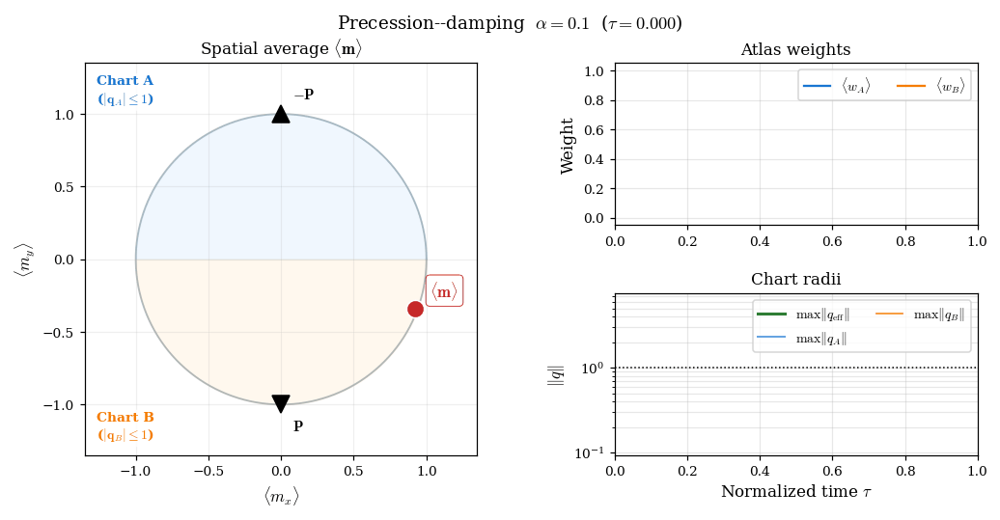
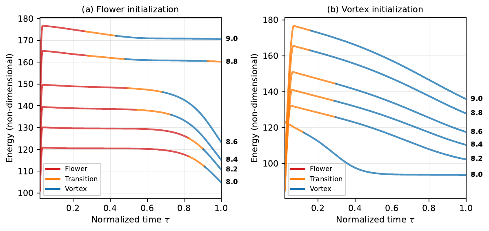
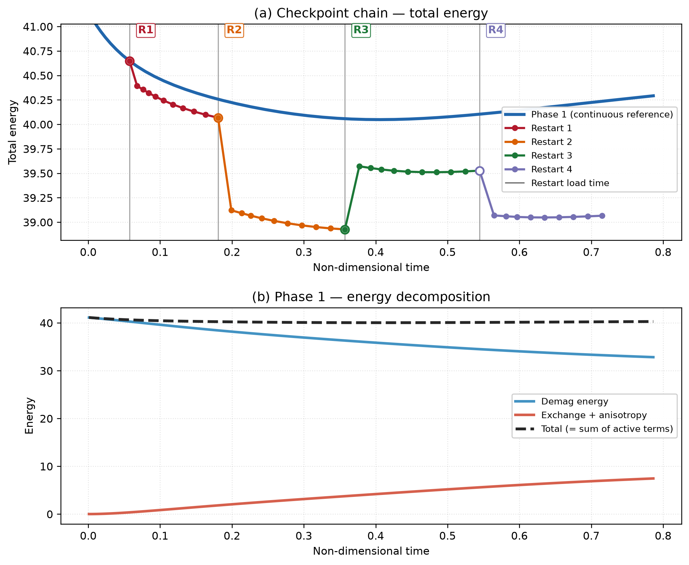

Benchmarks
==========

This chapter collects benchmark simulations used to evaluate the accuracy and robustness of
the dual-chart stereographic solver.  Each example is chosen to exercise a specific aspect
of the formulation, and further cases will be added as the solver develops.

.. _example-precession:

Precession and damping
----------------------

The time evolution of a spatially uniform magnetization under a constant external field
provides a direct test of gyromagnetic precession, damping-driven relaxation, and atlas
adaptation in a well-controlled setting where no spatial gradients are present
:cite:`brach2026zmag`.

The simulation domain is a cubic box of edge length :math:`L = 1.0\,\ell_{\mathrm{ex}}`.
The dynamics are driven solely by a uniform applied field aligned with :math:`+z`,
:math:`\mathbf{H}_{\mathrm{ext}} = (0,0,1)`, with exchange, anisotropy, and magnetostatics
absent.  The initial magnetization is spatially uniform, set to the unit vector
:math:`\mathbf{m}_0 = (0.92, -0.34, 0.18)`, which is misaligned with both the field and
the chart poles.  Simulations are performed for
:math:`\alpha \in \{0.05, 0.1, 0.5, 1.0\}` to cover the range from weakly damped
precession to strongly damped relaxation.  The two stereographic charts project from
antipodal poles :math:`\mathbf{p}_A = (0,-1,0)` and :math:`\mathbf{p}_B = (0,+1,0)`;
since the precessional orbit encircles :math:`z`, the trajectory repeatedly crosses the
equatorial band and visits the ill-conditioned neighborhood of each pole in turn, providing
a stringent test of the atlas.  The driver is :file:`test_dynamic_precession_damping.py`.

Starting from the initial condition, the magnetization spirals smoothly toward the
field-aligned equilibrium :math:`+z`.  As :math:`\alpha` increases, the number of
revolutions about the field axis decreases and the spiral tightens: for
:math:`\alpha = 0.05` the trajectory completes many revolutions before converging, while
for :math:`\alpha = 1.0` it approaches equilibrium nearly radially with minimal angular
displacement, consistent with the transition from underdamped precession to overdamped
relaxation.  The smooth and continuous character of the trajectories demonstrates that
the dual-chart formulation provides a globally coherent representation throughout the
evolution, with no artificial discontinuities arising from the chart structure.

The animations below show, on the left, the top-view projection of the magnetization
trajectory on the unit sphere.  On the right, the top row tracks the domain-averaged atlas
weights :math:`\langle w_A \rangle` and :math:`\langle w_B \rangle` over time, while the
bottom row shows the maximum stereographic radii :math:`|\mathbf{q}_A|`,
:math:`|\mathbf{q}_B|`, and the effective radius
:math:`|\mathbf{q}_{\mathrm{eff}}| = \min(|\mathbf{q}_A|,|\mathbf{q}_B|)` (evaluated
as a pointwise minimum and reported as a domain maximum).  The atlas weights oscillate in
counterphase as the magnetization precesses about the field axis, with decreasing
frequency as equilibrium is approached.  As the magnetization approaches the projection
pole of one chart, the corresponding stereographic radius :math:`|\mathbf{q}|` grows
while the complementary chart remains well-conditioned; the effective radius
:math:`|\mathbf{q}_{\mathrm{eff}}|` remains below unity throughout all simulations,
confirming that the atlas stays within the valid domain of the stereographic
representation.  Increasing :math:`\alpha` reduces the time spent near the poles and the
number of visible oscillations in the atlas diagnostics.

   Precessional relaxation with :math:`\alpha = 0.1`.
   **Left:** top-view of the magnetization trajectory on the unit sphere spiraling toward
   :math:`+z`.
   **Right (top):** time evolution of the domain-averaged atlas weights
   :math:`\langle w_A \rangle` (blue) and :math:`\langle w_B \rangle` (orange), which
   alternate continuously as the precessing magnetization shifts the dominant hemisphere.
   **Right (bottom):** maximum stereographic radii :math:`|\mathbf{q}_A|`,
   :math:`|\mathbf{q}_B|`, and the effective radius :math:`|\mathbf{q}_{\mathrm{eff}}|`.
   With lighter damping the trajectory completes many revolutions, producing many
   oscillation cycles in the atlas diagnostics before convergence.

   Same configuration with :math:`\alpha = 0.5`.  Stronger damping shortens the spiral to
   two or three revolutions; the atlas weights complete a corresponding number of
   oscillation cycles and :math:`|\mathbf{q}_{\mathrm{eff}}|` remains bounded before
   settling as the magnetization converges to the :math:`+z` equilibrium.

.. _example-sp3:

:math:`\mu`\ MAG Standard Problem 3
-------------------------------------

Standard Problem 3 (SP3) :cite:`nist_sp3,hertel2002finite` is classically formulated as a
static energy-minimization problem to determine the crossover cube size between the flower
and vortex ground states of a cubic ferromagnet.  Here the corresponding damped LLG
relaxation dynamics are used instead, to assess whether the solver can robustly follow
physically plausible pathways in a multistable system — a stringent test in the presence
of strongly nonuniform magnetization configurations :cite:`brach2026zmag`.

Simulations are performed for cubic magnets with edge lengths
:math:`L = 8.0`–:math:`9.0\,\ell_{\mathrm{ex}}`, spanning the known crossover region
(typically reported near :math:`L \approx 8.4`–:math:`8.6\,\ell_{\mathrm{ex}}` depending
on the numerical setup :cite:`hertel2002finite`).
Material parameters follow the SP3 specification:
:math:`M_s^* = A^* = K^* = 1`, uniaxial easy axis along :math:`z`, :math:`Q_1 = 0.1`,
:math:`\alpha = 0.5`.  The energy functional includes exchange, uniaxial anisotropy, and
open-boundary magnetostatics (FEM–BEM).  Chart poles are at
:math:`\mathbf{p}_A = (0,-1,0)` and :math:`\mathbf{p}_B = (0,+1,0)`.
Each simulation runs for 6000 BDF2 time steps from two initial conditions described below.
The driver is :file:`test_dynamic_std_prb3.py`.

**Flower initialization.**  The magnetization is seeded uniformly along the easy axis
with a small random perturbation :math:`\boldsymbol{\eta}` of amplitude :math:`\sigma`:

.. math::
   :label: sp3-flower-init

   \mathbf{m}_F(\mathbf{x}) = \mathcal{N}\!\left((0,\, 0,\, 1) + \boldsymbol{\eta}(\mathbf{x})\right),
   \qquad \boldsymbol{\eta} \sim \mathcal{N}(0,\sigma^2),

where :math:`\mathcal{N}(\cdot)` denotes normalization to unit length.  This seed places
the system squarely in the axially-aligned flower basin.

**Vortex initialization.**  The magnetization is seeded with a spatially varying
orientation that rotates smoothly from :math:`+z` to :math:`-z` in the
:math:`y`–:math:`z` plane as a function of the normalized coordinate
:math:`\tilde{x} = x/L - 1/2 \in [-1/2,\,1/2]` :cite:`ubermag_std3`:

.. math::
   :label: sp3-vortex-init

   \mathbf{m}_V(\mathbf{x}) = \mathcal{N}\!\left(
     \bigl(0,\;
     \sin\!\bigl(\tfrac{\pi}{2}\,\tilde{x}\bigr),\;
     \cos\!\bigl(\tfrac{\pi}{2}\,\tilde{x}\bigr)\bigr)
     + \boldsymbol{\eta}(\mathbf{x})\right),

with the same small noise :math:`\boldsymbol{\eta}`.  At :math:`\tilde{x}=-1/2` the
seed points along :math:`-y`, at :math:`\tilde{x}=0` it aligns with :math:`+z`, and at
:math:`\tilde{x}=+1/2` it points along :math:`+y`, providing a smooth vortex-like
starting configuration that breaks the axial symmetry.

The figure below shows the energy relaxation curves, colored by the identified magnetic
regime: flower (red), transition (orange), and vortex (blue).  For flower
initializations, the trajectories start in the flower-like metastable basin and pass
through an intermediate transition regime before relaxing toward a vortex-like state —
behavior consistent with the twisted-flower regime reported near the flower–vortex
crossover :cite:`hertel2002finite`.  For vortex initializations, the trajectories begin
in a transitional configuration and relax toward the vortex-like equilibrium.  The energy
decreases monotonically at every accepted step, a direct consequence of the thermodynamic
gate (:ref:`phase-e`).  These trends are consistent with the established SP3 literature;
the damped trajectories probe the energy landscape dynamically, so intermediate states and
relaxation pathways may connect metastable configurations to a competing basin without
coinciding with the static minimizer.

   Energy relaxation during damped LLG dynamics for
   :math:`L = 8.0`–:math:`9.0\,\ell_{\mathrm{ex}}`.
   Curves are colored by the identified magnetic regime: flower (red), transition (orange),
   vortex (blue).  **Left panel:** flower initialization — trajectories leave the flower
   basin, pass through a transition regime, and approach a vortex-like state.
   **Right panel:** vortex initialization — trajectories relax monotonically toward the
   vortex equilibrium.     Numbers indicate cube edge length in units of
   :math:`\ell_{\mathrm{ex}}`.

.. _example-checkpoints:

Checkpoint and restart chain
----------------------------

Long production runs are often split across cluster jobs.  For that reason,
``Z-mag`` supports checkpointing and restart in both solver variants:

* **demag** — self-consistent magnetostatics via a hybrid FEM–BEM operator,
  including a demagnetizing potential ``phi``.
* **nodemag** — the same adaptive implicit time integrator and atlas
  checkpointing, but without magnetostatics (so there is no ``phi`` and no
  BEM operator to rebuild).

The benchmark in :file:`test_dynamic_checkpoints.py` focuses on the **demag**
solver, because it additionally exercises the warm-start ``phi`` pathway and
the need to rebuild the BEM operator after a restart.

The benchmark exercises this workflow as a **chain** of four consecutive
restarts on MPI-parallel meshes, verifying that mesh tags, atlas fields, and
BDF/controller history round-trip correctly while the thermodynamic gate
remains active after each reload.

**Problem setup.**  An elongated box (aspect ratio :math:`4{:}1`) is magnetized
along its long axis, with exchange, uniaxial anisotropy, and open-boundary
magnetostatics.  The run uses 50 accepted BDF2 steps with a checkpoint written
every 10 steps.  The protocol is:

1. **Phase 1** — one continuous reference run, steps :math:`0`–:math:`49`.
2. **Restart 1** — load the step-10 checkpoint, run steps :math:`11`–:math:`20`.
3. **Restart 2** — load the step-20 checkpoint from Restart 1, run
   :math:`21`–:math:`30`.
4. **Restart 3** — load step 30, run :math:`31`–:math:`40`.
5. **Restart 4** — load step 40, run :math:`41`–:math:`49`.

Each restart reads from the **previous** segment's output directory, so the
test validates repeated save/load cycles rather than a single resume from Phase
1.

**What is checkpointed.**  A restart bundle combines three layers (see
:ref:`checkpoint-format` in :doc:`config`):

* **Distributed mesh** — ``checkpoint_timestep_{step}.bp`` via
  ``adios4dolfinx`` (topology, geometry, cell/facet tags).
* **Atlas + time integrator state** — ``_qA.npz``, ``_qB.npz``, BDF history
  (``_qA_prev``, ``_qB_prev``, …), chart metadata, and controller state
  (``_time_state.npz``: BDF order, ``dt`` caps, thermo EMAs, …).
* **Demag potential** — ``_phi.npz`` is present only in the **demag**
  variant, as a warm start for magnetostatics.

On restore, the restart segment reproduces the checkpointed fields to
machine precision (:math:`\lesssim 10^{-10}` relative error).  That is the
**hard gate** of the benchmark.

**How restart works (in practice).**  A restart segment is always run by a
fresh solver instance:

1. **Build the solver and read the checkpoint header** to recover the timestep
   ``step_start`` and the corresponding ``t_start``/``dt``.
2. **Rebuild the mesh and tags** from the stored ``.bp`` file.
3. **Assemble operators on the restart job's MPI partition**:

   * call the usual setup methods (``set_mesh``, ``set_materials``,
     ``set_magnetostatics``),
   * and, for ``model="demag"``, call ``set_BEMcpp`` after ``set_mesh``.

4. **Restore atlas and controller state** with
   ``restore_checkpoint_atlas_state``.
5. **Initialize the restart solve** with ``init_dynamic(first_run=False)``.
   For the demag solver this step is also where we reconcile magnetostatics:
   the stored ``phi`` is used only as a warm start; the code recomputes
   ``phi`` using the live BEM operator before seeding the thermodynamic
   baseline.

**Why the mesh and BEM must be rebuilt.**  The key point is that
``read_checkpoint_mesh`` reconstructs the **same global mesh**, but not
necessarily with the **same MPI partition** as the job that produced the
checkpoint.  ``adios4dolfinx`` redistributes cells across ranks, so the
local DOF layout, ghost layers, and boundary-node ordering change.

For demagnetization, the BEM operator is assembled from the live partition's
exterior facet nodes.  That means the restart job must rebuild the BEM
matrix; the stored ``phi`` corresponds to the previous job's BEM layout and
can be inconsistent with the newly assembled operator.

**Demag re-equilibration and thermo seeding.**  Restored chart fields
``q_A``/``q_B`` define the magnetization.  In contrast, the demagnetizing
potential ``phi`` depends on the magnetostatic operator (and thus on how the
mesh is partitioned across MPI ranks).

If the restart kept the checkpointed ``phi`` without reconciliation, the
first Newton iteration would effectively measure an ``operator swap``
instead of genuine LLG dissipation.  In the checkpoint chain this would show
up as a thermodynamic gate failure at the first post-restart step.

The demag solver therefore **recomputes** ``phi`` from the restored
magnetization using the live BEM in ``init_dynamic``.  After that, the code
seeds ``thermo_last_energy`` from the consistent (re-equilibrated) state.
Checkpoint ``phi`` remains useful only as a warm start.

**Energy in the continuous reference run.**  The logged total energy is the sum
of the active terms written by :meth:`~Zmag_bins.Zmag_dynamic_stereo_demag.Z_sim_dynamic_stereo_demag.compute_energy`
(exchange, anisotropy, demagnetization).  In this benchmark the magnetization
starts nearly uniform along the easy axis, so exchange and anisotropy are
initially small while demagnetization dominates the total.  As the structure
develops, exchange and anisotropy grow while demagnetization decreases.  The
total therefore falls at first, reaches a minimum near step :math:`31`, and
then rises again because the gain in exchange/anisotropy temporarily outweighs
the continued drop in demagnetization.  This is visible in panel (b) of the
figure below and is **not** a sign of a failed run: every accepted step in
Phase 1 passed the thermodynamic gate.

**What happens at a restart load.**  Immediately after
``restore_checkpoint_atlas_state`` the atlas fields match the checkpoint to
machine precision (the hard gate of the test).  The coloured traces in panel
(a) then show how each restart segment evolves on its **own** MPI partition
after ``adios4dolfinx`` redistribution.  Because the FEM/BEM operators are
reassembled on that partition, the trajectory can drift slightly above or
below the Phase 1 reference even though the checkpoint itself is correct.
Small upward or downward shifts at the first post-restart step are therefore
normal and do not, by themselves, indicate corruption.

For the **demag** solver there is one additional effect that must be handled
explicitly.  The stored ``phi`` was computed with the BEM layout of the job
that wrote the checkpoint.  After remesh redistribution the live BEM operator
changes, so keeping the old ``phi`` would make the first dynamical step look
like a large artificial energy jump (often :math:`\mathcal{O}(0.1)`–:math:`\mathcal{O}(1)`).
The code therefore recomputes ``phi`` from the restored magnetization in
``init_dynamic`` and only then seeds the thermodynamic baseline.  That
reconciliation removes the spurious jump; the remaining drift relative to
Phase 1 is the partition-dependent numerical effect described above.

   Checkpoint-chain benchmark (representative successful run).
   **(a)** Total energy: blue curve = continuous Phase 1 reference; coloured
   curves = restart segments loaded at the vertical grey lines (labels R1–R4).
   Segments agree at each load point, then drift apart because each restart
   uses a redistributed MPI partition.
   **(b)** Phase 1 energy decomposition: demagnetization falls while
   exchange + anisotropy rise; their sum explains the minimum and subsequent
   increase of the total in the continuous run.

**Pass criteria.**  The driver reports ``PASS`` when

* cell/facet tag counts match on every restart, and
* restored atlas field norms match the ground truth to the required tolerance
  at every checkpoint in the chain.

Energy drift relative to Phase 1 is logged for inspection but does not fail the
test.
Reproduce with ``mpirun -n N python test_dynamic_checkpoints.py`` (see
:doc:`installation`).
