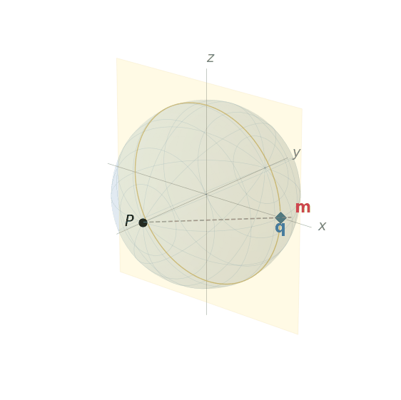
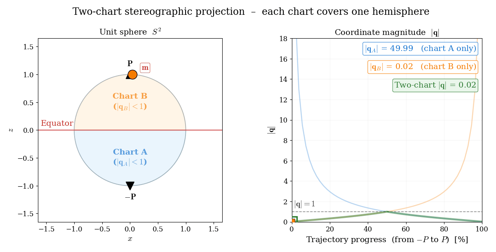
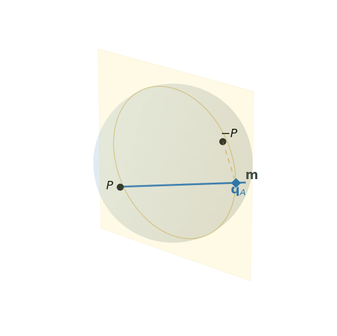
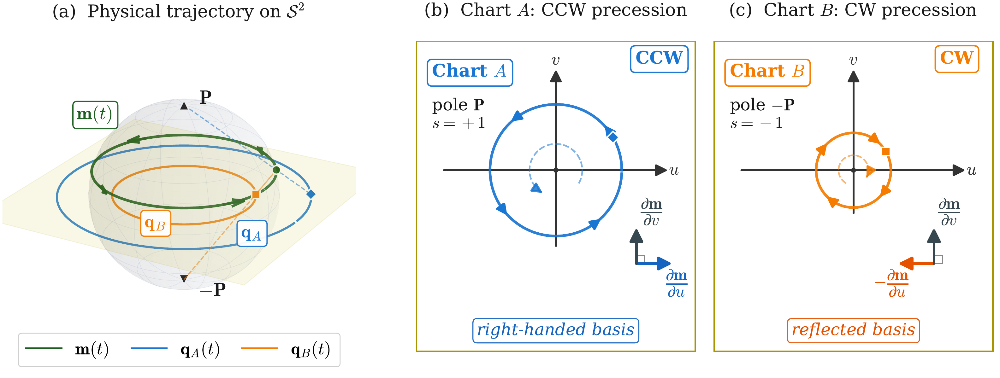
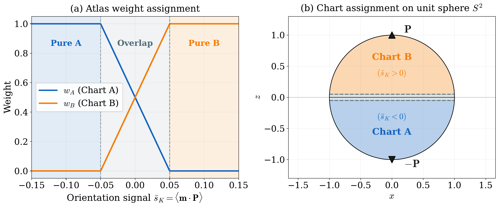

Stereographic formulation
=========================

The LLG equation derived in :doc:`theory_llg` governs the time evolution of the reduced
magnetization :math:`\mathbf{m}\in\mathcal{S}^2`.  Cartesian parametrizations do not
preserve the unit-length constraint :math:`|\mathbf{m}|=1` intrinsically, while spherical
coordinates enforce it by construction but introduce coordinate singularities at the two
physically reachable poles :math:`\theta_0=0,\pi`.  Stereographic projection resolves both
issues simultaneously: the constraint is built into the parametrization, and the only
singularity is moved to infinity, where it cannot be reached by any finite coordinate state
:cite:`horley2009application,rybakov2015new`.

This section develops the stereographic formulation of the LLG equation in three stages.
It first derives the single-chart map, including the forward and inverse transformations,
tangent map, conformal metric, and projected LLG system, and then identifies the remaining
conditioning issue near the projection pole.  It next introduces the two-chart atlas that
removes this limitation.  The section closes with the weak formulation assembled by ``Z-mag``
at each time step, including the energy torque functional and the nondimensional chart
residual.

The normalized LLG equation :eq:`eq:llg_normalized_m` from :doc:`theory_llg` is recalled
here for reference:

.. math::
    :label: eq:llg_normalized

    \frac{\partial\mathbf{m}}{\partial t}
    = -\gamma_0\mu_0\,\mathbf{m}\times\mathbf{H}_{\text{eff}}
    + \alpha\,\mathbf{m}\times\frac{\partial\mathbf{m}}{\partial t},

where :math:`\gamma_0`, :math:`\mu_0`, :math:`\alpha`, and :math:`\mathbf{H}_{\text{eff}}`
are defined in :doc:`theory_llg` and :doc:`theory_energy`.

Single-chart projection
-----------------------

Stereographic projection provides a two-coordinate representation of the reduced magnetization
:math:`\mathbf{m}\in\mathcal{S}^2` in which the unit-length constraint is built into the
parametrization itself.  This section develops the single-chart formulation, deriving the
coordinate map, the associated tangent map and conformal metric, the projected form of the
LLG equation, and the representation of the effective field in chart variables.

   Stereographic projection from pole :math:`\mathbf{P}=(0,-1,0)`.  As the magnetization
   :math:`\mathbf{m}` (red) traces a trajectory on :math:`\mathcal{S}^2`, the projection line
   through :math:`\mathbf{P}` maps :math:`\mathbf{m}` to the equatorial coordinate
   :math:`\mathbf{q}` (blue) on the plane :math:`y=0`.  The coordinate :math:`|\mathbf{q}|`
   remains moderate on the hemisphere opposite :math:`\mathbf{P}` and grows without bound only
   as :math:`\mathbf{m}\to\mathbf{P}`.

Geometric construction
~~~~~~~~~~~~~~~~~~~~~~

Let :math:`\mathbf{P}\in\mathcal{S}^2` be a projection pole, and let
:math:`\{\mathbf{e}_1,\mathbf{e}_2\}` be an orthonormal basis of the plane through the origin
perpendicular to :math:`\mathbf{P}`.  As shown in :numref:`fig:stereo_geometry`, for any
:math:`\mathbf{m}\in\mathcal{S}^2\setminus\{\mathbf{P}\}`, the line passing through
:math:`\mathbf{P}` and :math:`\mathbf{m}` intersects this equatorial plane at a unique point
:math:`\mathbf{q}=(u,v)\in\mathbb{R}^2`.  Solving for the intersection gives the forward map:

.. math::
    :label: eq:stereo_forward

    \mathbf{q} = (u,v)
    = \frac{\bigl(\mathbf{m}\cdot\mathbf{e}_1,\;\mathbf{m}\cdot\mathbf{e}_2\bigr)}{1 - \mathbf{m}\cdot\mathbf{P}}.

The denominator :math:`1-\mathbf{m}\cdot\mathbf{P}` is strictly positive for all
:math:`\mathbf{m}\neq\mathbf{P}` and measures how close :math:`\mathbf{m}` is to the pole.

The inverse map, recovering :math:`\mathbf{m}` from :math:`(u,v)`, is obtained by
substituting the parametric form of the projection line back into the sphere equation
:math:`|\mathbf{m}|=1`:

.. math::
    :label: eq:stereo_inverse

    \mathbf{m} = \frac{-\mathbf{P}(1-r^2) + 2u\mathbf{e}_1 + 2v\mathbf{e}_2}{1+r^2},
    \quad r^2 = u^2+v^2.

This formula reconstructs a unit vector for every finite :math:`\mathbf{q}`.  To verify
:math:`|\mathbf{m}|=1` explicitly, note that :math:`\{\mathbf{P},\mathbf{e}_1,\mathbf{e}_2\}`
form an orthonormal basis, so

.. math::
    :label: eq:norm_verification

    |\mathbf{m}|^2
    = \frac{(1-r^2)^2 + 4u^2 + 4v^2}{(1+r^2)^2}
    = \frac{(1-r^2)^2 + 4r^2}{(1+r^2)^2}
    = \frac{(1+r^2)^2}{(1+r^2)^2} = 1,

where the numerator identity :math:`(1-r^2)^2 + 4r^2 = (1+r^2)^2` follows from direct
expansion.  The mapping is therefore bijective between :math:`\mathbb{R}^2` and
:math:`\mathcal{S}^2\setminus\{\mathbf{P}\}`, with the pole :math:`\mathbf{P}` corresponding to
the limit :math:`|\mathbf{q}|\to\infty`.  In contrast to spherical coordinates, where
singularities occur at two *finite* parameter values (:math:`\theta_0=0,\pi`), the stereographic
singularity has been pushed to infinity and is therefore never reached by any finite coordinate
state.

Tangent map
~~~~~~~~~~~

Since :math:`\mathbf{m}` depends on time only through :math:`\mathbf{q}(t)`, the chain rule gives

.. math::
    :label: eq:chain_rule

    \frac{\partial\mathbf{m}}{\partial t}
    = \mathcal{A}(\mathbf{q})\,\frac{\partial\mathbf{q}}{\partial t},
    \qquad
    \mathcal{A}(\mathbf{q}) = \frac{\partial\mathbf{m}}{\partial\mathbf{q}}
    =
    \begin{pmatrix}
    \dfrac{\partial\mathbf{m}}{\partial u} & \dfrac{\partial\mathbf{m}}{\partial v}
    \end{pmatrix}.

The :math:`3\times 2` matrix :math:`\mathcal{A}` is called the **tangent map**.  Differentiating
:eq:`eq:stereo_inverse` with respect to :math:`u` by the quotient rule:

.. math::
    :label: eq:tangent_u

    \frac{\partial\mathbf{m}}{\partial u}
    = \frac{(1+r^2)(2u\mathbf{P}+2\mathbf{e}_1)
            -[-\mathbf{P}(1-r^2)+2u\mathbf{e}_1+2v\mathbf{e}_2]\cdot 2u}{(1+r^2)^2}.

Grouping terms in :math:`\mathbf{P}`, :math:`\mathbf{e}_1`, and :math:`\mathbf{e}_2`:

.. math::

    \frac{\partial\mathbf{m}}{\partial u}
    = \frac{2}{(1+r^2)^2}
    \Bigl[2u\,\mathbf{P} + (1+v^2-u^2)\,\mathbf{e}_1 - 2uv\,\mathbf{e}_2\Bigr].

The analogous calculation for :math:`v` gives

.. math::
    :label: eq:tangent_v

    \frac{\partial\mathbf{m}}{\partial v}
    = \frac{2}{(1+r^2)^2}
    \Bigl[2v\,\mathbf{P} - 2uv\,\mathbf{e}_1 + (1+u^2-v^2)\,\mathbf{e}_2\Bigr].

Assembling both columns, the explicit tangent map is:

.. math::
    :label: eq:tangent_map

    \mathcal{A}(\mathbf{q})
    = \frac{2}{(1+r^2)^2}
    \begin{pmatrix}
    2u\,\mathbf{P} + (1+v^2-u^2)\,\mathbf{e}_1 - 2uv\,\mathbf{e}_2 \\
    2v\,\mathbf{P} - 2uv\,\mathbf{e}_1 + (1+u^2-v^2)\,\mathbf{e}_2
    \end{pmatrix}^{\!\text{T}}.

The columns of :math:`\mathcal{A}` span the tangent space :math:`T_{\mathbf{m}}\mathcal{S}^2`:
since :math:`|\mathbf{m}|^2=1` implies :math:`\mathbf{m}\cdot\partial\mathbf{m}/\partial u=0`
and :math:`\mathbf{m}\cdot\partial\mathbf{m}/\partial v=0`, any variation
:math:`\delta\mathbf{m}=\mathcal{A}\,\delta\mathbf{q}` is automatically tangential to the
sphere.  The unit-length constraint is therefore built directly into the parametrization, so
admissible first-order variations remain on :math:`\mathcal{S}^2`.

Conformal metric
~~~~~~~~~~~~~~~~

The metric tensor induced by the parametrization is:

.. math::
    :label: eq:metric_tensor

    \mathcal{P}(\mathbf{q}) = \mathcal{A}(\mathbf{q})^\text{T}\mathcal{A}(\mathbf{q})
    = \sigma^2(\mathbf{q})\,\mathbf{I}_2,
    \qquad
    \sigma^2(\mathbf{q}) = \left(\frac{2}{1+r^2}\right)^2.

Because the metric :math:`\mathcal{P}` is a scalar multiple of the identity,
the stereographic map is conformal: angles between curves on the sphere are preserved by the
projection, and both coordinate directions are scaled by the same local factor
:math:`\sigma^2`.  This follows directly from substituting :eq:`eq:tangent_map` into
:math:`\mathcal{A}^\text{T}\mathcal{A}` and observing that the off-diagonal entries vanish
identically.

The conformal factor :math:`\sigma^2=(2/(1+r^2))^2` remains finite at :math:`r=0`,
corresponding to the antipodal point :math:`\mathbf{m}=-\mathbf{P}`, decreases monotonically as
:math:`r` grows, and tends to zero as :math:`r\to\infty` (i.e.\ as
:math:`\mathbf{m}\to\mathbf{P}`).  In the implementation, the same quantity is represented by
:meth:`~Zmag_bins.Zmag_dynamic_stereo_base.Z_sim_dynamic_stereo_base._sigma2`.
The isotropic metric contrasts sharply with the spherical-coordinate metric
:math:`\mathcal{P}=\mathrm{diag}(1,\sin^2\theta_0)`, which degenerates along one direction as
:math:`\theta_0\to 0` or :math:`\pi`.

LLG in stereographic coordinates
~~~~~~~~~~~~~~~~~~~~~~~~~~~~~~~~~

The derivation follows a standard projection strategy: substitute the chain rule
:eq:`eq:chain_rule` into the LLG equation :eq:`eq:llg_normalized`, then project onto the
coordinate plane by left-multiplying with :math:`\mathcal{A}^\text{T}`.

**Step 1: substitute the chain rule.**
Replacing :math:`\partial_t\mathbf{m}` by :math:`\mathcal{A}\,\partial_t\mathbf{q}` in
:eq:`eq:llg_normalized` gives

.. math::
    :label: eq:llg_substituted

    \mathcal{A}\,\frac{\partial\mathbf{q}}{\partial t}
    = -\gamma_0\mu_0\,\mathbf{m}\times\mathbf{H}_{\text{eff}}
    + \alpha\,\mathbf{m}\times\mathcal{A}\,\frac{\partial\mathbf{q}}{\partial t}.

**Step 2: left-multiply by** :math:`\mathcal{A}^\text{T}`.
Using :math:`\mathcal{A}^\text{T}\mathcal{A}=\sigma^2\mathbf{I}_2` from :eq:`eq:metric_tensor`:

.. math::
    :label: eq:llg_projected

    \sigma^2\,\frac{\partial\mathbf{q}}{\partial t}
    = -\gamma_0\mu_0\,\mathcal{A}^\text{T}(\mathbf{m}\times\mathbf{H}_{\text{eff}})
    + \alpha\,\mathcal{A}^\text{T}\!\left(\mathbf{m}\times\mathcal{A}\,\frac{\partial\mathbf{q}}{\partial t}\right).

**Step 3: reduce the cross-product terms.**
Two identities simplify the right-hand side.

*Identity 1.* Let :math:`\mathbf{v}=(v_1,v_2)\in\mathbb{R}^2`.  The vector
:math:`\mathcal{A}\mathbf{v}=v_1\,\partial\mathbf{m}/\partial u + v_2\,\partial\mathbf{m}/\partial v`
is tangent to :math:`\mathcal{S}^2` at the point :math:`\mathbf{m}` because it is a linear
combination of the basis vectors of :math:`T_{\mathbf{m}}\mathcal{S}^2`.  The vector
:math:`\mathbf{m}\times\mathcal{A}\mathbf{v}` is therefore tangent as well: it is orthogonal to
:math:`\mathbf{m}` by construction, and hence lies in the tangent plane.

Consequently, :math:`\mathbf{m}\times\mathcal{A}\mathbf{v}` can again be expanded in the same
basis.  The corresponding chart coordinates are obtained by applying :math:`\mathcal{A}^\text{T}`.
A direct substitution of :eq:`eq:tangent_map` gives

.. math::

    \mathcal{A}^\text{T}(\mathbf{m}\times\mathcal{A}\mathbf{v})
    = \sigma^2 \begin{pmatrix} v_2 \\ -v_1 \end{pmatrix}.

Writing this transformation in matrix form yields

.. math::
    :label: eq:identity1

    \mathcal{A}^\text{T}(\mathbf{m}\times\mathcal{A}\mathbf{v}) = \sigma^2\mathbf{J}\,\mathbf{v},
    \qquad
    \mathbf{J} = \begin{pmatrix}0 & 1\\-1 & 0\end{pmatrix}.

*Identity 2.* Let :math:`\mathbf{w}\in\mathbb{R}^3` be arbitrary.  Decompose it into the sum of a
component normal to the sphere :math:`\mathcal{S}^2` and a component tangent to
:math:`\mathcal{S}^2` at the point :math:`\mathbf{m}`:

.. math::

    \mathbf{w} = \mathbf{w}_{//} + \mathbf{w}_{\perp},
    \qquad
    \mathbf{w}_{\perp} = (\mathbf{m}\cdot\mathbf{w})\,\mathbf{m},
    \qquad
    \mathbf{m}\cdot\mathbf{w}_{//} = 0.

Here :math:`\mathbf{w}_{\perp}` is the component normal to :math:`\mathcal{S}^2`, which is parallel
to :math:`\mathbf{m}`, and :math:`\mathbf{w}_{//}` is the component tangent to
:math:`\mathcal{S}^2`.  The normal contribution does not contribute to the cross product because
:math:`\mathbf{w}_{\perp}` is a scalar multiple of :math:`\mathbf{m}`:

.. math::

    \mathbf{m}\times\mathbf{w}_{\perp}
    = \mathbf{m}\times\bigl[(\mathbf{m}\cdot\mathbf{w})\mathbf{m}\bigr]
    = (\mathbf{m}\cdot\mathbf{w})(\mathbf{m}\times\mathbf{m})
    = \mathbf{0},

since the cross product of any vector with itself is zero.  Therefore

.. math::

    \mathbf{m}\times\mathbf{w}
    = \mathbf{m}\times\mathbf{w}_{//}.

Because :math:`\mathbf{w}_{//}` lies in the tangent plane, it can be expanded in the chart basis as
:math:`\mathbf{w}_{//}=\mathcal{A}\mathbf{v}` for some :math:`\mathbf{v}\in\mathbb{R}^2`.  Applying
Identity 1 gives

.. math::

    \mathcal{A}^\text{T}(\mathbf{m}\times\mathbf{w})
    = \mathcal{A}^\text{T}(\mathbf{m}\times\mathbf{w}_{//})
    = \mathcal{A}^\text{T}(\mathbf{m}\times\mathcal{A}\mathbf{v})
    = \sigma^2\mathbf{J}\,\mathbf{v}.

Moreover, because :math:`\mathbf{w}_{\perp}` is parallel to :math:`\mathbf{m}` while the columns of
:math:`\mathcal{A}` are tangent to the sphere, one has :math:`\mathcal{A}^\text{T}\mathbf{w}_{\perp}=0`.
Hence

.. math::

    \mathcal{A}^\text{T}\mathbf{w}
    = \mathcal{A}^\text{T}(\mathbf{w}_{//}+\mathbf{w}_{\perp})
    = \mathcal{A}^\text{T}\mathbf{w}_{//}
    = \mathcal{A}^\text{T}\mathcal{A}\mathbf{v}
    = \sigma^2\mathbf{v}.

Thus :math:`\mathbf{v}=\sigma^{-2}\mathcal{A}^\text{T}\mathbf{w}`, and substitution into the previous
relation yields

.. math::
    :label: eq:identity2

    \mathcal{A}^\text{T}(\mathbf{m}\times\mathbf{w}) = \sigma^{-2}\mathbf{J}\,\mathcal{A}^\text{T}\mathbf{w}.

**Step 4: assemble the projected equation.**
Applying Identity 1 to the damping term and Identity 2 to the precession term in
:eq:`eq:llg_projected`:

.. math::

    \sigma^2\,\frac{\partial\mathbf{q}}{\partial t}
    = -\gamma_0\mu_0\,\sigma^2\mathbf{J}\,\mathcal{A}^\text{T}\mathbf{H}_{\text{eff}}
    + \alpha\,\sigma^2\,\mathbf{J}\,\frac{\partial\mathbf{q}}{\partial t}.

Left-multiplying by :math:`-\mathbf{J}` and using :math:`\mathbf{J}^{-1}=-\mathbf{J}`,
:math:`\mathbf{J}^2=-\mathbf{I}_2`:

.. math::
    :label: eq:llg_rearranged

    \sigma^2(\alpha\mathbf{I}_2 - \mathbf{J})\,\frac{\partial\mathbf{q}}{\partial t}
    = \gamma_0\mu_0\,\mathcal{A}^\text{T}\mathbf{H}_{\text{eff}}.

Defining the **damping matrix** :math:`\mathcal{L}(\mathbf{q})=\sigma^2(\alpha\mathbf{I}_2-\mathbf{J})`,
the single-chart LLG in stereographic coordinates is

.. math::
    :label: eq:llg_stereo_single

    \mathcal{L}(\mathbf{q})\,\frac{\partial\mathbf{q}}{\partial t}
    = \gamma_0\mu_0\,\mathcal{A}(\mathbf{q})^\text{T}\mathbf{H}_{\text{eff}},

where

.. math::
    :label: eq:damping_matrix_single

    \mathcal{L}(\mathbf{q}) = \sigma^2(\mathbf{q})
    \begin{pmatrix}
    \alpha & 1 \\
    -1 & \alpha
    \end{pmatrix}.

The determinant :math:`\det\mathcal{L}=\sigma^4(\alpha^2+1)>0` is strictly positive for all
finite :math:`\mathbf{q}`, so the system is well-posed and uniquely determines
:math:`\partial_t\mathbf{q}` at every point.  In spherical coordinates, by contrast,
:math:`\det\mathcal{L}=(1+\alpha^2)\sin^2\theta_0` vanishes at the physically reachable poles.

Projected effective field
~~~~~~~~~~~~~~~~~~~~~~~~~

The right-hand side of :eq:`eq:llg_stereo_single` involves the projection
:math:`\mathcal{A}(\mathbf{q})^\text{T}\mathbf{H}_{\text{eff}}`, where :math:`\mathbf{H}_{\text{eff}}`
is the sum of four contributions defined in :doc:`theory_energy`:

.. math::
    :label: eq:heff_projected_split

    \mathcal{A}^\text{T}\mathbf{H}_{\text{eff}}
    = \mathcal{A}^\text{T}\mathbf{H}_{\text{ex}}
    + \mathcal{A}^\text{T}\mathbf{H}_{\text{ani}}
    + \mathcal{A}^\text{T}\mathbf{H}_{\text{zee}}
    + \mathcal{A}^\text{T}\mathbf{H}_{\text{d}}.

The anisotropy, Zeeman, and demagnetizing fields depend on :math:`\mathbf{m}` but not on its
spatial gradients.  Their projected chart forces
:math:`\mathcal{A}^\text{T}\mathbf{H}_{\text{ani}}`, :math:`\mathcal{A}^\text{T}\mathbf{H}_{\text{zee}}`,
and :math:`\mathcal{A}^\text{T}\mathbf{H}_{\text{d}}` are therefore obtained by pointwise
multiplication of the Cartesian field by :math:`\mathcal{A}^\text{T}`, without involving spatial
derivatives of the chart map.

The exchange contribution requires separate treatment.  Its energy density
:math:`A|\nabla\mathbf{m}|^2` depends on spatial gradients of :math:`\mathbf{m}`, so expressing
it in chart coordinates introduces both the conformal metric and an additional term arising from
the spatial variation of the tangent basis.  Applying the spatial chain rule
:math:`\nabla\mathbf{m}=\mathcal{A}\nabla\mathbf{q}` together with the metric :eq:`eq:metric_tensor`
gives

.. math::
    :label: eq:gradient_squared

    |\nabla\mathbf{m}|^2
    = \operatorname{tr}\!\bigl[(\nabla\mathbf{q})^\text{T}\mathcal{A}^\text{T}\mathcal{A}\,\nabla\mathbf{q}\bigr]
    = \sigma^2\,|\nabla\mathbf{q}|^2,

so the exchange energy simplifies to

.. math::
    :label: eq:exchange_stereo

    \mathcal{E}_{\text{ex}} = \int_\Omega A\,\sigma^2\,|\nabla\mathbf{q}|^2\,dV.

This conformally weighted Dirichlet functional is the natural analogue of the Cartesian exchange
energy.  Variational differentiation with respect to :math:`\mathbf{q}` yields the projected
exchange field:

.. math::
    :label: eq:exchange_projected

    \mathcal{A}^\text{T}\mathbf{H}_\text{ex}
    = \frac{4A}{\mu_0 M_\text{s}}
    \left[\nabla\cdot(\sigma^2\nabla\mathbf{q}) + \tfrac{1}{2}\mathbf{Q}\right],
    \qquad
    \mathbf{Q} = -\frac{4\sigma^2}{1+r^2}\,|\nabla\mathbf{q}|^2\,\mathbf{q}.

The first term is a conformally weighted Laplacian arising from the first variation of
:eq:`eq:exchange_stereo`.  The correction :math:`\mathbf{Q}` accounts for the curvature of the
stereographic coordinate frame.  Because the tangent basis
:math:`\{\partial\mathbf{m}/\partial u,\partial\mathbf{m}/\partial v\}` varies with
:math:`\mathbf{q}`, differentiation of :math:`\mathcal{A}(\mathbf{q})\nabla\mathbf{q}` produces
additional terms that are absent in a flat parametrization.  The correction vanishes whenever
:math:`\nabla\mathbf{q}=0`, i.e. for spatially uniform magnetization.

This decomposition is mirrored in the implementation.  The conformal metric is assembled by
:meth:`~Zmag_bins.Zmag_dynamic_stereo_base.Z_sim_dynamic_stereo_base.P_mu_gamma`,
while the curvature term :math:`\mathbf{Q}` is returned by
:meth:`~Zmag_bins.Zmag_dynamic_stereo_base.Z_sim_dynamic_stereo_base.Q_mu`.
Accordingly, the exchange contribution is written explicitly in the dynamic weak form, whereas the
anisotropy, Zeeman, and demagnetizing contributions enter through pointwise projections of their
Cartesian fields.

Summary and limitation
~~~~~~~~~~~~~~~~~~~~~~

The single-chart stereographic formulation has several structural advantages over Cartesian and
spherical-coordinate representations.

- **Constraint preservation by construction.**  The inverse map :eq:`eq:stereo_inverse`
  sends every finite :math:`\mathbf{q}` to a unit vector on :math:`\mathcal{S}^2`.  The
  magnetization therefore satisfies :math:`|\mathbf{m}|=1` identically, and the tangent-map
  relation :eq:`eq:chain_rule` ensures that time variations remain tangent to the sphere.

- **Non-degenerate system matrix.**  The damping matrix :eq:`eq:damping_matrix_single`
  satisfies :math:`\det\mathcal{L}=\sigma^4(\alpha^2+1)>0` for every finite
  :math:`\mathbf{q}`.  The projected evolution equation is therefore well posed throughout the
  chart domain, in contrast to spherical-coordinate formulations whose system matrix degenerates
  at :math:`\theta_0=0,\pi`.

- **Isotropic conformal metric.**  The induced metric :eq:`eq:metric_tensor` has the form
  :math:`\mathcal{P}=\sigma^2\mathbf{I}_2`.  Both coordinate directions are scaled by the same
  factor, so the chart introduces no directional bias in the differential operators.  This
  isotropic structure simplifies the exchange contribution and avoids the directional degeneracy
  associated with spherical coordinates.

- **Fixed global basis.**  The tangent structure is encoded in the smooth map
  :math:`\mathcal{A}(\mathbf{q})` rather than in nodewise orthonormal frames.  A single pair
  :math:`\{\mathbf{e}_1,\mathbf{e}_2\}` fixed in space is sufficient to define the chart over
  the whole domain.

The remaining limitation arises when the magnetization approaches the projection pole
:math:`\mathbf{P}`.  In that regime the coordinate radius satisfies :math:`|\mathbf{q}|\to\infty`,
while the conformal factor in :eq:`eq:metric_tensor` tends to zero.  The entries of the damping
matrix :eq:`eq:damping_matrix_single` then become small in absolute value, whereas the exchange
correction :math:`\mathbf{Q}` in :eq:`eq:exchange_projected` becomes comparatively large.
Trajectories that pass sufficiently close to the projection pole may therefore lead to
ill-conditioned nonlinear systems, especially if the solution spends several successive time steps
in that region.  This limitation motivates the two-chart stereographic atlas introduced in the
next section.

.. _theory-dynamics-two-chart:

Two-chart formulation
---------------------

As established in the preceding section, the single-chart construction maintains bounded
coordinates and a well-conditioned system matrix throughout the hemisphere opposite the projection
pole, but its conformal factor :math:`\sigma^2` tends to zero as :math:`\mathbf{m}\to\mathbf{P}`.
A trajectory that passes through or near the pole encounters coordinates of unbounded magnitude,
reducing the entries of :math:`\mathcal{L}` and amplifying the curvature correction
:math:`\mathbf{Q}` in :eq:`eq:exchange_projected`.  Introducing a second stereographic chart
whose pole is placed at :math:`-\mathbf{P}` ensures that every magnetization state is
well-conditioned in at least one of the two charts.  This section derives the unified
parametrization, the conformal metric, the projected LLG and effective field in each chart,
the weighted atlas combination, and the initialization procedure.

Geometric construction
~~~~~~~~~~~~~~~~~~~~~~

Two stereographic charts, denoted A and B, are defined with projection poles :math:`\mathbf{P}`
and :math:`-\mathbf{P}` respectively.  Both share the equatorial plane through the origin
perpendicular to :math:`\mathbf{P}`, spanned by the same orthonormal basis
:math:`\{\mathbf{e}_1,\mathbf{e}_2\}` as the single-chart construction; they differ only in
the sign of the pole vector.

For any :math:`\mathbf{m}\in\mathcal{S}^2`, the chart-A coordinate radius satisfies
:math:`|\mathbf{q}_A|\leq 1` whenever :math:`\mathbf{m}\cdot\mathbf{P}\leq 0` (the hemisphere
opposite :math:`\mathbf{P}`), while the chart-B radius satisfies :math:`|\mathbf{q}_B|\leq 1`
whenever :math:`\mathbf{m}\cdot\mathbf{P}\geq 0` (the hemisphere opposite :math:`-\mathbf{P}`).
The two hemispheres thus provide complementary coverage: every direction that has large
coordinates in one chart has bounded coordinates in the other.  The charts overlap in the
equatorial band :math:`|\mathbf{m}\cdot\mathbf{P}|\approx 0`, where both coordinate radii
are of order unity (:numref:`fig:two_chart_idea`).

   Complementary hemispheric coverage of the two-chart atlas.  Left: a magnetization direction
   :math:`\mathbf{m}` traverses a great circle; the shaded hemisphere indicates which chart
   keeps the stereographic radius bounded by :math:`|\mathbf{q}|\leq 1`.  Right: the radii
   :math:`|\mathbf{q}_A|` and :math:`|\mathbf{q}_B|` each diverge near their respective poles,
   while the active chart remains bounded throughout the motion.

A unified parametrization is obtained by introducing a sign parameter :math:`s\in\{+1,-1\}`,
with :math:`s=+1` for Chart A and :math:`s=-1` for Chart B.  The inverse stereographic map
then takes the single form

.. math::
    :label: eq:stereo_inverse_unified

    \mathbf{m}(\mathbf{q},s) = \frac{-s\mathbf{P}(1-r^2) + 2u\mathbf{e}_1 + 2v\mathbf{e}_2}{1+r^2},

where :math:`\mathbf{q}=(u,v)` and :math:`r^2=u^2+v^2`.  The role of :math:`s` is to switch
the projection pole while leaving the planar coordinates unchanged.  This is seen directly at
the origin,

.. math::
    :label: eq:chart_origins

    \mathbf{m}(\mathbf{0},+1) = -\mathbf{P},
    \qquad
    \mathbf{m}(\mathbf{0},-1) = +\mathbf{P},

so :math:`\mathbf{q}=\mathbf{0}` corresponds to opposite poles of :math:`\mathcal{S}^2` in
the two charts.  As a result, the mapping :math:`\mathbf{q}\mapsto\mathbf{m}` depends on the
chart: the same planar coordinate :math:`\mathbf{q}` represents different points on
:math:`\mathcal{S}^2` for different values of :math:`s`.  Conversely, a given magnetization
state :math:`\mathbf{m}\in\mathcal{S}^2` is represented by two distinct coordinate vectors
:math:`\mathbf{q}_A` and :math:`\mathbf{q}_B`, one in each chart, as illustrated in
:numref:`fig:dual_pole_stereo`.

   Dual-chart stereographic projection with antipodal poles :math:`\mathbf{P}=(0,-1,0)` and
   :math:`-\mathbf{P}`.  Both charts project :math:`\mathbf{m}` onto the same equatorial plane
   :math:`y=0`; Chart~A (blue) and Chart~B (orange) use opposite projection poles.  The active
   chart is shown with a solid ray from its pole through :math:`\mathbf{m}` to the plane; the
   inactive chart is shown with a dashed segment from its pole to :math:`\mathbf{m}`.

Conformal metric
~~~~~~~~~~~~~~~~

The metric tensor induced by the signed parametrization is
:math:`\mathcal{P}(\mathbf{q},s)=\mathcal{A}(\mathbf{q},s)^\text{T}\mathcal{A}(\mathbf{q},s)`,
where the tangent map :math:`\mathcal{A}(\mathbf{q},s)=\partial\mathbf{m}/\partial\mathbf{q}`
is obtained by differentiating :eq:`eq:stereo_inverse_unified`:

.. math::
    :label: eq:tangent_map_unified

    \mathcal{A}(\mathbf{q},s) = \frac{2}{(1+r^2)^2}
    \begin{pmatrix}
    s \cdot 2u\,\mathbf{P} + (1+v^2-u^2)\,\mathbf{e}_1 - 2uv\,\mathbf{e}_2 \\[2pt]
    s \cdot 2v\,\mathbf{P} - 2uv\,\mathbf{e}_1 + (1+u^2-v^2)\,\mathbf{e}_2
    \end{pmatrix}^\text{T}.

Substituting into :math:`\mathcal{A}^\text{T}\mathcal{A}`, the cross-terms involving :math:`s`
cancel identically, and the metric reduces to

.. math::
    :label: eq:metric_unified

    \mathcal{P}(\mathbf{q},s) = \sigma^2(\mathbf{q})\,\mathbf{I}_2,
    \qquad
    \sigma^2(\mathbf{q}) = \left(\frac{2}{1+r^2}\right)^2.

The metric is therefore independent of :math:`s` and has the same functional form as in the
single-chart case :eq:`eq:metric_tensor`.  It follows that the spatial chain rule
:math:`\nabla\mathbf{m}=\mathcal{A}(\mathbf{q},s)\nabla\mathbf{q}` and the gradient-norm
identity :math:`|\nabla\mathbf{m}|^2=\sigma^2|\nabla\mathbf{q}|^2` hold in either chart,
so the exchange energy :eq:`eq:exchange_stereo` retains the same conformally weighted Dirichlet
structure in both.

LLG in each chart
~~~~~~~~~~~~~~~~~

The single-chart derivation of Section `Single-chart projection`_ carries over to each chart
without modification.  The projection steps (substituting the chain rule, left-multiplying by
:math:`\mathcal{A}(\mathbf{q},s)^\text{T}`, and applying Identities 1 and 2) proceed identically,
with the tangent map :eq:`eq:tangent_map_unified` replacing :eq:`eq:tangent_map`.  The resulting
projected LLG on chart :math:`s` is

.. math::
    :label: eq:llg_stereo_chart_s

    \mathcal{L}(\mathbf{q},s)\,\frac{\partial\mathbf{q}}{\partial t}
    = \gamma_0\mu_0\,\mathcal{A}(\mathbf{q},s)^\text{T}\mathbf{H}_{\text{eff}},

where the **damping matrix** is

.. math::
    :label: eq:damping_matrix_unified

    \mathcal{L}(\mathbf{q},s) = \sigma^2(\mathbf{q})
    \begin{pmatrix}
    \alpha & s \\
    -s & \alpha
    \end{pmatrix}.

The dependence on :math:`s` appears exclusively in the off-diagonal entries.  It reflects the
reversal of orientation on the tangent plane when the projection pole changes sign: projection
from :math:`\mathbf{P}` and projection from :math:`-\mathbf{P}` induce tangent bases of
opposite handedness.  The determinant :math:`\det\mathcal{L}=\sigma^4(\alpha^2+1)>0` is
strictly positive for all finite :math:`\mathbf{q}` and both signs of :math:`s`; the sign
parameter affects only the orientation of the off-diagonal precession term and leaves the
well-posedness of the projected equation unchanged.

   Handedness of the tangent basis in Charts A and B.  Projection from :math:`\mathbf{P}`
   (:math:`s=+1`) and from :math:`-\mathbf{P}` (:math:`s=-1`) induce opposite orientations
   (counter-clockwise and clockwise, respectively), which is expressed as a sign reversal in
   the off-diagonal entries of :math:`\mathcal{L}(\mathbf{q},s)` in :eq:`eq:damping_matrix_unified`.

.. note::

   In the implementation, :math:`\sigma^2` is regularized by a small floor value
   :math:`\sigma^2_{\mathrm{floor}}` to prevent near-zero entries of :math:`\mathcal{L}` in
   the case that coordinates approach the pole before a chart switch occurs:

   .. math::

       \sigma^2_{\mathrm{reg}} = \max\!\bigl(\sigma^2(\mathbf{q}),\;\sigma^2_{\mathrm{floor}}\bigr).

   This floor is active only in the inactive chart near its own pole; the active chart maintains
   :math:`\sigma^2\geq 1` throughout its own hemisphere by construction.

Projected effective field
~~~~~~~~~~~~~~~~~~~~~~~~~

The right-hand side of :eq:`eq:llg_stereo_chart_s` involves the projection
:math:`\mathcal{A}(\mathbf{q},s)^\text{T}\mathbf{H}_{\text{eff}}`.  Since the metric
:eq:`eq:metric_unified` is independent of :math:`s`, each contribution to the effective field
takes the same form as in the single-chart case :eq:`eq:heff_projected_split`.

The anisotropy, Zeeman, and demagnetizing fields depend on :math:`\mathbf{m}` but not on its
spatial gradients, so their projections
:math:`\mathcal{A}(\mathbf{q},s)^\text{T}\mathbf{H}_{\text{ani}}`,
:math:`\mathcal{A}(\mathbf{q},s)^\text{T}\mathbf{H}_{\text{zee}}`, and
:math:`\mathcal{A}(\mathbf{q},s)^\text{T}\mathbf{H}_{\text{d}}` reduce to pointwise
multiplication of each Cartesian field by :math:`\mathcal{A}(\mathbf{q},s)^\text{T}`.

The exchange contribution requires separate treatment because its energy density depends on
spatial gradients of :math:`\mathbf{m}`.  The variational derivative of :eq:`eq:exchange_stereo`
with respect to :math:`\mathbf{q}` yields

.. math::
    :label: eq:exchange_projected_s

    \mathcal{A}(\mathbf{q},s)^\text{T}\mathbf{H}_\text{ex}
    = \frac{4A}{\mu_0 M_\text{s}}
    \left[\nabla\cdot(\sigma^2\nabla\mathbf{q}) + \tfrac{1}{2}\mathbf{Q}\right],
    \qquad
    \mathbf{Q} = -\frac{4\sigma^2}{1+r^2}\,|\nabla\mathbf{q}|^2\,\mathbf{q},

where :math:`\mathbf{Q}` is the curvature correction accounting for the spatial variation of
the tangent basis.  It involves only :math:`\mathbf{q}`, :math:`r^2`, and
:math:`\nabla\mathbf{q}` and carries no dependence on :math:`s`, so
:eq:`eq:exchange_projected_s` is structurally identical to :eq:`eq:exchange_projected`.

Atlas weights
~~~~~~~~~~~~~

Both chart fields :math:`\mathbf{q}_A` and :math:`\mathbf{q}_B` are carried as unknowns over
the entire domain, each governed by :eq:`eq:llg_stereo_chart_s` evaluated at :math:`s=+1`
and :math:`s=-1` respectively.  To maintain well-conditioned operators throughout the domain,
cell-wise weights :math:`w_A(K)` and :math:`w_B(K)` are introduced that select the
better-conditioned chart in each element and suppress the contribution of the ill-conditioned
one.

The local conditioning of each chart is captured by the cell-averaged dot product

.. math::
    :label: eq:orientation_signal

    \bar{s}_K = \frac{1}{|K|}\sum_{i\in K}\mathbf{m}(\mathbf{x}_i)\cdot\mathbf{P},

which measures the alignment of the magnetization with the projection axis in element
:math:`K`.  When :math:`\bar{s}_K\approx +1`, the magnetization is near the Chart-A pole
:math:`\mathbf{P}` and Chart A is ill-conditioned; when :math:`\bar{s}_K\approx -1`, Chart B
is ill-conditioned instead.  Given a threshold :math:`s_0\geq 0` and a transition half-width
:math:`\Delta s\geq 0`, the cell-wise weights are assigned as

.. math::
    :label: eq:weight_functions

    w_A(K) =
    \begin{cases}
    1 & \bar{s}_K \leq -(s_0+\Delta s), \\[4pt]
    \dfrac{1}{2}\!\left(1 - \dfrac{\bar{s}_K}{s_0+\Delta s}\right) & |\bar{s}_K| < s_0+\Delta s, \\[6pt]
    0 & \bar{s}_K \geq s_0+\Delta s,
    \end{cases}
    \qquad
    w_B(K) = 1 - w_A(K).

Chart A is exclusively active (:math:`w_A=1`, :math:`w_B=0`) when
:math:`\bar{s}_K\leq-(s_0+\Delta s)`, i.e.\ where it is well-conditioned.  Chart B is
exclusively active in the symmetric case :math:`\bar{s}_K\geq s_0+\Delta s`.  In the
equatorial overlap band :math:`|\bar{s}_K|<s_0+\Delta s`, both charts are active and their
weights vary linearly, reaching :math:`w_A=w_B=\tfrac{1}{2}` at :math:`\bar{s}_K=0`.  The
parameter :math:`s_0` sets the width of the flat equatorial region in which both charts
remain comparably weighted, while :math:`\Delta s` controls the steepness of the transition.
The resulting weight functions are illustrated in :numref:`fig:atlas_weights`.

   Atlas weight functions :math:`w_A` and :math:`w_B` from :eq:`eq:weight_functions` as
   functions of :math:`\bar{s}_K`.  Chart~A is exclusively active near
   :math:`\mathbf{m}\approx-\mathbf{P}`, Chart~B near :math:`\mathbf{m}\approx+\mathbf{P}`,
   with a linear transition through the equatorial overlap band of half-width
   :math:`s_0+\Delta s`.

Since the two hemispheres are complementary, at least one chart satisfies
:math:`|\mathbf{q}|\leq 1` and :math:`\sigma^2\geq 1` for any
:math:`\mathbf{m}\in\mathcal{S}^2`, ensuring that the active chart's damping matrix
:eq:`eq:damping_matrix_unified` remains non-degenerate throughout the simulation.  How these
weights enter the assembled weak form is detailed in the `Weak formulation`_ section.

Weak formulation
----------------

This section derives the Galerkin weak form of the stereographic LLG equations that
``Z-mag`` assembles at each time step
(:cite:`yi2014constraint`, :cite:`abert2019micromagnetics`).  The effective field
:math:`\mathbf{H}_\text{eff}` is defined by :eq:`eq:heff_definition` in :doc:`theory_energy`.
The demagnetizing variant additionally solves the Fredkin–Koehler magnetostatic subproblem
for :math:`\varphi`, described in :doc:`theory_magnetostatics`, and couples
:math:`\mathbf{H}_\text{d}=-\nabla\varphi` back into the residual.  Time discretization
(BDF formulas, timestep control, acceptance gates, and the SNES solve) is presented later
on this page in the :ref:`theory-dynamics-semidiscrete` section; throughout this section
the time derivative :math:`\partial_t\mathbf{q}` is kept in continuous form.

Galerkin projection
~~~~~~~~~~~~~~~~~~~

The strong-form LLG in chart coordinates for sign :math:`s\in\{+1,-1\}` is
:eq:`eq:llg_stereo_chart_s`, with the sign-dependent damping matrix
:eq:`eq:damping_matrix_unified`.  Let
:math:`\mathbf{v}\in [H^1(\Omega_{\mathrm m})]^2` be a vector-valued test function,
where :math:`H^1(\Omega_{\mathrm m})` denotes the Sobolev space of functions whose
first derivatives are square-integrable on :math:`\Omega_{\mathrm m}`.
Multiplying :eq:`eq:llg_stereo_chart_s` by :math:`\mathbf{v}` and integrating over
:math:`\Omega_{\mathrm{m}}` yields

.. math::
    :label: eq:weak_SI_galerkin

    \int_{\Omega_{\mathrm m}}
    \mathcal{L}(\mathbf{q},s)\,\frac{\partial\mathbf{q}}{\partial t}\cdot\mathbf{v}\,dV
    =
    \int_{\Omega_{\mathrm m}}
    \gamma_0\mu_0\,\mathcal{A}(\mathbf{q},s)^{\mathrm{T}}\mathbf{H}_{\text{eff}}\cdot\mathbf{v}\,dV
    \qquad\forall\,\mathbf{v}.

The right-hand side is rewritten in terms of the total energy by substituting the
definition of the effective field from :doc:`theory_energy`: the normalized negative
variational derivative of the total micromagnetic energy with respect to :math:`\mathbf{m}`:

.. math::
    :label: eq:heff_recalled

    \mathbf{H}_\text{eff}
    = -\frac{1}{\mu_0 M_{\mathrm{s}}}
    \frac{\delta\mathcal{E}_{\mathrm{SI}}}{\delta\mathbf{m}},

so that :math:`\mathcal{A}^{\mathrm{T}}\mathbf{H}_{\text{eff}}` on the right-hand side of
:eq:`eq:weak_SI_galerkin` represents the torque projected onto chart coordinates.  Since
:math:`\mathbf{m}=\mathbf{m}(\mathbf{q},s)`, a perturbation
:math:`\delta\mathbf{q}=\mathbf{v}` induces a tangent displacement
:math:`\delta\mathbf{m}=\mathcal{A}(\mathbf{q},s)\,\mathbf{v}`.  By the chain rule, the
variational derivative of the energy with respect to the chart coordinate :math:`\mathbf{q}`
is therefore

.. math::
    :label: eq:torque_q_SI

    \frac{\delta\mathcal{E}_{\mathrm{SI}}}{\delta\mathbf{q}}
    \equiv
    \mathcal{A}(\mathbf{q},s)^{\mathrm{T}}\frac{\delta\mathcal{E}_{\mathrm{SI}}}{\delta\mathbf{m}}
    = -\mu_0 M_{\mathrm{s}}\,\mathcal{A}(\mathbf{q},s)^{\mathrm{T}}\mathbf{H}_{\text{eff}},

where the second step uses :eq:`eq:heff_recalled`.  Solving for
:math:`\gamma_0\mu_0\,\mathcal{A}^{\mathrm{T}}\mathbf{H}_{\text{eff}}` and substituting into
:eq:`eq:weak_SI_galerkin` yields

.. math::
    :label: eq:weak_SI_energy

    \int_{\Omega_{\mathrm m}}
    \mathcal{L}(\mathbf{q},s)\,\frac{\partial\mathbf{q}}{\partial t}\cdot\mathbf{v}\,dV
    =
    -\frac{\gamma_0}{M_{\mathrm{s}}}
    \int_{\Omega_{\mathrm m}}
    \frac{\delta\mathcal{E}_{\mathrm{SI}}}{\delta\mathbf{q}}\cdot\mathbf{v}\,dV.

The right-hand side is a Gateaux derivative: for any energy functional
:math:`\mathcal{E}[\mathbf{q}]`, the expression
:math:`\delta\mathcal{E}[\mathbf{v}]\equiv\int(\delta\mathcal{E}/\delta\mathbf{q})\cdot\mathbf{v}\,dV`
is the directional derivative of :math:`\mathcal{E}` at :math:`\mathbf{q}` in the direction
:math:`\mathbf{v}`.  The four contributions to :math:`\mathcal{E}_{\mathrm{SI}}` are
derived in turn below.

The anisotropy, Zeeman, and demagnetizing energies depend on :math:`\mathbf{q}` only
through the pointwise evaluation :math:`\mathbf{m}(\mathbf{q},s)` and carry no dependence
on :math:`\nabla\mathbf{q}`, so their Gateaux derivatives are local in space.  A
perturbation :math:`\delta\mathbf{q}=\mathbf{v}` induces a tangent displacement
:math:`\delta\mathbf{m}=\mathcal{A}(\mathbf{q},s)\,\mathbf{v}`; the chain rule gives

.. math::
    :label: eq:gateaux_general

    \frac{\delta}{\delta\mathbf{q}}
    \int_{\Omega_\mathrm{m}} e(\mathbf{m})\,dV
    =
    \int_{\Omega_\mathrm{m}}
    \mathcal{A}(\mathbf{q},s)^{\mathrm{T}}
    \frac{\partial e}{\partial\mathbf{m}}
    \cdot\mathbf{v}
    \,dV,

for any integrand :math:`e` differentiable in :math:`\mathbf{m}` and independent of
:math:`\nabla\mathbf{q}`.  The exchange term requires separate treatment because the
stereographic exchange energy :eq:`eq:exchange_stereo` depends on :math:`\nabla\mathbf{q}`
and its Gateaux derivative involves integration by parts.

Anisotropy
^^^^^^^^^^

From :eq:`eq:energy_anisotropy`, the SI anisotropy integrand is

.. math::

    e_{\mathrm{ani}} = K_1\,f_{\mathrm{ani}},
    \qquad
    f_{\mathrm{ani}} = 1-(\mathbf{m}\cdot\mathbf{e}_{\mathrm{ua}})^2.

Its partial derivative with respect to :math:`\mathbf{m}` is

.. math::

    \frac{\partial e_{\mathrm{ani}}}{\partial\mathbf{m}}
    = -2K_1\,(\mathbf{m}\cdot\mathbf{e}_{\mathrm{ua}})\,\mathbf{e}_{\mathrm{ua}}.

Substituting into :eq:`eq:gateaux_general` gives

.. math::
    :label: eq:gateaux_ani

    \frac{\delta\mathcal{E}_{\mathrm{ani}}}{\delta\mathbf{q}}[\mathbf{v}]
    =
    -2\int_{\Omega_\mathrm{m}}
    K_1\,(\mathbf{m}\cdot\mathbf{e}_{\mathrm{ua}})\,
    \mathcal{A}(\mathbf{q},s)^{\mathrm{T}}\mathbf{e}_{\mathrm{ua}}
    \cdot\mathbf{v}
    \,dV.

The factor :math:`\mathcal{A}(\mathbf{q},s)^{\mathrm{T}}\mathbf{e}_{\mathrm{ua}}` is the
projection of the easy-axis direction onto the chart tangent plane.

Zeeman
^^^^^^

From :eq:`eq:energy_zeeman`, the SI Zeeman integrand is

.. math::

    e_{\mathrm{zee}} = -\mu_0 M_{\mathrm{s}}\,\mathbf{m}\cdot\mathbf{H}_{\mathrm{zee}},

with the applied field :math:`\mathbf{H}_{\mathrm{zee}}` prescribed and independent of
:math:`\mathbf{m}`.  Its partial derivative is

.. math::

    \frac{\partial e_{\mathrm{zee}}}{\partial\mathbf{m}}
    = -\mu_0 M_{\mathrm{s}}\,\mathbf{H}_{\mathrm{zee}}.

Substituting into :eq:`eq:gateaux_general`:

.. math::
    :label: eq:gateaux_zee

    \frac{\delta\mathcal{E}_{\mathrm{zee}}}{\delta\mathbf{q}}[\mathbf{v}]
    =
    -\mu_0\int_{\Omega_\mathrm{m}}
    M_{\mathrm{s}}\,
    \mathcal{A}(\mathbf{q},s)^{\mathrm{T}}\mathbf{H}_{\mathrm{zee}}
    \cdot\mathbf{v}
    \,dV.

Demagnetization
^^^^^^^^^^^^^^^

From :eq:`eq:energy_demagnetization`, the SI demagnetizing integrand is

.. math::

    e_{\mathrm{d}} = -\frac{\mu_0}{2}\,M_{\mathrm{s}}\,\mathbf{m}\cdot\mathbf{H}_{\mathrm{d}},

where :math:`\mathbf{H}_{\mathrm{d}}=-\nabla\varphi` and :math:`\varphi` is determined by
a separate magnetostatic subproblem (see :doc:`theory_magnetostatics`).  Treating
:math:`\varphi` as fixed when varying :math:`\mathbf{q}`, the partial derivative with
respect to :math:`\mathbf{m}` is

.. math::

    \frac{\partial e_{\mathrm{d}}}{\partial\mathbf{m}}
    = -\frac{\mu_0}{2}\,M_{\mathrm{s}}\,\mathbf{H}_{\mathrm{d}}.

Substituting into :eq:`eq:gateaux_general`:

.. math::
    :label: eq:gateaux_demag

    \frac{\delta\mathcal{E}_{\mathrm{d}}}{\delta\mathbf{q}}[\mathbf{v}]
    =
    -\frac{\mu_0}{2}\int_{\Omega_\mathrm{m}}
    M_{\mathrm{s}}\,
    \mathcal{A}(\mathbf{q},s)^{\mathrm{T}}\mathbf{H}_{\mathrm{d}}
    \cdot\mathbf{v}
    \,dV.

Exchange
^^^^^^^^

The exchange energy :eq:`eq:exchange_stereo` depends on :math:`\nabla\mathbf{q}`, so
:eq:`eq:gateaux_general` does not apply and integration by parts is required.  The
stereographic exchange energy recasts :eq:`eq:energy_exchange` as

.. math::

    \mathcal{E}_{\mathrm{ex}}
    = \int_{\Omega_\mathrm{m}} A\,\sigma^2\,|\nabla\mathbf{q}|^2\,dV,

where the conformal factor :math:`\sigma^2(\mathbf{q})=(2/(1+r^2))^2` from
:eq:`eq:metric_tensor` weights the Dirichlet energy by the stereographic metric.  The
first variation in the direction :math:`\mathbf{v}` decomposes into two terms:

.. math::
    :label: eq:exchange_first_variation

    \delta\mathcal{E}_{\mathrm{ex}}[\mathbf{v}]
    = \int_{\Omega_{\mathrm m}} 2A\,\sigma^2\,\nabla\mathbf{q}:\nabla\mathbf{v}\,dV
    + \int_{\Omega_{\mathrm m}} 2A\,(\partial_\mathbf{q}\sigma^2)\cdot\mathbf{v}\,|\nabla\mathbf{q}|^2\,dV.

The first integral arises from varying :math:`\nabla\mathbf{q}` at fixed :math:`\mathbf{q}`;
the second from the implicit dependence of :math:`\sigma^2` on :math:`\mathbf{q}`.
Defining the configurational stress tensor

.. math::
    :label: eq:pi_mu_def

    \boldsymbol{\Pi}_\mu(\mathbf{q},\nabla\mathbf{q})
    = 2A\,\mathcal{P}_\mu(\mathbf{q})\,\nabla\mathbf{q}
    = 2A\,\sigma^2(\mathbf{q})\,\nabla\mathbf{q},

the first integral in :eq:`eq:exchange_first_variation` reads
:math:`\int_{\Omega_{\mathrm m}}\boldsymbol{\Pi}_\mu:\nabla\mathbf{v}\,dV`.
Applying Green's first identity gives

.. math::
    :label: eq:exchange_ibp

    \int_{\Omega_{\mathrm m}}\boldsymbol{\Pi}_\mu:\nabla\mathbf{v}\,dV
    =
    -\int_{\Omega_{\mathrm m}}\nabla\cdot\boldsymbol{\Pi}_\mu\cdot\mathbf{v}\,dV
    +\oint_{\partial\Omega_{\mathrm m}}(\boldsymbol{\Pi}_\mu\cdot\mathbf{n})\cdot\mathbf{v}\,dS.

The boundary trace evaluates to

.. math::

    \boldsymbol{\Pi}_\mu\cdot\mathbf{n}
    = 2A\,\sigma^2\,\partial_{\mathbf{n}}\mathbf{q},

which is proportional to the normal derivative of the chart field.  Under the natural
Neumann boundary condition (flag ``NeumannBC = True``),

.. math::

    A\,\mathcal{P}_\mu\,(\nabla\mathbf{q})\cdot\mathbf{n}
    = \mathbf{0}
    \quad\text{on }\partial\Omega_{\mathrm{m}},

which is the chart-coordinate form of Brown's exchange boundary condition
:math:`A\,\partial_{\mathbf{n}}\mathbf{m}=\mathbf{0}` (:eq:`eq:brown_boundary`), the
surface integral in :eq:`eq:exchange_ibp` vanishes.  Collecting the volume divergence term
from :eq:`eq:exchange_ibp` and the :math:`\sigma^2`-variation term from
:eq:`eq:exchange_first_variation` into the curvature correction :math:`\mathbf{Q}_\mu`
from :eq:`eq:exchange_projected` yields the symmetric exchange weak form

.. math::
    :label: eq:exchange_weak_volume

    \delta\mathcal{E}_{\mathrm{ex}}[\mathbf{v}]
    = \int_{\Omega_{\mathrm m}} A\left[
    \mathrm{tr}\!\big(\mathcal{P}_\mu\nabla\mathbf{q}\,\nabla\mathbf{v}^{\mathrm{T}}\big)
    + \tfrac{1}{2}\mathbf{Q}_\mu\cdot\mathbf{v}
    \right]dV,

where

.. math::
    :label: eq:Q_mu_def

    \mathbf{Q}_\mu(\mathbf{q},\nabla\mathbf{q})
    = -\frac{4\sigma^2}{1+r^2}\,|\nabla\mathbf{q}|^2\,\mathbf{q}

is the curvature correction (from :eq:`eq:exchange_projected`) accounting for the spatial
variation of the stereographic frame.  The first term in :eq:`eq:exchange_weak_volume` is
the bilinear gradient coupling between :math:`\mathbf{q}` and :math:`\mathbf{v}` weighted
by the conformal metric; the second is a nonlinear correction that vanishes for spatially
uniform magnetization (:math:`\nabla\mathbf{q}=\mathbf{0}`).

Total weak form
^^^^^^^^^^^^^^^

Substituting the four Gateaux derivatives :eq:`eq:gateaux_ani`, :eq:`eq:gateaux_zee`,
:eq:`eq:gateaux_demag`, and :eq:`eq:exchange_weak_volume` into the right-hand side of
:eq:`eq:weak_SI_energy`, and noting that
:math:`-\gamma_0 M_{\mathrm{s}}^{-1}\,\delta\mathcal{E}_{\mathrm{SI}}/\delta\mathbf{q}`
collects all four energy torques, yields the complete SI weak form for chart :math:`s`,
satisfied for every :math:`\mathbf{v}\in[H^1(\Omega_{\mathrm{m}})]^2`:

.. math::
    :label: eq:weak_SI_full

    \int_{\Omega_{\mathrm m}}
    \mathcal{L}(\mathbf{q},s)\,\frac{\partial\mathbf{q}}{\partial t}
    \cdot\mathbf{v}\,dV
    \;=\;
    \frac{\gamma_0}{M_{\mathrm{s}}}
    \Biggl\{
        \int_{\Omega_{\mathrm m}}
        A\Bigl[
            \mathrm{tr}\!\bigl(\mathcal{P}_\mu\,\nabla\mathbf{q}\,\nabla\mathbf{v}^{\mathrm{T}}\bigr)
            + \tfrac{1}{2}\mathbf{Q}_\mu\cdot\mathbf{v}
        \Bigr]dV
        \\[4pt]
        -\;2\int_{\Omega_{\mathrm m}}
            K_1\,(\mathbf{m}\cdot\mathbf{e}_{\mathrm{ua}})\,
            \mathcal{A}(\mathbf{q},s)^{\mathrm{T}}\mathbf{e}_{\mathrm{ua}}
            \cdot\mathbf{v}\,dV
        \\[4pt]
        -\;\mu_0\int_{\Omega_{\mathrm m}}
            M_{\mathrm{s}}\,
            \mathcal{A}(\mathbf{q},s)^{\mathrm{T}}\mathbf{H}_{\mathrm{zee}}
            \cdot\mathbf{v}\,dV
        \\[4pt]
        -\;\frac{\mu_0}{2}\int_{\Omega_{\mathrm m}}
            M_{\mathrm{s}}\,
            \mathcal{A}(\mathbf{q},s)^{\mathrm{T}}\mathbf{H}_{\mathrm{d}}
            \cdot\mathbf{v}\,dV
    \Biggr\}.

The left-hand side is the inertia-like damping term from the projected LLG.  The
right-hand side collects the four energy torques derived above.  No boundary terms
appear because the natural Neumann condition eliminates the exchange surface integral.

Atlas residual
~~~~~~~~~~~~~~

The weak form :eq:`eq:weak_SI_full` is expressed in SI units.  To obtain the residual
that ``Z-mag`` assembles internally, the spatial scaling relations
:eq:`eq:star_scales_energy` from :doc:`theory_energy` are supplemented by a temporal
scale.  The nondimensional time is defined by

.. math::
    :label: eq:nondim_homogeneous

    t^\ast = \mu_0\gamma_0 M_{\mathrm{s}1}\,t,
    \qquad
    \frac{\partial}{\partial t}
    = \mu_0\gamma_0 M_{\mathrm{s}1}\,\frac{\partial}{\partial t^\ast},

whose unit :math:`(\mu_0\gamma_0 M_{\mathrm{s}1})^{-1}` is the precession period of the
reference material.  Substituting :eq:`eq:nondim_homogeneous` and
:eq:`eq:star_scales_energy` into :eq:`eq:weak_SI_full` and dividing through by
:math:`\mu_0\gamma_0 M_{\mathrm{s}1}^2\,\ell_{\mathrm{ex}1}^3` eliminates all dimensional
prefactors.

The assembled nonlinear system couples two types of residual blocks.  The **chart blocks**
:math:`\mathcal{F}_A(\mathbf{v})` and :math:`\mathcal{F}_B(\mathbf{v})` enforce the
stereographic LLG for each chart; they are always present.  When the self-consistent
stray-field contribution is included, a **magnetostatic block** :math:`F_\varphi(v_\varphi)`
is added, which enforces consistency between the scalar magnetostatic potential
:math:`\varphi` and the current atlas state.  The full nonlinear system is

.. math::
    :label: eq:full_system

    \mathcal{F}_A(\mathbf{v}) + \mathcal{F}_B(\mathbf{v}) + F_\varphi(v_\varphi) = 0
    \qquad\forall\,\mathbf{v},\,v_\varphi,

where :math:`F_\varphi = 0` when the stray-field contribution is absent.  The two block
types are derived below.

Chart blocks
^^^^^^^^^^^^

The two charts carry independent unknown fields :math:`\mathbf{q}_A` and
:math:`\mathbf{q}_B` over the entire domain :math:`\Omega_{\mathrm{m}}`.  After the
scaling of the preceding paragraph, each chart is weighted by :math:`w_s`
(:eq:`eq:weight_functions`) and the material ratio :math:`M_{\mathrm{s}}^\ast`, and the
time derivative is written as
:math:`\dot{\mathbf{q}}_s\equiv\partial\mathbf{q}_s/\partial t^\ast`.  This yields the
**chart residual** for sign :math:`s\in\{+1,-1\}`:

.. math::
    :label: eq:residual_chart

    \mathcal{F}_s(\mathbf{v})
    \;\equiv\;
    \int_{\Omega_{\mathrm m}}
        w_s\,M_{\mathrm{s}}^\ast\,
        \dot{\mathbf{q}}_s^{\mathrm{T}}\,
        \mathcal{L}(\mathbf{q}_s,s)^{\mathrm{T}}\,
        \mathbf{v}\,dV^\ast
    \\
    +\;\int_{\Omega_{\mathrm m}}
        w_s\,A^\ast\!\left[
            \mathrm{tr}\!\bigl(
                \mathcal{P}_\mu\,\nabla^\ast\mathbf{q}_s\,
                (\nabla^\ast\mathbf{v})^{\mathrm{T}}
            \bigr)
            + \tfrac{1}{2}\mathbf{Q}_\mu^\ast\cdot\mathbf{v}
        \right]dV^\ast
    \\
    -\;2\int_{\Omega_{\mathrm m}}
        w_s\,K^\ast Q_1\,
        (\mathbf{m}_s\cdot\mathbf{e}_{\mathrm{ua}})\,
        \mathcal{A}(\mathbf{q}_s,s)^{\mathrm{T}}\mathbf{e}_{\mathrm{ua}}
        \cdot\mathbf{v}\,dV^\ast
    \\
    -\;\int_{\Omega_{\mathrm m}}
        w_s\,M_{\mathrm{s}}^\ast\,
        \mathcal{A}(\mathbf{q}_s,s)^{\mathrm{T}}\mathbf{H}_{\mathrm{zee}}^\ast
        \cdot\mathbf{v}\,dV^\ast
    \\
    -\;\frac{1}{2}\int_{\Omega_{\mathrm m}}
        w_s\,\lambda_{\mathrm{dem}}\,M_{\mathrm{s}}^\ast\,
        \mathcal{A}(\mathbf{q}_s,s)^{\mathrm{T}}\mathbf{H}_{\mathrm{d}}^\ast
        \cdot\mathbf{v}\,dV^\ast
    \;=\; 0
    \qquad\forall\,\mathbf{v},\;\forall\,s.

The first line is the inertia-damping term; lines 2--5 are the nondimensional,
atlas-weighted Gateaux derivatives of the four energy contributions already
assembled in :eq:`eq:weak_SI_full`.  The scalar :math:`\lambda_{\mathrm{dem}}\in[0,1]` is
the continuation ramp factor
(``demag_ramp_constant``), set to unity once the ramp is complete.  On heterogeneous
domains, :math:`M_{\mathrm{s}}^\ast`, :math:`A^\ast`, and :math:`K^\ast` are
piecewise-constant material ratio fields (:eq:`eq:energy_material_ratios`).

Collecting lines 2--5 defines the **energy torque functional**

.. math::
    :label: eq:G_def

    \mathcal{G}_s[\mathbf{v}]
    \;\equiv\;
    \frac{w_s}{\mu_0 M_{\mathrm{s}1}^2}\,
    \delta\mathcal{E}_{\mathrm{SI}}[\mathbf{v}]\big|_s,

where :math:`\delta\mathcal{E}_{\mathrm{SI}}[\mathbf{v}]` is the SI Gateaux derivative
introduced in the Galerkin projection above, evaluated at sign :math:`s` through
:math:`\mathcal{A}(\mathbf{q}_s,s)`.  The prefactor carries the nondimensionalisation
of :eq:`eq:weak_SI_full` together with the atlas weight :math:`w_s`.  The chart residual
then takes the compact form

.. math::
    :label: eq:residual_chart_compact

    \mathcal{F}_s(\mathbf{v})
    = \int_{\Omega_{\mathrm m}}
    w_s\,M_{\mathrm{s}}^\ast\,
    \dot{\mathbf{q}}_s^{\mathrm{T}}\,\mathcal{L}(\mathbf{q}_s,s)^{\mathrm{T}}\,
    \mathbf{v}\,dV^\ast
    + \mathcal{G}_s[\mathbf{v}]
    = 0.

Magnetostatic block
^^^^^^^^^^^^^^^^^^^

When the stray-field energy term is active, the scalar magnetostatic potential
:math:`\varphi` (:eq:`eq:Hd_def`) becomes a third unknown.  The potential satisfies the
Poisson equation :math:`\Delta\varphi = \nabla\cdot\mathbf{M}` derived in
:doc:`theory_magnetostatics` (:eq:`eq:ms_poisson_phi`).  In the operator-splitting
scheme implemented in ``Z-mag``, :math:`\varphi` is not solved simultaneously with the
LLG Newton iteration.  Instead, at the start of each accepted time step, the
Fredkin–Koehler subproblem (:doc:`theory_magnetostatics`) is solved for a frozen
atlas state to produce a reference potential :math:`\varphi_{\mathrm{ref}}`.  Within
the subsequent SNES Newton iteration, the block :math:`F_\varphi` then constrains
the Newton iterate :math:`\varphi` to remain consistent with :math:`\varphi_{\mathrm{ref}}`:

.. math::
    :label: eq:F_phi

    F_\varphi(v_\varphi)
    \;\equiv\;
    \lambda_{\mathrm{dem}}
    \int_{\Omega_{\mathrm m}}
    \nabla(\varphi - \varphi_{\mathrm{ref}})\cdot\nabla v_\varphi\,dV^\ast
    \;=\; 0
    \qquad\forall\,v_\varphi \in H^1(\Omega_{\mathrm{m}}).

This is a Laplace equation for the difference :math:`\varphi - \varphi_{\mathrm{ref}}`,
which has the unique solution :math:`\varphi = \varphi_{\mathrm{ref}}` (up to a constant)
under natural boundary conditions.  The block therefore acts as a consistency
constraint: it drives the Newton iterate :math:`\varphi` toward the reference potential
produced by the outer magnetostatics solve without re-solving the full Fredkin–Koehler
system at each Newton step.  The full nonlinear system
:math:`\mathcal{F}_A + \mathcal{F}_B + F_\varphi = 0` is assembled as a single coupled
problem and passed to PETSc SNES; the demag operator-split loop, acceptance
logic, and inner Jacobian structure are described in :doc:`theory_algorithms`.

The magnetization sourcing :math:`\varphi_{\mathrm{ref}}` is the **atlas-blended field**

.. math::
    :label: eq:m_blend

    \mathbf{m}_{\mathrm{blend}}
    = \frac{w_A\,\mathbf{m}(\mathbf{q}_A,+1) + w_B\,\mathbf{m}(\mathbf{q}_B,-1)}
           {\bigl|w_A\,\mathbf{m}(\mathbf{q}_A,+1) + w_B\,\mathbf{m}(\mathbf{q}_B,-1)\bigr|},
    \qquad
    w_B = 1 - w_A,

using the cell weights :math:`w_A`, :math:`w_B` from :eq:`eq:weight_functions`.

.. _energy-assembly:

Stored energy
~~~~~~~~~~~~~

Assembling :eq:`eq:residual_chart_compact` requires the energy torque
:math:`\mathcal{G}_s` (:eq:`eq:G_def`).  Rather than differentiating
:math:`\mathcal{E}_{\mathrm{SI}}` directly, ``Z-mag`` builds :math:`\mathcal{G}_s` from
the Gateaux derivative of the **stored energy**

.. math::
    :label: eq:Esol_def

    \mathcal{E}_{\mathrm{sol}}
    = \int_{\Omega_{\mathrm m}} W(\mathbf{m},\varphi)\,dV^\ast,

with nondimensional densities :math:`W_i` chosen so that

.. math::
    :label: eq:Esol_variation

    \delta\mathcal{E}_{\mathrm{sol}}[\mathbf{v}] = \mathcal{G}_s[\mathbf{v}]

at fixed :math:`\varphi` and chart sign :math:`s`.  Each :math:`W_i=\tfrac{1}{2}e_i` is
half the corresponding integrand of :math:`\mathcal{E}^\ast` (:eq:`eq:Estar_heterogeneous`);
the variational checks are given in :doc:`theory_energy`.  In chart coordinates,

.. math::
    :label: eq:W_exchange

    W_{\mathrm{ex}}
    = \tfrac{1}{2}A^\ast\,
    \mathrm{tr}\!\big[\mathcal{P}_\mu\,\nabla^\ast\mathbf{q}\,(\nabla^\ast\mathbf{q})^{\mathrm{T}}\big],

.. math::
    :label: eq:W_ani

    W_{\mathrm{ani}} = \tfrac{1}{2}K^\ast Q_1\,f_{\mathrm{ani}},

.. math::
    :label: eq:W_zee

    W_{\mathrm{zee}} = -M_{\mathrm{s}}^\ast\,\mathbf{m}\cdot\mathbf{H}_{\mathrm{zee}}^\ast,

.. math::
    :label: eq:W_demag

    W_{\mathrm{d}}
    = -\tfrac{1}{2}\lambda_{\mathrm{dem}}\,M_{\mathrm{s}}^\ast\,
    \mathbf{m}\cdot\mathbf{H}_{\mathrm{d}}^\ast.

In the two-chart implementation, each density is multiplied by the atlas weight
:math:`w_s` before integration.  The Gateaux derivative :math:`\delta(w_s W_i)[\mathbf{v}]`
is obtained term by term as follows:

- **Exchange** (:math:`W_{\mathrm{ex}}`).
  Assembled directly from :eq:`eq:exchange_weak_volume`, because the gradient dependence
  of :math:`W_{\mathrm{ex}}` through the conformal metric :math:`\mathcal{P}_\mu` is not
  captured by differentiating the density alone.

- **Anisotropy** (:math:`W_{\mathrm{ani}}`) **and Zeeman** (:math:`W_{\mathrm{zee}}`).
  Obtained from the Gateaux derivative of the weighted densities
  :math:`w_s W_{\mathrm{ani}}` and :math:`w_s W_{\mathrm{zee}}`.  Both depend on
  :math:`\mathbf{q}_s` only through the pointwise map :math:`\mathbf{m}(\mathbf{q}_s,s)`
  and carry no :math:`\nabla^\ast\mathbf{q}_s`, so the chain rule through the stereographic
  map is exact.

- **Stray field** (:math:`W_{\mathrm{d}}`).
  Assembled from the projected demagnetizing field with :math:`\varphi` held fixed while
  :math:`\mathbf{q}_s` is varied, as in :eq:`eq:gateaux_demag`.

The same weighted :math:`W_i` are integrated at run time for energy monitoring; see
:doc:`theory_algorithms` for the thermodynamic gate.

.. _theory-dynamics-semidiscrete:

Time discretization
~~~~~~~~~~~~~~~~~~~

The chart fields :math:`\mathbf{q}_s(\mathbf{x},t)` are already discretized in space by
the finite-element mesh: expanding in the Lagrange nodal basis reduces the unknowns to
time-dependent coefficient vectors :math:`\{q_{s,i}(t)\}`, and substituting into
:eq:`eq:residual_chart_compact` yields a system of ordinary differential equations (ODEs)
for those coefficients.  The only remaining continuous variable is time.  This section
approximates the time derivative by a backward-differentiation formula, justifies the
implicit formulation on stiffness grounds, and derives the continuous energy decay
identity together with its discrete analogue.  Timestep control and the operator-splitting
loop for the demag driver are documented in :doc:`theory_algorithms`.

Backward-differentiation formulas
^^^^^^^^^^^^^^^^^^^^^^^^^^^^^^^^^^

The inertia-damping term in :eq:`eq:residual_chart_compact` involves the time derivative
:math:`\dot{\mathbf{q}}_s`, which is approximated by expressing it at the new time level
:math:`t^{n+1}` as a linear combination of the solution at :math:`t^{n+1}` (unknown) and
at the two most recently accepted times :math:`t^n` and :math:`t^{n-1}` (known).  A
backward-differentiation formula (BDF) determines the coefficients by requiring exact
reproduction of the derivative for polynomials up to a given degree:

.. math::
    :label: eq:bdf_approx

    \dot{\mathbf{q}}_s
    \;\approx\;
    \frac{c_0\,\mathbf{q}_s^{n+1} + c_1\,\mathbf{q}_s^{n} + c_2\,\mathbf{q}_s^{n-1}}
         {\Delta t^\ast}.

Substituting :eq:`eq:bdf_approx` into :eq:`eq:residual_chart_compact` converts the ODE
for the nodal coefficients into a nonlinear algebraic equation for
:math:`\mathbf{q}_s^{n+1}`, with the history values treated as constants.  Two orders
are used.

**First-order (BDF1).** Setting :math:`(c_0,c_1,c_2)=(1,-1,0)` gives the backward-Euler
formula :math:`\dot{\mathbf{q}}_s\approx(\mathbf{q}_s^{n+1}-\mathbf{q}_s^n)/\Delta t^\ast`.
BDF1 is first-order accurate and requires only one history level; it is therefore always
available.  The integrator begins in BDF1 mode and falls back to it after any rejection
event or continuation-ramp transition that may have invalidated the two-step history.

**Variable-step BDF2.** When two consecutive accepted steps are available, the accuracy
is raised to second order.  Because the timestep controller adjusts :math:`\Delta t^\ast`
at every step, consecutive intervals are generally of different lengths.  The coefficients
must account for the ratio :math:`r=\Delta t^\ast/\Delta t^{n-1}` of the current to the
previous accepted step; requiring exact reproduction of the derivative for quadratic
functions of time on this non-uniform spacing gives

.. math::
    :label: eq:bdf2_coeffs

    c_0 = \frac{1+2r}{1+r},
    \qquad
    c_1 = -(1+r),
    \qquad
    c_2 = \frac{r^2}{1+r}.

For equal step sizes (:math:`r=1`) these reduce to the standard coefficients
:math:`(3/2,\,-2,\,1/2)`.  BDF2 is second-order accurate and is activated automatically
once two consecutive accepted steps are available without an intervening restart.

**Embedded temporal defect.** A practical step-size controller requires an estimate of
the local truncation error without solving an additional system.  The BDF2 and
backward-Euler formulas applied to the same snapshot history give rates that differ by a
term of order :math:`\Delta t^2` for smooth trajectories; their difference therefore
measures how much the second-order formula corrects the first-order one.  The estimate is
formed on the atlas-blended magnetization :math:`\mathbf{m}` (:eq:`eq:m_blend`) rather
than on the raw chart coordinates, so that the error signal is chart-independent:

.. math::
    :label: eq:temporal_defect

    \mathbf{e}_{\mathrm{temp}}
    = \Delta t^\ast
      \left(
        \frac{c_0\,\mathbf{m}^{n+1}
              + c_1\,\mathbf{m}^{n}
              + c_2\,\mathbf{m}^{n-1}}
             {\Delta t^\ast}
        -
        \frac{\mathbf{m}^{n+1} - \mathbf{m}^{n}}{\Delta t^\ast}
      \right).

The root-mean-square (RMS) norm of :math:`\mathbf{e}_{\mathrm{temp}}`, normalised by the
number of degrees of freedom, feeds the error-based timestep controller
(:doc:`theory_algorithms`, :eq:`eq:dt_error`); in BDF1 mode no embedded estimate is
available.

A-stability and stiffness
^^^^^^^^^^^^^^^^^^^^^^^^^

The ODE system for the nodal coefficients of :eq:`eq:residual_chart_compact` is
**stiff**: it contains modes that evolve on widely separated timescales.  The source of
stiffness is the exchange Laplacian.  The eigenvalues of the discrete operator
:math:`-A^\ast\nabla^2` form a spectrum ranging from values of order unity, associated
with long-wavelength spatial variations (e.g.\ slow domain-wall displacement or uniform
precession), up to a maximum that scales as

.. math::
    :label: eq:exchange_eigenvalues

    |\lambda_{\max}| \;\sim\; \frac{A^\ast}{h^2},

where :math:`h` is the element size in the nondimensional units of
:eq:`eq:nondim_homogeneous`.  This largest eigenvalue governs fine-scale spatial
oscillations near the mesh scale, which damp out on a timescale of order
:math:`h^2/A^\ast`.  Accurate resolution of any non-uniform magnetization structure
— domain walls, vortex cores, or skyrmion profiles — requires :math:`h` to be a fraction
of the exchange length (i.e.\ a fraction of unity in the nondimensional system), so
:math:`|\lambda_{\max}|` is several orders of magnitude larger than the eigenvalues that
govern the physically observable dynamics (e.g.\ magnetization switching or domain-wall
nucleation).

For an **explicit** time-stepping scheme, numerical stability requires the timestep to
satisfy :math:`\Delta t^\ast \lesssim h^2/A^\ast` :cite:`hairer1996solving`.  This
constraint tightens quadratically as the mesh is refined, forcing the integrator to
resolve mesh-scale dissipation events that are irrelevant to the physical quantities of
interest.

An **implicit** scheme avoids this restriction by evaluating the energy-torque right-hand
side of :eq:`eq:residual_chart_compact` at the unknown time level :math:`t^{n+1}` rather
than at the accepted level :math:`t^n`.  The stiff exchange modes then enter the
nonlinear algebraic system solved at each step, so their stabilization is delegated to the
Newton--Krylov iteration (described in :doc:`theory_algorithms`) rather than imposed as an
upper bound on :math:`\Delta t^\ast`.

More precisely, a time-stepping method is **A-stable** if, for every linear test equation
:math:`\dot{y}=\lambda y` with :math:`\operatorname{Re}(\lambda)<0`, the numerical
solution remains bounded at any step size :cite:`hairer1996solving`.  The LLG satisfies
this condition: the damping parameter :math:`\alpha>0` ensures that every mode of the
linearized system decays in time, so all eigenvalues have strictly negative real part.
A-stability therefore guarantees bounded numerical solutions for every spatial mode,
including the stiffest exchange mode :eq:`eq:exchange_eigenvalues`, at any step size.
Both BDF1 (backward Euler) and BDF2 satisfy this condition.  By Dahlquist's second
barrier :cite:`hairer1996solving`, no A-stable linear multistep method can exceed second
order, so BDF2 is the highest-order scheme of this class and the natural upper bound for
the adaptive integrator.

Energy decay and discrete energy balance
^^^^^^^^^^^^^^^^^^^^^^^^^^^^^^^^^^^^^^^^

A-stability ensures bounded amplitudes for all spatial modes at any step size, but
places no constraint on the sign of the energy increment :math:`\Delta\mathcal{E}_{\mathrm{sol}}`
at a finite step.  The energy-decay identity :eq:`eq:energy_decay` below provides that
constraint for the continuous and semi-discrete systems; the remainder of this section
establishes its discrete counterpart.

**Continuous and semi-discrete decay.**
The continuous LLG is dissipative: Gilbert damping is the sole dissipation mechanism,
and every non-stationary trajectory satisfies :math:`d\mathcal{E}/dt\leq 0`
:cite:`abert2019micromagnetics`.  After Galerkin finite-element assembly, the same
inequality holds for the semi-discrete system, where the spatial degrees of freedom are
finite-element nodal values but time remains a continuous variable
:cite:`kruzik2006recent,banas2019numerical`.  The key property that makes this possible
is that the time derivative :math:`\dot{\mathbf{q}}_s` of any nodal coefficient vector
belongs to the same finite-element space :math:`V_h`, and is therefore an admissible
test function in the chart residual :eq:`eq:residual_chart_compact`.

Setting :math:`\mathbf{v}=\dot{\mathbf{q}}_s` in :eq:`eq:residual_chart_compact` and
using :math:`\mathcal{F}_s(\dot{\mathbf{q}}_s)=0` (the residual vanishes on a solution)
yields

.. math::
    :label: eq:power_balance

    \int_{\Omega_{\mathrm{m}}}
    w_s\,M_{\mathrm{s}}^\ast\,
    \dot{\mathbf{q}}_s^{\mathrm{T}}\,
    \mathcal{L}(\mathbf{q}_s,s)\,\dot{\mathbf{q}}_s\,dV^\ast
    +\,\underbrace{\mathcal{G}_s[\dot{\mathbf{q}}_s]}_{=\,d\mathcal{E}_{\mathrm{sol}}/dt^\ast}
    = 0.

The second term equals :math:`d\mathcal{E}_{\mathrm{sol}}/dt^\ast` because
:math:`\mathcal{G}_s` is by construction the Gateaux derivative of
:math:`\mathcal{E}_{\mathrm{sol}}` with respect to :math:`\mathbf{q}_s`
(:eq:`eq:Esol_def`, :eq:`eq:Esol_variation`): evaluating it in the direction
:math:`\dot{\mathbf{q}}_s` gives exactly the rate of change of
:math:`\mathcal{E}_{\mathrm{sol}}` along the trajectory, by the chain rule.

The first term reduces to a purely dissipative contribution.  The damping matrix
:eq:`eq:damping_matrix_unified` decomposes as
:math:`\mathcal{L}=\alpha\sigma^2\mathbf{I}_2+s\sigma^2\mathbf{J}`, where
:math:`\mathbf{J}=\bigl(\begin{smallmatrix}0&1\\-1&0\end{smallmatrix}\bigr)` is
skew-symmetric, i.e.\ :math:`\mathbf{J}^\mathrm{T}=-\mathbf{J}`.  For any vector
:math:`\mathbf{x}`, the quadratic form
:math:`\mathbf{x}^\mathrm{T}\mathbf{J}\mathbf{x}=0` identically, because
:math:`\mathbf{x}^\mathrm{T}\mathbf{J}\mathbf{x}=-\mathbf{x}^\mathrm{T}\mathbf{J}^\mathrm{T}\mathbf{x}
=-\mathbf{x}^\mathrm{T}\mathbf{J}\mathbf{x}`, which forces the expression to zero.
Consequently the skew-symmetric, precession part of :math:`\mathcal{L}` contributes
nothing to the quadratic form
:math:`\dot{\mathbf{q}}_s^\mathrm{T}\mathcal{L}\dot{\mathbf{q}}_s`,
and only the symmetric damping part :math:`\alpha\sigma^2\mathbf{I}_2` survives.
In physical terms, the precession torque :math:`\mathbf{m}\times\mathbf{H}_\text{eff}`
is orthogonal to :math:`\partial_t\mathbf{m}` and therefore does no work on the
magnetization; only the dissipative component of :math:`\mathcal{L}` contributes to the
power balance.  Equation :eq:`eq:power_balance` thus becomes

.. math::

    \alpha\int_{\Omega_{\mathrm{m}}}
    w_s\,M_{\mathrm{s}}^\ast\,\sigma^2\,|\dot{\mathbf{q}}_s|^2\,dV^\ast
    \;=\; -\frac{d\mathcal{E}_{\mathrm{sol}}}{dt^\ast}.

Summing over both charts :math:`s\in\{+1,-1\}` and noting that all integrands are
non-negative, the left-hand side is non-negative and its equality to
:math:`-d\mathcal{E}_{\mathrm{sol}}/dt^\ast` yields the energy-decay identity:

.. math::
    :label: eq:energy_decay

    \frac{d\mathcal{E}_{\mathrm{sol}}}{dt^\ast}
    \;=\;
    -\alpha\sum_{s\in\{+1,-1\}}
    \int_{\Omega_{\mathrm{m}}}
    w_s\,M_{\mathrm{s}}^\ast\,\sigma^2\,|\dot{\mathbf{q}}_s|^2\,dV^\ast
    \;\leq\; 0,

with equality only at stationary states (:math:`\dot{\mathbf{q}}_s\equiv 0` for both
charts).  This identity is exact for both the continuous and the Galerkin semi-discrete
systems: because :math:`\dot{\mathbf{q}}_s` lies in :math:`V_h`, every step in the
derivation holds algebraically in the finite-element space, and spatial discretization
introduces no error.

**Discrete energy balance.**
The derivation of :eq:`eq:energy_decay` requires :math:`\dot{\mathbf{q}}_s` to be an
admissible test function and to satisfy the chain-rule identity
:math:`\mathcal{G}_s[\dot{\mathbf{q}}_s]=d\mathcal{E}_{\mathrm{sol}}/dt^\ast`.  Both
conditions hold at the semi-discrete level, where :math:`\dot{\mathbf{q}}_s` is the
genuine time derivative of a continuous trajectory.  Once time is also discretized,
:math:`\dot{\mathbf{q}}_s` is replaced by the BDF approximation :eq:`eq:bdf_approx`,
i.e.\ the linear combination
:math:`(c_0\,\mathbf{q}_s^{n+1}+c_1\,\mathbf{q}_s^n+c_2\,\mathbf{q}_s^{n-1})/\Delta t^\ast`.
This linear combination is a vector of fixed real numbers formed from accepted nodal
values at three time levels; it is not the time derivative of any continuous curve.
As a consequence, evaluating :math:`\mathcal{G}_s` on this vector no longer yields
:math:`d\mathcal{E}_{\mathrm{sol}}/dt^\ast` via the chain rule; the two terms
in :eq:`eq:power_balance` — the damping integral and the energy rate — no longer sum to
zero at a given discrete step.  The relevant quantity at the discrete level is therefore
the finite energy increment
:math:`\Delta\mathcal{E}_{\mathrm{sol}}^{n+1}=\mathcal{E}_{\mathrm{sol}}^{n+1}-\mathcal{E}_{\mathrm{sol}}^{n}`
over :math:`[t^n,t^{n+1}]`, and its sign is no longer guaranteed to be non-positive.
Two independent sources contribute to the departure from exact decay:

- **Temporal truncation error.**  The BDF stencil reproduces the time derivative exactly
  only for polynomials up to degree :math:`p`, where :math:`p` is the BDF order
  (:math:`p=1` for BDF1, :math:`p=2` for BDF2).  Applied to the actual nonlinear
  trajectory, it introduces a local truncation error of order :math:`O(\Delta t^{p})`,
  which propagates into :math:`\Delta\mathcal{E}_{\mathrm{sol}}^{n+1}`.  The BDF
  formulas are selected for their A-stability on the stiff exchange spectrum
  :eq:`eq:exchange_eigenvalues`, not for any property of energy preservation.

- **Nonlinear solver residual.**  The discrete chart residual
  :eq:`eq:discrete_chart_residual` is a nonlinear algebraic equation for
  :math:`\mathbf{q}_s^{n+1}`, solved at each step by PETSc SNES.  The solver terminates
  when the residual norm :math:`\|\mathbf{F}\|` falls below a prescribed tolerance, so
  the accepted iterate satisfies the equation only approximately.  The resulting defect
  :math:`\|\mathbf{F}\|>0` introduces an additional imbalance in
  :math:`\Delta\mathcal{E}_{\mathrm{sol}}^{n+1}` that is independent of, and additive
  to, the temporal truncation error.

**Dissipation and external work.**
The physical reference for the energy balance over :math:`[t^n,t^{n+1}]` consists of
two quantities: the energy removed by Gilbert damping and the energy injected by any
change in the applied field.  The first is obtained by integrating the right-hand side
of :eq:`eq:energy_decay` over the step, with the continuous :math:`\dot{\mathbf{q}}_s`
replaced by the BDF approximation :eq:`eq:bdf_approx`:

.. math::
    :label: eq:Dq_definition

    D_q
    = \Delta t^\ast
      \int_{\Omega_{\mathrm{m}}}
      \alpha\,M_{\mathrm{s}}^\ast
      \bigl(
        w_A\,\sigma_A^2\,|\dot{\mathbf{q}}_A|^2
        +
        w_B\,\sigma_B^2\,|\dot{\mathbf{q}}_B|^2
      \bigr)\,dV^\ast,

where :math:`\dot{\mathbf{q}}_s` is the BDF approximation :eq:`eq:bdf_approx` evaluated
at the accepted iterate.  Because :math:`\alpha>0` and all other factors are
non-negative, :math:`D_q\geq 0`: Gilbert damping can only remove energy from the system.

A second contribution arises when the applied Zeeman field changes between :math:`t^n`
and :math:`t^{n+1}`.  The Zeeman energy density
:math:`W_{\mathrm{zee}}=-M_{\mathrm{s}}^\ast\,\mathbf{m}\cdot\mathbf{H}_{\mathrm{zee}}^\ast`
(:eq:`eq:W_zee`) depends on the field directly, so a change
:math:`\Delta\mathbf{H}_{\mathrm{zee}}^\ast=\mathbf{H}_{\mathrm{zee}}^{n+1}-\mathbf{H}_{\mathrm{zee}}^{n}`
shifts the stored energy independently of any motion of :math:`\mathbf{m}`.  This
field-induced shift is the work done on the system by the external source over the step:

.. math::
    :label: eq:Wext_theory

    W_{\mathrm{ext}}
    = \int_{\Omega_{\mathrm{m}}}
      M_{\mathrm{s}}^\ast\,
      \Delta\mathbf{H}_{\mathrm{zee}}^\ast
      \cdot\mathbf{m}\,dV^\ast,

where :math:`\mathbf{m}` is the atlas-blended magnetization :eq:`eq:m_blend`.
For a time-independent applied field, :math:`\Delta\mathbf{H}_{\mathrm{zee}}^\ast=\mathbf{0}`
and :math:`W_{\mathrm{ext}}=0`.

In the continuous dissipative system, the exact balance over any interval reads

.. math::

    \Delta\mathcal{E}_{\mathrm{sol}} = -D_q - W_{\mathrm{ext}}.

The sign convention is as follows.  Dissipation always removes energy:
:math:`-D_q\leq 0` with :math:`D_q\geq 0`.  The external work term :math:`-W_{\mathrm{ext}}`
acts with the opposite sign: when the applied field increases in the direction of
:math:`\mathbf{m}`, the Zeeman energy density :math:`-\mathbf{m}\cdot\mathbf{H}_{\mathrm{zee}}^\ast`
decreases, so :math:`W_{\mathrm{ext}}>0` and the total stored energy decreases further.
Conversely, when the field is reduced or reversed, :math:`W_{\mathrm{ext}}<0` and
:math:`-W_{\mathrm{ext}}>0`, meaning the field change increases the stored energy
independently of damping.  Since :math:`D_q\geq 0`, the exact balance implies
:math:`\Delta\mathcal{E}_{\mathrm{sol}}\leq -W_{\mathrm{ext}}`, or equivalently
:math:`\Delta\mathcal{E}_{\mathrm{sol}}\leq\max(0,-W_{\mathrm{ext}})` (the maximum with
zero accounts for the case :math:`W_{\mathrm{ext}}\geq 0`, where both dissipation and
field change reduce the energy and the bound simply becomes :math:`\Delta\mathcal{E}\leq 0`).

At the discrete level, the temporal truncation error and the solver residual identified
above perturb the exact balance.  The thermodynamic gate (phase~E of
:doc:`theory_algorithms`) therefore imposes the relaxed inequality

.. math::
    :label: eq:discrete_energy_budget

    \Delta\mathcal{E}_{\mathrm{sol}}^{n+1}
    \;\leq\;
    \max(0,\,-W_{\mathrm{ext}}) + B,

where :math:`B\geq 0` is a numerical budget that accounts for the truncation error of
the BDF stencil and the residual of the nonlinear solve.  The explicit form of :math:`B`
is given by :eq:`eq:thermo_budget` in :doc:`theory_algorithms`, together with the
associated backtracking procedure.

Assembled nonlinear system
^^^^^^^^^^^^^^^^^^^^^^^^^^

Substituting :eq:`eq:bdf_approx` into :eq:`eq:residual_chart_compact` replaces
:math:`\dot{\mathbf{q}}_s` by a linear combination of the known history and the unknown
:math:`\mathbf{q}_s^{n+1}`.  The time-discrete chart residual at step :math:`n\to n+1`
is

.. math::
    :label: eq:discrete_chart_residual

    \mathcal{F}_s^{n+1}(\mathbf{v})
    \;=\;
    \frac{1}{\Delta t^\ast}
    \int_{\Omega_{\mathrm{m}}}
    w_s\,M_{\mathrm{s}}^\ast\,
    \bigl(
      c_0\,\mathbf{q}_s^{n+1}
      + c_1\,\mathbf{q}_s^{n}
      + c_2\,\mathbf{q}_s^{n-1}
    \bigr)^{\!\mathrm{T}}
    \mathcal{L}(\mathbf{q}_s^{n+1},s)^{\mathrm{T}}\,
    \mathbf{v}\,dV^\ast
    \\
    + \mathcal{G}_s[\mathbf{v}]\big|_{t^{n+1}}
    = 0
    \qquad\forall\,\mathbf{v}.

The history values enter as constants in the load vector, so the only unknown is
:math:`\mathbf{q}_s^{n+1}`.  The energy torque functional
:math:`\mathcal{G}_s[\mathbf{v}]|_{t^{n+1}}` (:eq:`eq:G_def`) depends nonlinearly on
:math:`\mathbf{q}_s^{n+1}` through the conformal metric, the tangent map, and the
reconstructed magnetization, making the system fully implicit.

The two chart residuals for :math:`s=+1` and :math:`s=-1`, together with the magnetostatic
block :math:`F_\varphi^{n+1}` (:eq:`eq:F_phi`) when the stray-field contribution is
active, are assembled into the monolithic system

.. math::
    :label: eq:monolithic_system

    \mathcal{F}_A^{n+1}(\mathbf{v})
    + \mathcal{F}_B^{n+1}(\mathbf{v})
    + F_\varphi^{n+1}(v_\varphi)
    = 0
    \qquad \forall\,\mathbf{v},\,v_\varphi,

which is passed to PETSc SNES.  At each Newton iteration the Jacobian
:math:`\partial\mathbf{F}/\partial\mathbf{u}` is evaluated by automatic differentiation
(UFL :code:`ufl.derivative`) for the anisotropy and Zeeman blocks, and analytically for
the exchange and stray-field blocks, as described in the
:ref:`energy-assembly` section above.
The block structure of the Jacobian and the inner linear preconditioner are documented in
:doc:`theory_algorithms`.

.. _dual-chart-initialization:

Initializing the atlas
----------------------

Before time integration can begin, the solver must translate a prescribed initial
magnetization field :math:`\mathbf{m}(\mathbf{x})\in\mathcal{S}^2` into a consistent
two-chart atlas state.  The primary variables during the time loop are not the Cartesian
components of :math:`\mathbf{m}` but the stereographic coordinate fields
:math:`\mathbf{q}_A(\mathbf{x})` and :math:`\mathbf{q}_B(\mathbf{x})` together with
cell-wise atlas weights :math:`w_A` and :math:`w_B`.  Initialization is therefore a
one-time map

.. math::
    :label: eq:init_map

    \mathbf{m}(\mathbf{x})
    \;\longmapsto\;
    \bigl(\mathbf{q}_A(\mathbf{x}),\,\mathbf{q}_B(\mathbf{x}),\,w_A,\,w_B\bigr),

which must remain well defined for every admissible magnetization direction, including the
projection poles :math:`\mathbf{m}=\pm\mathbf{P}` where one of the forward maps diverges.
The pipeline is implemented in
:meth:`~Zmag_bins.Zmag_dynamic_stereo_base.Z_sim_dynamic_stereo_base._initialize_and_smooth_q_from_m`
and executed by any of the four public entry points described below.

Entry points
~~~~~~~~~~~~

Four methods provide routes for specifying the initial magnetization:

- :meth:`~Zmag_bins.Zmag_dynamic_stereo_base.Z_sim_dynamic_stereo_base.set_init_q_from_m_function`
  accepts a callable ``eval_m_init(x)`` returning :math:`(m_x, m_y, m_z)` arrays evaluated
  at the node coordinates ``x`` of shape :math:`(3, N)`.  This is the most general entry
  point; any unit or non-unit field is accepted because vectors are normalized internally.

- :meth:`~Zmag_bins.Zmag_dynamic_stereo_base.Z_sim_dynamic_stereo_base.set_init_q_from_theta_function`
  accepts a callable ``eval_theta_init(x)`` returning spatially varying spherical angles
  :math:`(\theta_0, \theta_1)`, which are converted to Cartesian components before
  projection.

- :meth:`~Zmag_bins.Zmag_dynamic_stereo_base.Z_sim_dynamic_stereo_base.set_init_q_from_angles`
  initializes a spatially uniform direction from a single pair of spherical angles
  :math:`(\theta_0, \theta_1)`, with optional Gaussian noise and Helmholtz smoothing.

- :meth:`~Zmag_bins.Zmag_dynamic_stereo_base.Z_sim_dynamic_stereo_base.set_init_q_from_external_field`
  aligns the initial magnetization with the normalized local Zeeman field direction at each
  node, falling back to :math:`-\mathbf{P}` where the field vanishes.  This entry point
  requires the ``zeeman`` energy term to be active.

All four methods construct a node-local Cartesian array :math:`\mathbf{m}(\mathbf{x})` and
then pass it to the same internal projection pipeline.  They also accept common keyword
arguments for optional Gaussian noise (``std_u``, ``std_v``) and Helmholtz smoothing
(``smoothing_len``, ``smoothing_iters``), described further below.

Dual forward projection
~~~~~~~~~~~~~~~~~~~~~~~

The signed forward stereographic map generalizes :eq:`eq:stereo_forward` to both charts:

.. math::
    :label: eq:stereo_forward_signed

    (u,v) =
    \frac{\bigl(\mathbf{m}\cdot\mathbf{e}_1,\;\mathbf{m}\cdot\mathbf{e}_2\bigr)}
         {1 - s\,\mathbf{m}\cdot\mathbf{P}},

with :math:`s=+1` for Chart A and :math:`s=-1` for Chart B.  Before applying
this map, each input vector is normalized to unit length; nodes whose Euclidean norm falls
below :math:`10^{-15}` are replaced by :math:`-\mathbf{P}`, which is the physical direction
associated with the Chart-A origin :math:`\mathbf{q}=\mathbf{0}` and is always a
well-conditioned starting point.

Both charts are then evaluated simultaneously from the normalized field, yielding

.. math::
    :label: eq:dual_projection

    \mathbf{q}_A = \Pi_{+1}(\mathbf{m}),
    \qquad
    \mathbf{q}_B = \Pi_{-1}(\mathbf{m}),

where :math:`\Pi_s` denotes :eq:`eq:stereo_forward_signed` evaluated at sign :math:`s`.
The two projections produce different coordinates for the same physical direction because
the planar origin :math:`\mathbf{q}=\mathbf{0}` maps to opposite physical poles in the two
charts (recall :eq:`eq:chart_origins`).  They must therefore be evaluated independently.

Exact-pole repair
~~~~~~~~~~~~~~~~~

At a projection pole the denominator of :eq:`eq:stereo_forward_signed` is zero on the
corresponding chart, so the forward map is undefined.  The two cases are handled
asymmetrically, since the poles are resolved by opposite charts.

**Case** :math:`\mathbf{m}=+\mathbf{P}` (detected by
:math:`\mathbf{m}\cdot\mathbf{P}\geq 1-\varepsilon_{\mathrm{tol}}`): Chart B is
authoritative and its coordinate is set to the origin,
:math:`\mathbf{q}_B=\mathbf{0}`, which maps exactly back to :math:`+\mathbf{P}` via
:eq:`eq:stereo_inverse_unified`.  Chart A, being singular at this direction, is assigned a
finite capped radius

.. math::
    :label: eq:r_cap

    R_{\mathrm{cap}} = \sqrt{\frac{2-\varepsilon}{\varepsilon}},
    \qquad
    \varepsilon = \max\!\bigl(\varepsilon_{\mathrm{pole}},\,\varepsilon_{\mathrm{tol}}\bigr),

where :math:`\varepsilon_{\mathrm{pole}}` is derived from ``atlas_overlap_tau`` as
half the overlap width (clamped between :math:`10^{-8}` and :math:`0.1`), and
:math:`\varepsilon_{\mathrm{tol}}=64\,\epsilon_{\mathrm{mach}}` is a floating-point guard.
Geometrically, :math:`R_{\mathrm{cap}}` is the stereographic radius at the boundary of the
near-pole neighborhood defined by :math:`\varepsilon`.  The angular direction of the
capped coordinate within the :math:`(u,v)` plane is inherited from the previous chart state
when available (e.g.\ during a noise or smoothing round-trip); on a cold start it defaults to
:math:`+\mathbf{e}_1`.

**Case** :math:`\mathbf{m}=-\mathbf{P}`: Chart A stores :math:`\mathbf{q}_A=\mathbf{0}`
and Chart B receives the cap at :math:`R_{\mathrm{cap}}`.

Away from exact poles both forward maps are evaluated directly and no repair is applied.
The resulting coordinate configurations at the limiting directions are:

.. list-table::
   :header-rows: 1
   :widths: 28 24 48

   * - Prescribed :math:`\mathbf{m}`
     - Active chart
     - Chart coordinates
   * - :math:`\mathbf{m}=+\mathbf{P}`
     - B (:math:`w_B\to 1`)
     - :math:`\mathbf{q}_B=\mathbf{0}`; :math:`\mathbf{q}_A` at :math:`R_{\mathrm{cap}}`
   * - :math:`\mathbf{m}=-\mathbf{P}`
     - A (:math:`w_A\to 1`)
     - :math:`\mathbf{q}_A=\mathbf{0}`; :math:`\mathbf{q}_B` at :math:`R_{\mathrm{cap}}`
   * - :math:`\mathbf{m}\perp\mathbf{P}` (equatorial)
     - both equally
     - :math:`|\mathbf{q}_A|=|\mathbf{q}_B|=1`; :math:`w_A=w_B=\tfrac{1}{2}`

The effective chart radius :math:`r_{\mathrm{eff}}=\min(|\mathbf{q}_A|,|\mathbf{q}_B|)` is
therefore bounded everywhere on :math:`\mathcal{S}^2`.

Optional noise and smoothing
~~~~~~~~~~~~~~~~~~~~~~~~~~~~~

The two operations described in this section, Gaussian perturbations and Helmholtz
smoothing, are both optional and serve the same physical purpose: breaking the spatial
uniformity of the initial chart coordinates.  A perfectly uniform magnetization state
(e.g. :math:`\mathbf{m}=\text{const}`) maps to identical coordinate values
:math:`\mathbf{q}(\mathbf{x})=\text{const}` at every node, and the corresponding uniform
chart field has zero exchange energy and zero spatial gradient.  Starting from such a state
the exchange torque is identically zero, which can prevent the solver from exploring nearby
non-uniform configurations or from converging to a local minimum with spatial structure.
Gaussian perturbations break this degeneracy pointwise, while Helmholtz smoothing imposes
a spatially correlated structure on top of the perturbed (or directly projected) coordinates.
Together they allow the user to seed a physically motivated, spatially regular initial
condition.

Both operations are applied after the initial dual projection has produced the first
consistent chart fields, and before the atlas weights are seeded.  Because both operations
modify the stereographic coordinates without preserving the unit-sphere constraint, each
one is followed by the same **round-trip**: the modified chart coordinates are converted
back to a single Cartesian direction, and dual projection is applied again so that both
charts are mutually consistent.

**Round-trip blending rule.**  Noise and smoothing both modify the four scalar chart
components :math:`(u_A,v_A,u_B,v_B)` independently, without preserving any relationship
to the unit sphere.  To recover a geometrically valid Cartesian direction, the modified
coordinates are processed by the **minimum-radius rule**:

.. math::
    :label: eq:min_radius_blend

    \mathbf{m}_{\mathrm{blend}}(\mathbf{x}) =
    \begin{cases}
    \mathbf{m}(\mathbf{q}_A,+1) & \text{if } |\mathbf{q}_A|\leq|\mathbf{q}_B|,\\
    \mathbf{m}(\mathbf{q}_B,-1) & \text{otherwise,}
    \end{cases}

where :math:`\mathbf{m}(\mathbf{q},s)` is the inverse stereographic map
:eq:`eq:stereo_inverse_unified`.  At each node the chart with the smaller coordinate
radius is chosen: smaller :math:`|\mathbf{q}|` means a larger conformal factor
:math:`\sigma^2=(2/(1+|\mathbf{q}|^2))^2` and therefore a less distorted inverse map.
:math:`\mathbf{m}_{\mathrm{blend}}` is a transient intermediate: it is always immediately
passed to a fresh dual projection that rebuilds consistent :math:`\mathbf{q}_A` and
:math:`\mathbf{q}_B` fields from it.  The complete sequence is: modify chart coordinates
→ reconstruct :math:`\mathbf{m}_{\mathrm{blend}}` via :eq:`eq:min_radius_blend` →
dual-project back to obtain updated chart coordinates.

**Gaussian perturbations** are activated by setting ``std_u > 0`` or ``std_v > 0``.  At
each mesh node, independent random offsets drawn from a zero-mean normal distribution with
standard deviations ``std_u`` and ``std_v`` are added to the :math:`u` and :math:`v`
coordinates of the active chart:

- Chart A receives noise where :math:`\mathbf{m}\cdot\mathbf{P}<-\varepsilon_{\mathrm{pole}}` (the hemisphere where Chart A is well conditioned).
- Chart B receives noise where :math:`\mathbf{m}\cdot\mathbf{P}>\varepsilon_{\mathrm{pole}}` (the hemisphere where Chart B is well conditioned).
- Both charts receive noise in the equatorial overlap band
  :math:`|\mathbf{m}\cdot\mathbf{P}|\leq\varepsilon_{\mathrm{pole}}`.

Here :math:`\varepsilon_{\mathrm{pole}}` is the same near-pole half-width introduced in
:eq:`eq:r_cap`.  Routing the noise to the active chart ensures the perturbation is applied
where :math:`\sigma^2` is large and the chart is locally accurate; adding noise to the
ill-conditioned chart would amplify the perturbation through the distorted inverse map.
The round-trip :eq:`eq:min_radius_blend` then restores sphere consistency.

**Helmholtz smoothing** is activated by setting ``smoothing_iters > 0`` together with a
positive ``smoothing_len``.  Its purpose is to replace the pointwise-independent chart
coordinates (whether from direct projection or from the noisy state) with a spatially
correlated field, so that the initial magnetization varies smoothly across the mesh.  The
smoothing operator is applied independently to each of the four scalar components
:math:`u_A, v_A, u_B, v_B`.  Each of the ``smoothing_iters`` passes solves the linear
system

.. math::
    :label: eq:helmholtz_smooth

    \bigl(\mathbf{I} - \lambda^2 h^2 \Delta_h\bigr)\,\tilde{u} = u,

where :math:`\Delta_h` is the mesh Laplacian, :math:`h(\mathbf{x})` the local element-size
field, and :math:`\lambda` = ``smoothing_len`` a dimensionless length-scale factor.  The
product :math:`\lambda h(\mathbf{x})` defines a spatially varying smoothing radius that
automatically adapts to non-uniform meshes: finer elements are smoothed over a smaller
absolute length, coarser elements over a larger one.  Because the Helmholtz operator acts
independently on each scalar component, the smoothed output
:math:`(\tilde{u}_A,\tilde{v}_A,\tilde{u}_B,\tilde{v}_B)` does not in general correspond
to any unit-sphere direction.  The round-trip :eq:`eq:min_radius_blend` is therefore applied
once more to restore sphere consistency.

Seeding atlas weights
~~~~~~~~~~~~~~~~~~~~~

Once all optional operations have been applied, the coordinate fields
:math:`\mathbf{q}_A` and :math:`\mathbf{q}_B` hold their final values.  To assign the
atlas weights the solver needs a reliable Cartesian reference that unambiguously identifies
which hemisphere the magnetization occupies at each cell.  This is critical near poles,
where a blend computed from unweighted chart coordinates would report an erroneous
equatorial signal.  This reference is the last :math:`\mathbf{m}_{\mathrm{blend}}` that
was produced by :eq:`eq:min_radius_blend` and passed into the final dual projection.  If
neither noise nor smoothing was requested, it is the original normalized input from the
entry point.  Either way it is denoted :math:`\mathbf{m}_{\mathrm{trusted}}`: the
definitive record of what physical direction the coordinate fields encode, retained
precisely to avoid a later circularity in the weight computation.

For each cell :math:`K`, the cell-averaged alignment with the projection axis,

.. math::

    \bar{s}_K = \frac{1}{|K|}\sum_{i\in K}\mathbf{m}_{\mathrm{trusted}}(\mathbf{x}_i)\cdot\mathbf{P},

is compared against the overlap half-band
:math:`\delta = \delta_{\mathrm{hyst}} + \delta_{\mathrm{overlap}}`, where
:math:`\delta_{\mathrm{hyst}}` = ``chart_hysteresis_tau`` and
:math:`\delta_{\mathrm{overlap}}` = ``atlas_overlap_tau``.
The assignment rule follows the same formula as the runtime atlas update
(:eq:`eq:weight_functions`):

- :math:`\bar{s}_K > \delta`: Chart~B exclusively active (:math:`w_B=1`, :math:`w_A=0`).
- :math:`\bar{s}_K < -\delta`: Chart~A exclusively active (:math:`w_A=1`, :math:`w_B=0`).
- :math:`|\bar{s}_K|\leq\delta` (equatorial overlap band): both charts active with

  .. math::
      :label: eq:weight_init_equatorial

      w_A = \frac{1}{2}\!\left(1 - \frac{\bar{s}_K}{\delta}\right),
      \qquad
      w_B = 1 - w_A.

The weight function is continuous: at the band boundaries :math:`\bar{s}_K=\pm\delta` the
weights recover the exclusive-chart values :math:`w_A\in\{0,1\}` without discontinuity.
At initialization the weights are set directly, with no relaxation, so the seeded atlas
state matches the prescribed magnetization exactly.

Writing the chart state and BDF history
~~~~~~~~~~~~~~~~~~~~~~~~~~~~~~~~~~~~~~~

The finalized arrays :math:`(u_A,v_A,u_B,v_B)` are written into the owned DOFs of the
chart fields :math:`\mathbf{q}_A` and :math:`\mathbf{q}_B`.  Ghost DOFs are immediately
updated via ``scatter_forward``.  The BDF history slots ``qA_prev``, ``qA_prev_prev``,
``qB_prev``, and ``qB_prev_prev`` are all populated with the same values, encoding the
assumption that the magnetization field has been constant up to :math:`t=0`.  This is the
standard cold-start condition: the BDF time derivative
:math:`\dot{\mathbf{q}}\approx(\mathbf{q}^{n}-\mathbf{q}^{n-1})/\Delta t^\ast` vanishes
identically at the first step, which is correct for a stationary initial condition.

If an atlas checkpoint is restored instead (via :func:`~Zmag_bins.Zmag_dynamic_stereo_base.restore_checkpoint_atlas_state`),
the ``qA``/``qB`` fields and their BDF history are loaded from file and the initialization
pipeline is skipped.  The DG0 atlas weights are then rehydrated immediately by the same
:math:`\mathbf{m}_{\mathrm{trusted}}`-based seeding procedure applied to the blended
Cartesian direction reconstructed from the restored charts.

Time integration and per-step atlas weight updates that follow from this initialization are
described in :doc:`theory_algorithms`.  Further API detail is available in
:class:`~Zmag_bins.Zmag_dynamic_stereo_demag.Z_sim_dynamic_stereo_demag`
and
:class:`~Zmag_bins.Zmag_dynamic_stereo_nodemag.Z_sim_dynamic_stereo_nodemag`.
