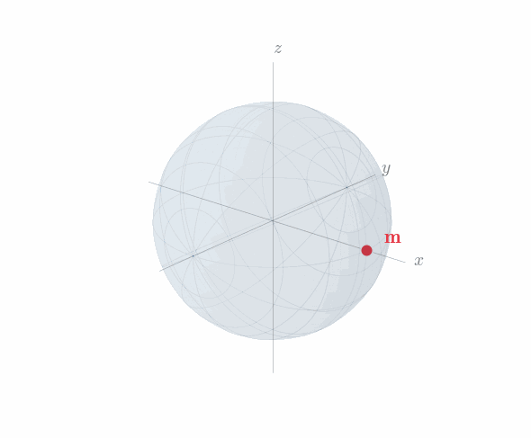
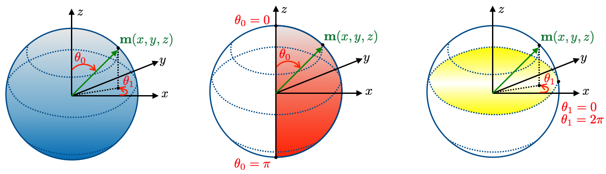

Magnetization dynamics
======================

This section establishes the physical and mathematical basis for the reduced magnetization
:math:`\mathbf{m}` and its governing equation.  It introduces the unit-length constraint
and surveys the two classical families of computational parametrization, motivating the
stereographic approach used in ``Z-mag`` and developed in detail in :doc:`theory_dynamics`.

Unit-length constraint
-----------------------

In a ferromagnet, each atom carries a magnetic moment whose magnitude is set by the spin
quantum number of that atom.  At temperatures well below the Curie temperature, the
quantum-mechanical exchange interaction maintains collective alignment of these moments,
keeping their magnitudes saturated regardless of the applied fields or the local
orientation.  At the continuum level (obtained by averaging over volume elements that are
large with respect to the lattice spacing but small with respect to the scale over which
orientation varies spatially), this saturation persists.  The resulting magnetization density
:math:`\mathbf{M}(\mathbf{x},t)`, where :math:`\mathbf{x}\in\Omega_\mathrm{m}\subset\mathbb{R}^3`
is a point in the magnetic domain and :math:`t\in(0,t_\mathrm{end}]` the time, has
magnitude fixed at the material constant :math:`M_\mathrm{s}(\mathbf{x})` [A/m], the
*saturation magnetization* :cite:`brown1963micromagnetics,abert2019micromagnetics`.

It is therefore natural to separate magnitude from orientation by writing

.. math::
    :label: eq:M_decomposition

    \mathbf{M}(\mathbf{x},t) = M_\mathrm{s}(\mathbf{x})\,\mathbf{m}(\mathbf{x},t),

where :math:`\mathbf{m}` is the *reduced magnetization*, a unit-vector field satisfying

.. math::
    :label: eq:unit_sphere

    |\mathbf{m}(\mathbf{x},t)| = 1,
    \quad\forall\,(\mathbf{x},t)\in\Omega_{\mathrm{m}}\times(0,t_\mathrm{end}].

Geometrically, the state of :math:`\mathbf{m}` at each spatial point lives on the unit
sphere :math:`\mathcal{S}^2 := \{\mathbf{v}\in\mathbb{R}^3 : |\mathbf{v}|=1\}`, a
two-dimensional manifold embedded in :math:`\mathbb{R}^3` (Fig. :numref:`fig:mag_on_sphere`).
The constraint :math:`|\mathbf{m}|=1` is a direct consequence of the atomic-scale
saturation; it is not a modelling assumption.

   The reduced magnetization :math:`\mathbf{m}` lives on the unit sphere
   :math:`\mathcal{S}^2`.  The red marker represents the current orientation at a given
   spatial point.

Magnetization parametrizations
-------------------------------

Because :math:`\mathbf{m}` is constrained to :math:`\mathcal{S}^2`, any computational
representation requires a choice of how to parametrize that manifold.  Two classical
families exist :cite:`reichel2022comparative,horley2009application`.

**Cartesian formulations** store :math:`\mathbf{m}=(m_x,m_y,m_z)\in\mathbb{R}^3` as
three independent degrees of freedom.  The constraint :math:`|\mathbf{m}|=1` is not
encoded in the parametrization and must be enforced externally at each step.  Three
approaches are common:

- *Post-step renormalization* rescales the solution after each accepted step,
  :math:`\mathbf{m}\leftarrow\mathbf{m}/|\mathbf{m}|`.  The operation is inexpensive,
  but the renormalized point on :math:`\mathcal{S}^2` is not the one a constrained
  integrator would reach, so a small directional error is introduced at each step.  Over
  long, low-damping simulations this accumulates as artificial dissipation and phase drift
  :cite:`abert2019micromagnetics,kruzik2006recent`.

- *Penalty methods* augment the energy density with a term
  :math:`\lambda(|\mathbf{m}|^2-1)^2`.  Constraint satisfaction improves with increasing
  :math:`\lambda`, but large :math:`\lambda` also stiffens the discrete system and
  degrades its conditioning.

- *Lagrange multiplier methods* impose the constraint weakly via an auxiliary scalar field,
  enforcing :math:`|\mathbf{m}|=1` exactly at the continuous level.  The price is a
  saddle-point system that requires inf-sup-stable discretization and specialized solvers.

Each approach carries a trade-off between accuracy, conditioning, and implementation
complexity, which is why all three remain in use.

**Intrinsic (parametric) formulations** represent :math:`\mathbf{m}` using only two
coordinates on :math:`\mathcal{S}^2`, so that :math:`|\mathbf{m}|=1` is satisfied by
construction for any coordinate value, with no external enforcement required.  The
canonical example is the spherical-angle parametrization (Fig. :numref:`fig:sph_coords`),
which uses a polar angle :math:`\theta_0\in[0,\pi]` measured from the :math:`z`-axis and
an azimuthal angle :math:`\theta_1\in[0,2\pi)` in the equatorial plane:

.. math::
    :label: eq:spherical_m

    \mathbf{m}(\theta_0,\theta_1) = \bigl(\sin\theta_0\cos\theta_1,\;
    \sin\theta_0\sin\theta_1,\; \cos\theta_0\bigr)^\top.

Since :math:`|\mathbf{m}|^2=\sin^2\theta_0+\cos^2\theta_0=1` identically, the
unit-length constraint is encoded by the map itself with no post-processing.  The induced
metric tensor measures arc-lengths on :math:`\mathcal{S}^2` in terms of coordinate
increments, via :math:`|d\mathbf{m}|^2 = d\boldsymbol{\theta}^\top\mathcal{P}\,d\boldsymbol{\theta}`:

.. math::
    :label: eq:metric_sph

    \mathcal{P}(\boldsymbol{\theta})
    = \begin{pmatrix} 1 & 0 \\ 0 & \sin^2\theta_0 \end{pmatrix}.

The metric is diagonal but anisotropic: the polar direction has unit arc-length everywhere,
while the azimuthal arc-length scales as :math:`\sin\theta_0` and vanishes at the poles
:math:`\theta_0=0` and :math:`\theta_0=\pi`.  There, all values of :math:`\theta_1` map
to the same physical point and the parametrization is no longer locally bijective.  These
poles correspond to :math:`\mathbf{m}\parallel\pm z`, states routinely visited during
switching and precessional dynamics.

   Spherical-angle parametrization on :math:`\mathcal{S}^2`.  Left: the angles
   :math:`\theta_0` (polar) and :math:`\theta_1` (azimuthal).  Centre: the singular
   poles :math:`\theta_0=0,\pi` (red).  Right: the azimuthal wrap-around
   :math:`\theta_1=0\equiv 2\pi` (yellow).

The existence of such singular points is unavoidable for any intrinsic parametrization.
Cartesian formulations are exempt because :math:`\mathbf{m}` is treated as an
unconstrained vector in :math:`\mathbb{R}^3`; the coordinate space is flat and globally
non-singular.  An intrinsic parametrization, by contrast, identifies :math:`\mathbf{m}`
with the image of a smooth map :math:`\boldsymbol{\phi}:\mathcal{U}\to\mathcal{S}^2`
from a coordinate domain :math:`\mathcal{U}\subset\mathbb{R}^2`.  For this map to be a
valid local chart, its derivative :math:`d\boldsymbol{\phi}` — the two column vectors
:math:`\partial\mathbf{m}/\partial\theta_0` and
:math:`\partial\mathbf{m}/\partial\theta_1` — must span the tangent plane of
:math:`\mathcal{S}^2` at every point, i.e. they must constitute a smooth, non-vanishing
tangent frame on :math:`\mathcal{S}^2`.  The **Hairy Ball Theorem**
:cite:`eisenberg1979proof` asserts that no such frame can exist globally on
:math:`\mathcal{S}^2`: the derivative of any single-chart parametrization must therefore
lose rank at least at one point, producing a coordinate singularity.  The choice of
intrinsic parametrization therefore determines only *where* that singularity falls, not
whether one exists.

The Landau--Lifshitz--Gilbert equation
---------------------------------------

The time evolution of :math:`\mathbf{m}` is governed by the
Landau--Lifshitz--Gilbert (LLG) equation
:cite:`landau1935theory,gilbert2004phenomenological`:

.. math::
    :label: eq:llg_phys

    \frac{\partial\mathbf{M}}{\partial t}
    = -\gamma_0\mu_0\,\mathbf{M}\times\mathbf{H}_{\text{eff}}
    + \frac{\alpha}{M_\mathrm{s}}\,\mathbf{M}\times\frac{\partial\mathbf{M}}{\partial t},

where :math:`\gamma_0` [rad/(T·s)] is the gyromagnetic ratio, :math:`\mu_0` [T·m/A] the
vacuum permeability, and :math:`\alpha` [-] the dimensionless Gilbert damping parameter.
The effective field :math:`\mathbf{H}_\text{eff}` [A/m] is the variational derivative of
the total micromagnetic energy with respect to :math:`\mathbf{m}`; its contributions
(Zeeman, exchange, anisotropy, demagnetizing) are derived in :doc:`theory_energy` and
:doc:`theory_magnetostatics`.
The first term describes gyromagnetic precession: :math:`\mathbf{M}` rotates around
:math:`\mathbf{H}_\text{eff}` at the Larmor frequency
:math:`\omega_L=\gamma_0\mu_0|\mathbf{H}_\text{eff}|` [rad/s], the angular precession
rate of a magnetic moment in a field of magnitude :math:`|\mathbf{H}_\text{eff}|`.  The
second term is dissipative and drives :math:`\mathbf{M}` towards alignment with
:math:`\mathbf{H}_\text{eff}` on a characteristic time scale :math:`(\alpha\omega_L)^{-1}`.

Dividing by :math:`M_\mathrm{s}` gives the normalized form in terms of :math:`\mathbf{m}`:

.. math::
    :label: eq:llg_normalized_m

    \frac{\partial\mathbf{m}}{\partial t}
    = -\gamma_0\mu_0\,\mathbf{m}\times\mathbf{H}_{\text{eff}}
    + \alpha\,\mathbf{m}\times\frac{\partial\mathbf{m}}{\partial t}.

Both right-hand-side terms are cross products with :math:`\mathbf{m}`, so
:math:`\partial_t\mathbf{m}` is perpendicular to :math:`\mathbf{m}` at all times:

.. math::
    :label: eq:tangent_constraint

    \mathbf{m}\cdot\frac{\partial\mathbf{m}}{\partial t}=0
    \;\Longleftrightarrow\;
    \frac{d}{dt}|\mathbf{m}|^2=0.

The LLG equation therefore preserves :math:`|\mathbf{m}|=1` exactly at the continuous
level, consistent with the physical saturation constraint.

LLG in each parametrization
----------------------------

The choice of parametrization determines how well :math:`|\mathbf{m}|=1` is preserved
when the LLG equation is discretized in time.

**Cartesian.** The LLG equation :eq:`eq:llg_normalized_m` is integrated as a vector ODE
in :math:`\mathbb{R}^3`.  Standard implicit time-stepping schemes advance :math:`\mathbf{m}`
without enforcing the tangency condition :eq:`eq:tangent_constraint` at the discrete level.
As a result, :math:`|\mathbf{m}^{n+1}|\neq 1` in general after any such step, even if
:math:`|\mathbf{m}^n|=1`.  The constraint must therefore be re-imposed at each step by
one of the three external mechanisms described above, each carrying its own accuracy or
conditioning cost.

**Spherical-angle.** Projecting :eq:`eq:llg_normalized_m` onto the tangent basis induced
by :eq:`eq:spherical_m` yields a :math:`2\times 2` system in :math:`(\theta_0,\theta_1)`,
where :math:`\mathcal{L}(\boldsymbol{\theta})` is the projected damping-precession matrix
and :math:`\mathcal{F}(\boldsymbol{\theta})` the corresponding right-hand-side vector
:cite:`yi2014constraint,dornisch2019coupled`:

.. math::
    :label: eq:damping_sph

    \mathcal{L}(\boldsymbol{\theta})\,\dot{\boldsymbol{\theta}} = \mathcal{F}(\boldsymbol{\theta}),
    \qquad
    \mathcal{L}(\boldsymbol{\theta}) = \frac{M_\mathrm{s}}{\gamma_0}
    \begin{pmatrix}
    \alpha & -\sin\theta_0 \\
    \sin\theta_0 & \alpha\sin^2\theta_0
    \end{pmatrix}.

Any update of :math:`(\theta_0,\theta_1)` maps back to :math:`\mathcal{S}^2` via
:eq:`eq:spherical_m`, so :math:`|\mathbf{m}|=1` is satisfied exactly at every discrete
step with no post-processing.  However, the determinant
:math:`\det\mathcal{L}=(1+\alpha^2)(M_\mathrm{s}/\gamma_0)^2\sin^2\theta_0` inherits
the metric singularity of :eq:`eq:metric_sph`: it vanishes at :math:`\theta_0=0` and
:math:`\theta_0=\pi`, rendering the system matrix rank-deficient at the poles and causing
iterative solvers to stagnate or fail.

By the Hairy Ball Theorem, these singular points cannot be eliminated, only relocated.
:doc:`theory_dynamics` develops a parametrization that pushes the singularity to
coordinate infinity, making it physically unreachable, and shows how ``Z-mag`` extends
it to maintain well-conditioned coordinates everywhere on :math:`\mathcal{S}^2`.
