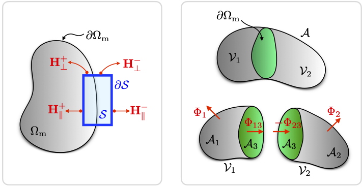

Magnetostatics
==============

This chapter describes the **magnetostatic subproblem** solved alongside stereographic LLG
dynamics in :class:`~Zmag_bins.Zmag_dynamic_stereo_demag.Z_sim_dynamic_stereo_demag`.
The demagnetizing field :math:`\mathbf{H}_{\mathrm{d}}=-\nabla\varphi` is derived from a
scalar magnetostatic potential :math:`\varphi`, computed via the Fredkin–Koehler
decomposition :math:`\varphi=\varphi_0+\varphi_1` described below.  Build and runtime
setup for the BEM component are in :doc:`installation`; weak-form coupling to the
stereographic chart coordinates is in :doc:`theory_dynamics`.

Governing equations
-------------------

Time-dependent equations
^^^^^^^^^^^^^^^^^^^^^^^^
The fundamental equations governing electromagnetic phenomena are Maxwell's equations.
In the general time-dependent case they read as

.. math::
    :label: eq:ms_maxwell_td

    \begin{alignedat}{3}
    &\nabla \times {\bf E} + \frac{\partial{\bf B}}{\partial t} &&= {\bf 0}
      \qquad &&\text{Faraday-Henry law}\\[4pt]
    &\nabla \times {\bf H} - \frac{\partial{\bf D}}{\partial t} &&= {\bf J}
      \qquad &&\text{Maxwell-Ampere law}\\[4pt]
    &\nabla\cdot{\bf D}                                         &&= \rho
      \qquad &&\text{Gauss law}\\[4pt]
    &\nabla\cdot {\bf B}                                        &&= 0
      \qquad &&\text{Gauss magnetic law}
    \end{alignedat}

where :math:`t` is the time and:

* :math:`\mathbf{E}` is the *electric field* [:math:`\text{V}/\text{m}`]
* :math:`\mathbf{D}` is the *electric flux density* (or *electric displacement field*) [:math:`\text{C}/\text{m}^2`]
* :math:`\mathbf{H}` is the *magnetic field intensity* [:math:`\text{A}/\text{m}`]
* :math:`\mathbf{B}` is the *magnetic flux density* (or *magnetic induction*) [:math:`\text{Wb}/\text{m}^2=\text{T}`]
* :math:`\mathbf{J}` is the *electric current density* [:math:`\text{A}/\text{m}^2`]
* :math:`\rho` is the *electric charge volume density* [:math:`\text{C}/\text{m}^3`]

Maxwell's equations are supplemented by the continuity equation

.. math::
    :label: eq:ms_continuity

    \nabla\cdot {\bf J} + \frac{\partial \rho}{\partial t} = 0 \qquad \text{Continuity equation}

Of the five equations above, only three are independent; the standard choice is
the Faraday-Henry law, the Maxwell-Ampere law, and the continuity equation
:eq:`eq:ms_continuity`.
These are accompanied by the *constitutive relationships* describing the electromagnetic
properties of the material:

.. math::
    :label: eq:ms_constitutive_J

    {\bf J} = \sigma\,{\bf E} + {\bf J}_\text{s}

.. math::
    :label: eq:ms_constitutive_D

    {\bf D} = \epsilon\,{\bf E}

.. math::
    :label: eq:ms_constitutive_B

    {\bf B} = \mu\,{\bf H}

where

* :math:`\sigma` is the *electric conductivity* [:math:`\text{S}/\text{m}`]
* :math:`\epsilon` is the *electric permittivity* [:math:`\text{F}/\text{m}`]
* :math:`\mu` is the *magnetic permeability* [:math:`\text{H}/\text{m}`]
* :math:`\mathbf{J}_\text{s}` is the *source current density* [:math:`\text{A}/\text{m}^2`]

:eq:`eq:ms_constitutive_J` expresses the total current density as the sum of a conduction
term (Ohm's law) and a prescribed source term :math:`\mathbf{J}_\text{s}`.
:eq:`eq:ms_constitutive_D` relates the electric flux density to the electric field via the
permittivity of the medium.
:eq:`eq:ms_constitutive_B` establishes a linear relationship between the magnetic flux
density :math:`\mathbf{B}` and the magnetic field intensity :math:`\mathbf{H}` at every
point in the material.

The constitutive parameters :math:`\sigma`, :math:`\epsilon`, and :math:`\mu` are scalars
for isotropic materials, tensors for anisotropic materials, and functions of position for
heterogeneous media.  The permittivity and permeability can be factored as
:math:`\epsilon=\epsilon_r\epsilon_0` and :math:`\mu=\mu_r\mu_0`, where
:math:`\epsilon_r` and :math:`\mu_r` are the dimensionless *relative* permittivity and
permeability of the material, and :math:`\mu_0=4\pi\times10^{-7}\,\text{H/m}`,
:math:`\epsilon_0=1/(\mu_0 c^2)\approx 8.854\times10^{-12}\,\text{F/m}` are the
free-space values (:math:`c` is the speed of light in vacuum).

Time-independent equations
^^^^^^^^^^^^^^^^^^^^^^^^^^
Under *electrostatic* and *magnetostatic* conditions the field quantities do not vary in
time.  In this case, electric and magnetic phenomena decouple from each other.  The
governing equations reduce to

.. math::
    \left\{
    \begin{aligned}
    &\nabla \times {\bf E} = {\bf 0} \qquad &&\text{Faraday-Henry law}\\
    &\nabla \times {\bf H} = {\bf J} \qquad &&\text{Maxwell-Ampere law}\\
    &\nabla\cdot{\bf D} = \rho \qquad &&\text{Gauss law}\\
    &\nabla\cdot {\bf B} = 0 \qquad &&\text{Gauss magnetic law}\\
    &\nabla\cdot {\bf J} = 0 \qquad &&\text{Continuity equation}
    \end{aligned}
    \right.

Assuming a vanishing electric current :math:`{\bf J}={\bf 0}`, the time-independent governing equations simplify to

* **Electrostatic problem**

.. math::

    \begin{alignedat}{3}
    &\nabla \times {\bf E} &&= {\bf 0}         \qquad &&\text{Faraday-Henry law}\\[4pt]
    &\nabla\cdot{\bf D}    &&= \rho             \qquad &&\text{Gauss law}\\[4pt]
    &{\bf D}               &&= \epsilon\,{\bf E}\qquad &&\text{Constitutive law}
    \end{alignedat}

* **Magnetostatic problem**

.. math::
    :label: eq:ms_curl_H_zero

    \nabla \times {\bf H} = {\bf 0} \qquad \text{Maxwell-Ampere law}

.. math::
    :label: eq:ms_div_B_zero

    \nabla\cdot {\bf B} = 0 \qquad \text{Gauss magnetic law}

.. math::
    :label: eq:ms_constitutive_B_ms

    {\bf B} = \mu\,{\bf H} \qquad \text{Constitutive law}

For permanent magnets, :eq:`eq:ms_constitutive_B_ms` assumes the modified form

.. math::
    :label: eq:ms_B_H_M

    {\bf B} = \mu_0\,\left({\bf M} + {\bf H}\right)

where :math:`\mathbf{M}` is the *magnetization field* [:math:`\text{A}/\text{m}`],
equal to :math:`\mathbf{0}` outside the magnetic material.

Magnetostatics
--------------

According to :eq:`eq:ms_curl_H_zero`, the magnetostatic field :math:`\mathbf{H}` is
irrotational and therefore conservative.  It can thus be expressed as the gradient of a
scalar potential :math:`\varphi` [A], called the *magnetostatic potential*:

.. math::
    :label: eq:ms_H_grad_phi

    \mathbf{H} = -\nabla\varphi.

Substituting :eq:`eq:ms_H_grad_phi` and the constitutive law :eq:`eq:ms_B_H_M` into the
Gauss magnetic law :eq:`eq:ms_div_B_zero` gives
:math:`\nabla\cdot\mathbf{B}=\mu_0(\nabla\cdot\mathbf{M}-\Delta\varphi)=0`, which
simplifies to the Poisson equation

.. math::
    :label: eq:ms_poisson_phi

    \Delta\varphi = \nabla\cdot\mathbf{M}.

This equation must be solved throughout :math:`\mathbb{R}^3`, decomposed into the magnetic
domain :math:`\Omega_\text{m}` and its complement, the vacuum :math:`\Omega_\text{v}`.
The boundary conditions are

.. math::
    :label: eq:ms_bc_infinity

    \varphi({\bf x}) = \mathcal{O}\left(\frac{1}{\lVert {\bf x} \rVert} \right) \qquad \text{for}\,\,\,{\bf x}\to +\infty

.. math::
    :label: eq:ms_bc_continuity_phi

    \varphi^+({\bf x^+}) = \varphi^-({\bf x^-}) \qquad \text{for}\,\,\,{\bf x^\pm}\in\partial\Omega_\text{m}

.. math::
    :label: eq:ms_bc_neumann_phi

    \left.\frac{\partial\varphi}{\partial\mathbf{n}}\right|^+ -
    \left.\frac{\partial\varphi}{\partial\mathbf{n}}\right|^-
    = \mathbf{M}\cdot\mathbf{n} \qquad \text{on}\,\,\partial\Omega_\text{m}.

The first condition :eq:`eq:ms_bc_infinity` is an *open boundary condition*, requiring the
potential to decay at infinity.  The second, :eq:`eq:ms_bc_continuity_phi`, imposes
continuity of :math:`\varphi` across :math:`\partial\Omega_\text{m}`.  The third,
:eq:`eq:ms_bc_neumann_phi`, is a *jump condition* on the normal derivative: the superscripts
:math:`+` and :math:`-` denote the **inner (magnet) and outer (vacuum) limits** at
:math:`\partial\Omega_\text{m}`, respectively, and :math:`\mathbf{n}` is the outward unit
normal to :math:`\partial\Omega_\text{m}` (pointing from magnet into vacuum).

Boundary conditions
^^^^^^^^^^^^^^^^^^^
The continuity condition :eq:`eq:ms_bc_continuity_phi` follows from applying Stokes'
theorem to the magnetostatic Ampère law :eq:`eq:ms_curl_H_zero` :cite:`wolski`.
To this aim, consider a surface :math:`\mathcal{S}` bounded by a loop :math:`\partial\mathcal{S}` that crosses the boundary :math:`\partial\Omega_\text{m}` between the magnet and the vacuum, as shown in :numref:`fig_boundary_conditions` (left).
Integrating both sides of :eq:`eq:ms_curl_H_zero` over :math:`\mathcal{S}` and subsequently applying Stokes' theorem leads to

.. math::
    \int_{\mathcal{S}} \nabla \times {\bf H}\cdot d{\bf \mathcal{S}} = \int_{\partial\mathcal{S}} {\bf H} \cdot d{\bf \ell}  = {\bf 0}

Let :math:`\mathcal{S}` be a thin rectangular strip whose long edges are parallel to
:math:`\partial\Omega_\text{m}` and whose short edges cross it perpendicularly.  As the
length of the short edges tends to zero, their contributions to the line integral vanish.
Only the long-edge contributions :math:`\mathbf{H}_\parallel^+` and
:math:`\mathbf{H}_\parallel^-` remain, giving

.. math::
    \mathbf{H}_\parallel^+ = \mathbf{H}_\parallel^- \qquad \Longrightarrow \quad (\nabla\varphi)_\parallel^+ = (\nabla\varphi)_\parallel^-.

The tangential component of :math:`\mathbf{H}`, and hence of :math:`\nabla\varphi`, is
therefore continuous across :math:`\partial\Omega_\text{m}`.  This means :math:`\varphi`
can differ at most by a constant across the interface; setting that constant to zero yields
:eq:`eq:ms_bc_continuity_phi`.

.. _fig_boundary_conditions:

   **Left:** Thin rectangular loop :math:`\partial\mathcal{S}` straddling the boundary
   :math:`\partial\Omega_\text{m}` used to derive tangential continuity of
   :math:`\mathbf{H}`.  **Right:** Gaussian pillbox :math:`\mathcal{V}` straddling
   :math:`\partial\Omega_\text{m}` used to derive the jump condition on the normal
   derivative of :math:`\varphi`.

The jump condition :eq:`eq:ms_bc_neumann_phi` follows from substituting the constitutive
relation :eq:`eq:ms_B_H_M` into the Gauss magnetic law :eq:`eq:ms_div_B_zero`:

.. math::
    \nabla\cdot\mathbf{B} = \mu_0\,\nabla\cdot(\mathbf{M}+\mathbf{H}) = 0
    \qquad\Longrightarrow\quad \nabla\cdot\mathbf{M} = -\nabla\cdot\mathbf{H}.

Consider a volume :math:`\mathcal{V}` bounded by a surface :math:`\mathcal{A}` that
straddles :math:`\partial\Omega_\text{m}`, as shown in :numref:`fig_boundary_conditions` (right).  Integrating
the identity above over :math:`\mathcal{V}` and applying the divergence theorem gives

.. math::
    \int_{\mathcal{A}} \left(\mathbf{M}+\mathbf{H}\right)\cdot\mathbf{n}_\mathcal{A}\,dA = 0,

where :math:`\mathbf{n}_\mathcal{A}` is the outward normal to :math:`\mathcal{A}`.
Partitioning :math:`\mathcal{V}` into two subvolumes :math:`\mathcal{V}_1` (inside
:math:`\Omega_\text{m}`) and :math:`\mathcal{V}_2` (inside :math:`\Omega_\text{v}`) by
the shared surface :math:`\mathcal{A}_3\subset\partial\Omega_\text{m}`, the flux through
the full surface decomposes as

.. math::
    \Phi(\mathcal{V}) = \Phi_1 + \Phi_{13} + \Phi_{2} + \Phi_{23} = 0.

The outward normal to :math:`\mathcal{A}_3` points in the direction :math:`+\mathbf{n}` as
seen from :math:`\mathcal{V}_1` and in the direction :math:`-\mathbf{n}` as seen from
:math:`\mathcal{V}_2`, so :math:`\Phi_{13}=-\Phi_{23}`.  The contributions from the outer
faces :math:`\mathcal{A}_1` and :math:`\mathcal{A}_2` vanish as the volume collapses onto
:math:`\partial\Omega_\text{m}`, leaving

.. math::
    \int_{\mathcal{A}_{3}}
    \left[\left(\mathbf{M}-\nabla\varphi\right)^+ - \left(\mathbf{M}-\nabla\varphi\right)^-\right]
    \cdot\mathbf{n}\,dA_3 = 0.

Since this must hold for any such surface element, the integrand must vanish pointwise,
giving

.. math::
    :label: eq:ms_bc_neumann_general

    \left.\frac{\partial\varphi}{\partial\mathbf{n}}\right|^+ -
    \left.\frac{\partial\varphi}{\partial\mathbf{n}}\right|^-
    = (\mathbf{M}^+-\mathbf{M}^-)\cdot\mathbf{n}
    \qquad\text{on}\,\,\partial\Omega_\text{m}.

Here :math:`+` is the side facing :math:`\mathcal{V}_1` (magnet interior) and :math:`-`
is the side facing :math:`\mathcal{V}_2`.  When :math:`\mathcal{V}_2` coincides with the
vacuum, :math:`\mathbf{M}^-=\mathbf{0}` and :eq:`eq:ms_bc_neumann_general` reduces to
:eq:`eq:ms_bc_neumann_phi`.

Equation :eq:`eq:ms_bc_neumann_general` is equivalent to continuity of the normal
component of :math:`\mathbf{B}` across the interface:

.. math::
    \begin{aligned}
    &\nabla\varphi^+\cdot\mathbf{n} - \nabla\varphi^-\cdot\mathbf{n}
      = (\mathbf{M}^+-\mathbf{M}^-)\cdot\mathbf{n}\\
    &\Longrightarrow\quad
      (\mathbf{M}^+-\nabla\varphi^+)\cdot\mathbf{n}
      = (\mathbf{M}^--\nabla\varphi^-)\cdot\mathbf{n}\\
    &\Longrightarrow\quad \mathbf{B}_\perp^+ = \mathbf{B}_\perp^-.
    \end{aligned}

.. note::
    The jump condition :eq:`eq:ms_bc_neumann_general` and the continuity condition
    :eq:`eq:ms_bc_continuity_phi` apply equally at interfaces between two magnetic
    materials with different properties :cite:`weddemann2011hybrid,wolski`.  In summary,
    the solution sought is a function :math:`\varphi(\mathbf{x})` defined for all
    :math:`\mathbf{x}\in\mathbb{R}^3` that satisfies the Poisson equation
    :eq:`eq:ms_poisson_phi`, decays at infinity according to :eq:`eq:ms_bc_infinity`, and
    fulfills :eq:`eq:ms_bc_continuity_phi`–:eq:`eq:ms_bc_neumann_general` at every
    material interface.

Hybrid FEM-BEM approach: homogeneous material
^^^^^^^^^^^^^^^^^^^^^^^^^^^^^^^^^^^^^^^^^^^^^

The Fredkin--Koehler approach :cite:`fredkin1990hybrid` introduces the decomposition of
the magnetostatic potential :math:`\varphi` into two contributions

.. math::
    \varphi = \varphi_0 + \varphi_1

where :math:`\varphi_0` is defined as the solution of the *Neumann problem*

.. math::
    :label: eq:ms_fk_phi0

    \begin{alignedat}{3}
    &\Delta \varphi_0                          &&= \nabla \cdot {\bf M}  \qquad &&\text{in}\,\,\Omega_\text{m}\\[4pt]
    &\frac{\partial\varphi_0}{\partial{\bf n}} &&= {\bf M}\cdot {\bf n}  \qquad &&\text{on}\,\,\partial\Omega_\text{m}\\[4pt]
    &\varphi_0                                 &&= 0                     \qquad &&\text{in}\,\,\Omega_\text{v}
    \end{alignedat}

whereas :math:`\varphi_1` is the solution of the *Laplace problem*

.. math::
    :label: eq:ms_fk_phi1

    \begin{alignedat}{3}
    &\Delta \varphi_1         &&= 0           \qquad &&\text{in}\,\,\Omega_\text{m}\cup\Omega_\text{v}\\[4pt]
    &\text{jump}(\varphi_1)   &&= \varphi_0   \qquad &&\text{on}\,\,\partial\Omega_\text{m}\\[4pt]
    &\varphi_1({\bf x})       &&\to 0         \qquad &&\text{for}\,\,{\bf x}\to +\infty
    \end{alignedat}

The resulting potential :math:`\varphi = \varphi_0 + \varphi_1` is continuous across the boundary :math:`\partial\Omega_\text{m}` (thus satisfying condition :eq:`eq:ms_bc_continuity_phi`),
while the individual parts :math:`\varphi_0` and :math:`\varphi_1` are generally discontinuous.
Splitting the potential into two parts allows one to avoid the difficulty that the interface conditions :eq:`eq:ms_bc_continuity_phi` and :eq:`eq:ms_bc_neumann_phi` are a priori unknown,
since the value of the potential at the boundary :math:`\partial\Omega_\text{m}` is not prescribed explicitly.

Since :math:`\varphi_1` satisfies a homogeneous Laplace equation, its value at any point
:math:`{\bf x}\in\mathbb{R}^n` can be recovered from the boundary data via the representation formula

.. math::
    :label: eq:ms_fk_green_integral

    \varphi_1({\bf x}) = \int_{\partial\Omega_\text{m}} \varphi_0({\bf x}^\prime) \frac{\partial\mathcal{G}({\bf x},{\bf x}^\prime)}{\partial{\bf n}}\,dS^\prime \qquad \forall\,{\bf x}\in\mathbb{R}^n

where :math:`n` is the system dimension and :math:`{\bf x}^\prime` is the integration variable on :math:`\partial\Omega_\text{m}`.
The Green's function :math:`\mathcal{G}` of the boundary value problem is :cite:`weddemann2011hybrid`

.. math::
    \begin{aligned}
    &\mathcal{G}({\bf x},{\bf x}^\prime) = \frac{1}{2\pi}\ln(\vert {\bf x}-{\bf x}^\prime \vert) \qquad &&\text{for}\,n=2\\
    &\mathcal{G}({\bf x},{\bf x}^\prime) = -\frac{1}{4\pi}\frac{1}{\vert {\bf x}-{\bf x}^\prime \vert} \qquad &&\text{for}\,n=3
    \end{aligned}

Unfortunately, evaluating :eq:`eq:ms_fk_green_integral` at every point in
:math:`\mathbb{R}^n` is numerically expensive, with storage requirements of order
:math:`\mathcal{O}(\mathcal{N}^{5/3})`, where :math:`\mathcal{N}` is the number of
elements :cite:`fredkin1990hybrid,weddemann2011hybrid`.  Instead, the integral is
evaluated only at the boundary nodes :math:`{\bf x}\in\partial\Omega_\text{m}`, and the
resulting values are used as the Dirichlet data needed to close the Laplace problem for
:math:`\varphi_1`.
In the framework of a *hybrid finite element – boundary element formulation* (FEM-BEM), the part :math:`\varphi_1` is therefore the solution of

.. math::
    :label: eq:ms_fk_bem

    \begin{alignedat}{2}
    &\Delta \varphi_1 = 0
      \qquad &&\text{in}\,\,\Omega_\text{m}\cup\Omega_\text{v}\\[6pt]
    &\varphi_1({\bf x}) = \displaystyle\int_{\partial\Omega_\text{m}} \varphi_0({\bf x}^\prime)
      \frac{\partial\mathcal{G}({\bf x},{\bf x}^\prime)}{\partial{\bf n}}\,dS^\prime
      + \left(\frac{\hat{\Omega}({\bf x})}{4\pi}-1 \right)\varphi_0({\bf x})
      \qquad &&\forall\,{\bf x}\in\partial\Omega_\text{m}\\[6pt]
    &\varphi_1({\bf x}) \to 0
      \qquad &&\text{for}\,\,{\bf x}\to +\infty
    \end{alignedat}

where :math:`\hat{\Omega}(\mathbf{x})` is the solid angle subtended by
:math:`\partial\Omega_\text{m}` at :math:`\mathbf{x}`.  For a smooth (non-corner, non-edge)
boundary point the solid angle equals :math:`2\pi`; at corners and edges it takes a smaller
value that depends on the local geometry.  In the implementation each boundary node carries
its own solid-angle weight, computed from the surrounding facets.

In summary, the Fredkin--Koehler approach consists of

* first, solving the Neumann problem for :math:`\varphi_0` in :math:`\Omega_\text{m}`;
* second, solving the Laplace problem for :math:`\varphi_1` with Dirichlet data on :math:`\partial\Omega_\text{m}` supplied by the BEM operator (in the production solver this FEM step is carried out on :math:`\Omega_\text{m}` only; see the mesh-scope note below).

Variational form of the Neumann problem
"""""""""""""""""""""""""""""""""""""""

In the presence of a magnetic induction field :math:`{\bf B}\cdot {\bf n}=-B_0` applied on the external boundary :math:`\partial\Omega_\text{m}` :cite:`dornisch2019coupled`, the boundary condition for the Neumann problem reads as

.. math::
    \begin{aligned}
    {\bf B}\cdot {\bf n}
      &= \mu_0\left({\bf H}+{\bf M}\right)\cdot {\bf n} = - B_0 \\
    \Longrightarrow\quad
    \nabla\varphi_0 \cdot {\bf n}
      &= {\bf M}\cdot {\bf n} + H_\text{zee}  \qquad \text{on}\,\,\partial\Omega_\text{m}
    \end{aligned}

where :math:`H_\text{zee} = B_0/\mu_0`. This leads to the following Neumann problem

.. math::
    \left\{
    \begin{aligned}
    &\Delta \varphi_0 = \nabla \cdot {\bf M} = f \qquad &&\text{in}\,\,\Omega_\text{m}\\
    &\frac{\partial\varphi_0}{\partial{\bf n}} = {\bf M}\cdot {\bf n} +H_\text{zee}  = g \qquad &&\text{on}\,\,\partial\Omega_\text{m}\\
    \end{aligned}
    \right.

where :math:`f` and :math:`g` are input data and :math:`{\bf n}` is the outward boundary normal.
The approximation to the solution is called the *trial function* :math:`\varphi_0^\text{trial}`,
and it is tested against a *test function* :math:`\varphi_0^\text{test}`.  Both belong to a
suitable function space.  Multiplying the PDE by :math:`\varphi_0^\text{test}` and integrating
over :math:`\Omega_\text{m}` gives

.. math::
    \int_{\Omega_\text{m}} \Delta \varphi_0^\text{trial} \cdot \varphi_0^\text{test}\,dV = \int_{\Omega_\text{m}} f \cdot \varphi_0^\text{test}\,dV

When deriving variational principles, the order of derivatives should be kept as small as possible.
To lower the order of differentiation, the Laplacian is shifted onto the test function by
integrating by parts (Green's first identity):

.. math::
    \begin{aligned}
    \int_{\Omega_\text{m}} \Delta \varphi_0^\text{trial} \cdot \varphi_0^\text{test}\,dV
      &= -\int_{\Omega_\text{m}} \nabla \varphi_0^\text{trial} \cdot \nabla \varphi_0^\text{test}\,dV
         +\int_{\partial\Omega_\text{m}}\frac{\partial\varphi_0^\text{trial}}{\partial{\bf n}}\cdot \varphi_0^\text{test}\,dS \\
      &= -\int_{\Omega_\text{m}} \nabla \varphi_0^\text{trial} \cdot \nabla \varphi_0^\text{test}\,dV
         +\int_{\partial\Omega_\text{m}}\left(\nabla\varphi_0^\text{trial} \cdot {\bf n} \right)\cdot \varphi_0^\text{test}\,dS
    \end{aligned}

The test function must vanish wherever the trial function is prescribed (Dirichlet data).
Because the Neumann problem has no Dirichlet conditions, :math:`\varphi_0^\text{test}\neq 0`
on :math:`\partial\Omega_\text{m}` and the boundary term is retained.  Substituting the
Neumann condition :math:`g` gives

.. math::
    \int_{\Omega_\text{m}} \Delta \varphi_0^\text{trial} \cdot \varphi_0^\text{test}\,dV = 
    -\int_{\Omega_\text{m}} \nabla \varphi_0^\text{trial} \cdot \nabla \varphi_0^\text{test}\,dV +
    \int_{\partial\Omega_\text{m}} g\cdot \varphi_0^\text{test}\,dS

Rearranging yields the weak form of the Neumann problem

.. math::
    :label: eq:ms_weak_neumann

    \int_{\Omega_\text{m}} \nabla \varphi_0^\text{trial} \cdot \nabla \varphi_0^\text{test}\,dV =
    -\int_{\Omega_\text{m}} f \cdot \varphi_0^\text{test}\,dV
    +\int_{\partial\Omega_\text{m}} g\cdot \varphi_0^\text{test}\,dS

In the standard notation :math:`a(u,v)=L(v)`:

.. math::
    \begin{aligned}
    & a\left(\varphi_0^\text{trial},\varphi_0^\text{test}\right)
      = \int_{\Omega_\text{m}} \nabla \varphi_0^\text{trial} \cdot \nabla \varphi_0^\text{test}\,dV
      \qquad &&\text{Bilinear form}\\
    & L\left(\varphi_0^\text{test}\right)
      = -\int_{\Omega_\text{m}} f \cdot \varphi_0^\text{test}\,dV
        +\int_{\partial\Omega_\text{m}} g\cdot \varphi_0^\text{test}\,dS
      \qquad &&\text{Linear form}
    \end{aligned}

The *non-dimensional form* of the Neumann problem uses the reference scales of material 1
(consistent with :eq:`eq:star_scales_energy` in :doc:`theory_energy`):

.. math::
    \varphi_0 = M_\mathrm{s1}\,\ell_\mathrm{ex1}\,\varphi_0^\ast,\quad
    H_\text{zee} = M_\mathrm{s1}\,H_\text{zee}^\ast,\quad
    \nabla = \ell_\mathrm{ex1}^{-1}\nabla^\ast,\quad
    dV = \ell_\mathrm{ex1}^3\,dV^\ast,\quad
    dS = \ell_\mathrm{ex1}^2\,dS^\ast.

Dividing through by the common factor :math:`M_\mathrm{s1}^2\ell_\mathrm{ex1}` yields the
non-dimensional weak form

.. math::
    \int_{\Omega_\text{m}} \left[
    \nabla^\ast\varphi_0^{\text{trial}\,\ast}\cdot\nabla^\ast\varphi_0^{\text{test}\,\ast}
    + f^\ast\,\varphi_0^{\text{test}\,\ast}
    \right]dV^\ast =
    \int_{\partial\Omega_\text{m}} g^\ast\,\varphi_0^{\text{test}\,\ast}\,dS^\ast,

where the non-dimensional source terms are the pointwise fields

.. math::
    \begin{aligned}
    &f^\ast = \nabla^\ast\cdot\mathbf{m},\\
    &g^\ast = \mathbf{m}\cdot\mathbf{n} + H_\text{zee}^\ast.
    \end{aligned}

The non-dimensional standard form :math:`a^\ast(u^\ast,v^\ast)=L^\ast(v^\ast)` is

.. math::
    \begin{aligned}
    & a^\ast\!\left(\varphi_0^{\text{trial}\,\ast},\varphi_0^{\text{test}\,\ast}\right)
      = \int_{\Omega_\text{m}} \nabla^\ast\varphi_0^{\text{trial}\,\ast}\cdot
        \nabla^\ast\varphi_0^{\text{test}\,\ast}\,dV^\ast
      \qquad &&\text{Bilinear form}\\
    & L^\ast\!\left(\varphi_0^{\text{test}\,\ast}\right)
      = -\int_{\Omega_\text{m}} f^\ast\,\varphi_0^{\text{test}\,\ast}\,dV^\ast
        +\int_{\partial\Omega_\text{m}} g^\ast\,\varphi_0^{\text{test}\,\ast}\,dS^\ast
      \qquad &&\text{Linear form}
    \end{aligned}

Variational form of the Laplace problem
"""""""""""""""""""""""""""""""""""""""

The FEM/BEM formulation of the Laplace problem reads as

.. math::
    \left\{
    \begin{aligned}
    &\Delta \varphi_1 = 0 \qquad &&\text{in}\,\,\Omega_\text{m}\cup\Omega_\text{v}=\Omega\\
    &\varphi_1({\bf x}) = \int_{\partial\Omega_\text{m}} \varphi_0({\bf x}^\prime) \frac{\partial\mathcal{G}({\bf x},{\bf x}^\prime)}{\partial{\bf n}}\,dS^\prime +
    \left(\frac{\hat{\Omega}({\bf x})}{4\pi}-1 \right)\,\varphi_0({\bf x}) \qquad &&\forall {\bf x}\in\partial\Omega_\text{m}\\
    &\varphi_1({\bf x}) \to 0 \qquad &&\text{for}\,\,{\bf x}\to +\infty
    \end{aligned}
    \right.

The integral expression of the Dirichlet boundary condition can be replaced by its discretized counterpart as :cite:`fredkin1990hybrid`

.. math::
    \left\{
    \begin{aligned}
    &\Delta \varphi_1 = 0 \qquad &&\text{in}\,\,\Omega\\
    &\varphi_1 = \mathcal{B}\,\varphi_0 \qquad &&\text{on}\,\,\partial\Omega_\text{m}\\
    &\varphi_1 \to 0 \qquad &&\text{for}\,\,{\bf x}\to +\infty
    \end{aligned}
    \right.

where :math:`\mathcal{B}` is the *BEM matrix*, assembled from the kernel integral
:eq:`eq:ms_fk_green_integral`.  Multiplying the Laplace equation by :math:`\varphi_1^\text{test}`
and integrating over :math:`\Omega` gives

.. math::
    \int_{\Omega} \Delta \varphi_1^\text{trial} \cdot \varphi_1^\text{test}\,dV  = 0

Integrating by parts:

.. math::
    \int_{\Omega} \Delta \varphi_1^\text{trial} \cdot \varphi_1^\text{test}\,dV  = 
    - \int_{\Omega} \nabla \varphi_1^\text{trial} \cdot \nabla \varphi_1^\text{test}\,dV +
    \int_{\partial\Omega}\frac{\partial\varphi_1^\text{trial}}{\partial{\bf n}}\cdot \varphi_1^\text{test}\,dS

Since :math:`\varphi_1^\text{trial}` is prescribed on :math:`\partial\Omega_\text{m}` (Dirichlet condition)
and vanishes at infinity, the test function satisfies :math:`\varphi_1^\text{test} = 0` on the
full boundary :math:`\partial\Omega`, and the surface integral drops out.  The weak form is

.. math::
    \int_{\Omega} \nabla \varphi_1^\text{trial} \cdot \nabla \varphi_1^\text{test}\,dV = 0

which can be expressed in the usual form :math:`a(u,v)=L(v)` as

.. math::
    \begin{aligned}
    & a\left(\varphi_1^\text{trial},\varphi_1^\text{test}\right)
      = \int_{\Omega} \nabla \varphi_1^\text{trial} \cdot \nabla \varphi_1^\text{test}\,dV
      \qquad &&\text{Bilinear form}\\
    & L\left(\varphi_1^\text{test}\right) = 0
      \qquad &&\text{Linear form}
    \end{aligned}

The *non-dimensional form* of the Laplace problem is obtained as follows

.. math::
    \int_{\Omega_\text{m}} M_\text{s}^2\ell_\text{ex}^3 \left[ \nabla^\ast \varphi_1^{\text{trial}\,\ast} \cdot \nabla^\ast \varphi_1^{\text{test}\,\ast} \right]\,dV^\ast= 0

with the non-dimensional standard form :math:`a^\ast(u^\ast,v^\ast)=L^\ast(v^\ast)` is

.. math::
    \begin{aligned}
    & a^\ast\left(\varphi_1^{\text{trial}\,\ast},\varphi_1^{\text{test}\,\ast}\right)
      = \int_{\Omega_\text{m}} \nabla^\ast \varphi_1^{\text{trial}\,\ast} \cdot \nabla^\ast \varphi_1^{\text{test}\,\ast}\,dV^\ast
      \qquad &&\text{Bilinear form}\\
    & L^\ast\left(\varphi_1^{\text{test}\,\ast}\right) = 0
      \qquad &&\text{Linear form}
    \end{aligned}

Hybrid FEM-BEM approach: heterogeneous material
^^^^^^^^^^^^^^^^^^^^^^^^^^^^^^^^^^^^^^^^^^^^^^^

Consider a magnetic material :math:`\Omega_\text{m}` comprised of two different materials :math:`\Omega_\text{m1}` and :math:`\Omega_\text{m2}`, divided 
by the interface :math:`\Gamma`. The magnetic domain is surrounded by the vacuum :math:`\Omega_\text{v}`. The overall volume is :math:`\Omega = \Omega_\text{m} \cup \Omega_\text{v}`,
where :math:`\Omega_\text{m}=\Omega_\text{m1}\cup\Omega_\text{m2}`. The boundary between magnetic domain and vacuum is :math:`\partial\Omega_\text{m}=\partial\Omega_\text{m1}\cup\partial\Omega_\text{m2}`.
The outward normal to :math:`\Omega_\text{m}` is :math:`{\bf n}`.
The outward normal to :math:`\Omega_\text{m1}` (respectively, :math:`\Omega_\text{m2}`) is :math:`{\bf n}^+` (respectively, :math:`{\bf n}^-`), with :math:`{\bf n}^- = -{\bf n}^+`.

The magnetostatic equations are

.. math::
    \left\{
    \begin{aligned}
    &\Delta \varphi = \nabla \cdot {\bf M} \qquad &&\text{in}\,\,\Omega_\text{m}=\Omega_\text{m1}\cup\Omega_\text{m2}\\
    &\frac{\partial\varphi}{\partial{\bf n}} = {\bf M}\cdot {\bf n} + H_\text{zee} \qquad &&\text{on}\,\,\partial\Omega_\text{m}\\
    &\frac{\partial\varphi^+}{\partial{\bf n}^+} - \frac{\partial\varphi^-}{\partial{\bf n}^-} = {\bf M}^+\cdot {\bf n}^+ - {\bf M}^-\cdot {\bf n}^- \qquad &&\text{on}\,\,\Gamma\\
    &\varphi^+ = \varphi^- \qquad &&\text{on}\,\,\partial\Omega_\text{m}\,\,\text{and on}\,\,\Gamma\\
    &\varphi = 0 \qquad &&\text{on}\,\,\partial\Omega_\text{v}
    \end{aligned}
    \right.

In the hybrid FEM-BEM approach

.. math::
    \varphi = \varphi_0 + \varphi_1\,, \quad \text{with} \quad \varphi_0=0 \,\,\,\text{on}\,\Omega_\text{v}

The previous equations are rewritten as follows.

* Equation :math:`\Delta \varphi = \nabla \cdot {\bf M}`:

.. math::
    \left\{
    \begin{aligned}
    &\Delta \varphi_1 = 0 \quad &&\text{in}\,\Omega_\text{m}\cup\Omega_\text{v}\\
    &\Delta \varphi_0 = \nabla \cdot {\bf M}  \quad &&\text{in}\,\,\Omega_\text{m}
    \end{aligned}
    \right.

* Neumann equations on :math:`\partial\varphi/\partial{\bf n}`:

.. math::
    \left\{
    \begin{aligned}
    &\frac{\partial\varphi_0^\text{m}}{\partial{\bf n}} = {\bf M}^\text{m}\cdot {\bf n} + H_\text{zee} \quad &&\text{on}\,\,\partial\Omega_\text{m}\\
    &\frac{\partial\varphi_1^\text{m}}{\partial{\bf n}} = \frac{\partial\varphi_1^\text{v}}{\partial{\bf n}} \quad &&\text{on}\,\,\partial\Omega_\text{m}\\
    &\frac{\partial\varphi_0^+}{\partial{\bf n}^+} - \frac{\partial\varphi_0^-}{\partial{\bf n}^-}  = \left({\bf M}^+ - {\bf M}^- \right)\cdot {\bf n}^+ \quad &&\text{on}\,\,\Gamma\\
    &\frac{\partial\varphi_1^+}{\partial{\bf n}^+} = \frac{\partial\varphi_1^-}{\partial{\bf n}^-} \quad &&\text{on}\,\,\Gamma
    \end{aligned}
    \right.

* Equation :math:`\varphi^+ = \varphi^-`:

.. math::
    \left\{
    \begin{aligned}
    &\text{jump}(\varphi_1)= \varphi_1^- - \varphi_1^+ = \varphi_0^+ \quad &&\text{on}\,\,\partial\Omega_\text{m}\\
    &\text{jump}(\varphi_1)= \varphi_1^- - \varphi_1^+ = -\text{jump}(\varphi_0) = \varphi_0^+ -  \varphi_0^-  \quad &&\text{on}\,\,\Gamma
    \end{aligned}
    \right.

Variational form of the Neumann problem
"""""""""""""""""""""""""""""""""""""""

The variational form of the Neumann problem is

.. math::
    \int_{\Omega_\text{m}} \Delta \varphi_0^\text{trial} \cdot \varphi_0^\text{test}\,dV = \int_{\Omega_\text{m}} (\nabla \cdot {\bf M}) \cdot \varphi_0^\text{test}\,dV

which results in

.. math::
    \begin{aligned}
    &-\int_{\Omega_\text{m}} \nabla \varphi_0^\text{trial} \cdot \nabla \varphi_0^\text{test}\,dV +
    \int_{\partial\Omega_\text{m}} \frac{\partial\varphi_0^\text{trial}}{\partial{\bf n}}\cdot \varphi_0^\text{test}\,dS +\\
    &\int_{\Gamma} \left(\frac{\partial\varphi_0^\text{trial+}}{\partial{\bf n}^+} - \frac{\partial\varphi_0^\text{trial-}}{\partial{\bf n}^-}\right)\cdot \varphi_0^\text{test}\,dS
    = \int_{\Omega_\text{m}} (\nabla \cdot {\bf M}) \cdot \varphi_0^\text{test}\,dV
    \end{aligned}

by applying the Neumann boundary conditions

.. math::
    \begin{aligned}
    &-\int_{\Omega_\text{m}} \nabla \varphi_0^\text{trial} \cdot \nabla \varphi_0^\text{test}\,dV +
    \int_{\partial\Omega_\text{m}} \left({\bf M}\cdot{\bf n} + H_\text{zee}\right)\cdot \varphi_0^\text{test}\,dS +\\
    &\int_{\Gamma} \left(\left({\bf M}^+ - {\bf M}^- \right)\cdot {\bf n}^+\right)\cdot \varphi_0^\text{test}\,dS
    = \int_{\Omega_\text{m}} (\nabla \cdot {\bf M}) \cdot \varphi_0^\text{test}\,dV
    \end{aligned}

The previous equation is non-dimensionalized by **taking material 1 as a reference**

.. math::
    \begin{aligned}
    &\nabla = \frac{\nabla^\ast}{\ell_\text{ex1}}\,,\quad
    dV = \ell_\text{ex1}^3\,dV^\ast\,,\quad
    dS = \ell_\text{ex1}^2\,dS^\ast\,,\quad\\
    &M_\text{s}^{\ast} = \frac{M_{\text{s}i}}{M_\text{s1}}\,,\quad
    \varphi_{0i} = M_\text{s1}\ell_\text{ex1}\,\varphi_{0i}^\ast\,,\quad
    H_\text{zee}^{\ast} = \frac{H_\text{zee}}{M_\text{s1}}
    \end{aligned}

with this notation, one obtains

.. math::
    \begin{aligned}
    &\int_{\Omega_\text{m1}} \nabla^\ast \varphi_{01}^{\text{trial}\,\ast} \cdot \nabla^\ast \varphi_{01}^{\text{test}\,\ast}\,dV^\ast +
    \int_{\Omega_\text{m2}} \nabla^\ast \varphi_{02}^{\text{trial}\,\ast} \cdot \nabla^\ast \varphi_{02}^{\text{test}\,\ast}\,dV^\ast +\\
    &\int_{\Omega_\text{m1}} (\nabla^\ast \cdot {\bf m}) \cdot \varphi_{01}^{\text{test}\,\ast}\,dV^\ast +
    \int_{\Omega_\text{m2}} \frac{M_\text{s2}}{M_\text{s1}}\left((\nabla^\ast \cdot {\bf m}) \cdot \varphi_{02}^{\text{test}\,\ast}\right)\,dV^\ast =\\
    &\int_{\partial\Omega_\text{m1}} \left({\bf m}\cdot{\bf n}+H_\text{zee}^{\ast}\right)\cdot \varphi_{01}^{\text{test}\,\ast}\,dS^\ast +
    \int_{\partial\Omega_\text{m2}} \left(\frac{M_\text{s2}}{M_\text{s1}}\left({\bf m}\cdot{\bf n}\right)+H_\text{zee}^{\ast}\right)\cdot \varphi_{02}^{\text{test}\,\ast}\,dS^\ast +\\
    &\int_{\Gamma} \left(\left({\bf m}^+ - \frac{M_\text{s2}}{M_\text{s1}} {\bf m}^- \right)\cdot {\bf n}^+\right)\cdot \varphi_{0}^{\text{test}\,\ast}\,dS^\ast
    \end{aligned}

which in the general case can be recast as

.. math::
    \begin{aligned}
    &\int_{\Omega_\text{m}} \left[\nabla^\ast \varphi_{0}^{\text{trial}\,\ast} \cdot \nabla^\ast \varphi_{0}^{\text{test}\,\ast} +
    M_\text{s}^\ast\left((\nabla^\ast \cdot {\bf m}) \cdot \varphi_{0}^{\text{test}\,\ast}\right)\right]\,dV^\ast = \\
    &\int_{\partial\Omega_\text{m}} \left(M_\text{s}^\ast\left({\bf m}\cdot{\bf n}\right)+H_\text{zee}^{\ast}\right)\cdot \varphi_{0}^{\text{test}\,\ast}\,dS^\ast +
    \int_{\Gamma} \left[\left(M_\text{s}^{\ast +}{\bf m}^+ - M_\text{s}^{\ast -}{\bf m}^- \right)\cdot {\bf n}^+\right]\cdot \varphi_{0}^{\text{test}\,\ast}\,dS^\ast
    \end{aligned}

The boundary integral over :math:`\partial\Omega_\text{m}` ensures :math:`{\bf B}_\perp^+ = {\bf B}_\perp^-` between the magnet and the vacuum.
The boundary integral over :math:`\Gamma` ensures :math:`{\bf B}_\perp^+ = {\bf B}_\perp^-` across the interface between different materials.

Variational form of the Laplace problem
"""""""""""""""""""""""""""""""""""""""

The variational form of the Laplace problem is

.. math::
    \int_{\Omega_\text{m}} \Delta \varphi_1^\text{trial} \cdot \varphi_1^\text{test}\,dV = 0

which results in

.. math::
    -\int_{\Omega_\text{m}} \nabla \varphi_1^\text{trial} \cdot \nabla \varphi_1^\text{test}\,dV +
    \int_{\partial\Omega_\text{m}} \frac{\partial\varphi_1^\text{trial}}{\partial{\bf n}}\cdot \varphi_1^\text{test}\,dS +
    \int_{\Gamma} \left(\frac{\partial\varphi_1^\text{trial+}}{\partial{\bf n}^+} - \frac{\partial\varphi_1^\text{trial-}}{\partial{\bf n}^-}\right)\cdot \varphi_1^\text{test}\,dS
    = 0

:math:`\varphi_1^\text{test}=0` in parts of the boundary where the solution :math:`\varphi_1^\text{trial}` is known.
In the Laplace problem, :math:`\varphi_1^\text{trial}` is known on :math:`\partial\Omega_\text{m}` (Dirichlet boundary condition).
The first boundary integral can thus be dropped.
The second boundary integral can also be dropped, given the Neumann boundary condition :math:`\nabla\varphi_1^\text{trial+}\cdot{\bf n}^+ = \nabla\varphi_1^\text{trial-}\cdot{\bf n}^-`. 

The previous equation is non-dimensionalized by **taking material 1 as a reference**. After some algebra, one obtains

.. math::
    \int_{\Omega_\text{m}} \nabla^\ast \varphi_1^{\text{trial}\,\ast} \cdot \nabla^\ast \varphi_1^{\text{test}\,\ast}\,dV^\ast = 0

this needs to be solved together with the boundary conditions 

.. math::
    \left\{
    \begin{aligned}
    &\varphi_1^\ast = \mathcal{B}\varphi_0^\ast\,\qquad&&\text{on}\,\,\partial\Omega_\text{m}\\
    &\varphi_1^\ast = 0\,\qquad&&\text{on}\,\,\partial\Omega_\text{v}
    \end{aligned}
    \right.

.. note::

   **Nullspace of the Fredkin–Koehler decomposition**

   Because :math:`\varphi_0` solves a Neumann (Poisson) problem with purely natural boundary
   conditions, it is determined only up to an additive constant — its solution space
   contains a one-dimensional nullspace of constant functions.

   :math:`\varphi_1`, by contrast, solves a Laplace problem with Dirichlet data on the
   external surface and therefore uniquely fixes this constant offset.  Consequently,
   the total potential :math:`\varphi = \varphi_0 + \varphi_1` is well-defined, and it is not
   necessary to explicitly pin the nullspace of :math:`\varphi_0` in the linear solver.

BEM assembler
-------------

The Laplace subproblem for :math:`\varphi_1` requires Dirichlet data on
:math:`\partial\Omega_\text{m}` at every time-step.  Those data are provided by the
boundary integral :eq:`eq:ms_fk_bem`, whose integrand depends on the boundary geometry
but not on the magnetization.  The integral can therefore be discretized once into the
*BEM matrix* :math:`\mathbf{B}`, assembled at the start of the simulation by
:class:`bem_assembler.bem_assembler.BEMAssembler` and stored as a read-only operator;
at each step, applying it reduces to a single matrix--vector product.  The assembly is
implemented in C++, with the matrix written directly into a pre-allocated NumPy buffer to
avoid redundant copies.
The subsections below cover the discretization of :math:`\mathbf{B}`, its distributed
assembly and memory layout, and its use in
:class:`~Zmag_bins.Zmag_magnetostatic.Z_sim_magnetostatic`.

Integral discretization
^^^^^^^^^^^^^^^^^^^^^^^^

The boundary representation formula :eq:`eq:ms_fk_bem` gives :math:`\varphi_1` at any point
:math:`\mathbf{x}\in\partial\Omega_\text{m}` as

.. math::
    :label: eq:ms_fk_bem_continuous

    \varphi_1(\mathbf{x})
    = \int_{\partial\Omega_\text{m}} \varphi_0(\mathbf{x}^\prime)\,
      \frac{\partial\mathcal{G}(\mathbf{x},\mathbf{x}^\prime)}{\partial n}\,dS^\prime
    + \left(\frac{\hat{\Omega}(\mathbf{x})}{4\pi}-1\right)\varphi_0(\mathbf{x}).

The first term is the *double-layer potential*: each source point :math:`\mathbf{x}^\prime` on
the boundary contributes to the field at the observation point :math:`\mathbf{x}` through the
normal derivative of the three-dimensional free-space Green's function
:math:`\mathcal{G}(\mathbf{x},\mathbf{x}^\prime)=-1/(4\pi\lvert\mathbf{x}-\mathbf{x}^\prime\rvert)`:

.. math::

    \frac{\partial\mathcal{G}}{\partial n}(\mathbf{x},\mathbf{x}^\prime)
    = \frac{\mathbf{n}(\mathbf{x}^\prime)\cdot(\mathbf{x}-\mathbf{x}^\prime)}
           {4\pi\,\lvert\mathbf{x}-\mathbf{x}^\prime\rvert^3}.

The second term is a local correction: :math:`\hat{\Omega}(\mathbf{x})` is the solid angle
subtended by :math:`\partial\Omega_\text{m}` at :math:`\mathbf{x}`, equal to :math:`2\pi` on
a smooth surface and smaller at corners or edges.

The boundary surface :math:`\partial\Omega_\text{m}` is triangulated into :math:`N_\text{bnd}`
nodes.  Approximating :math:`\varphi_0` on the boundary by piecewise-linear (P1) nodal
functions :math:`\{\Lambda_j\}`:

.. math::
    :label: eq:ms_phi0_disc

    \varphi_0(\mathbf{x}^\prime) \approx \sum_{j=1}^{N_\text{bnd}} \varphi_{0,j}\,\Lambda_j(\mathbf{x}^\prime),

and evaluating at each boundary node :math:`\mathbf{x}_i`, the integral in
:eq:`eq:ms_fk_bem_continuous` becomes a matrix--vector product:

.. math::
    :label: eq:ms_bem_matvec

    \varphi_{1,i} = \sum_{j=1}^{N_\text{bnd}} B_{ij}\,\varphi_{0,j},

where the matrix entries :math:`B_{ij}` are

.. math::
    :label: eq:ms_bem_entry

    B_{ij}
    = \int_{\partial\Omega_\text{m}} \Lambda_j(\mathbf{x}^\prime)\,
      \frac{\partial\mathcal{G}(\mathbf{x}_i,\mathbf{x}^\prime)}{\partial n}\,dS^\prime
    + \left(\frac{\Omega_i}{4\pi}-1\right)\delta_{ij}.

The Dirichlet condition for the Laplace subproblem therefore reads

.. math::
    :label: eq:ms_bem_system

    \boldsymbol{\varphi}_1\big|_{\partial\Omega_\text{m}}
    = \mathbf{B}\,\boldsymbol{\varphi}_0\big|_{\partial\Omega_\text{m}}.

:math:`\mathbf{B}` is a dense :math:`N_\text{bnd}\times N_\text{bnd}` matrix whose entries
depend only on the boundary geometry.  It is assembled once and reused at every time-step as
a read-only operator.  Total storage is :math:`8\,N_\text{bnd}^2` bytes, distributed across
:math:`P` MPI ranks as described below.

Off-diagonal entries
"""""""""""""""""""""

The off-diagonal entries of :math:`\mathbf{B}` come from the surface integral in
:eq:`eq:ms_bem_entry`.  Because each P1 basis function :math:`\Lambda_j` is nonzero only on
the triangles that share node :math:`j`, the global integral over :math:`\partial\Omega_\text{m}`
reduces to a sum over individual triangles.  For each boundary triangle :math:`T_k` with
outward unit normal :math:`\mathbf{n}_k` and vertex indices :math:`g_0,g_1,g_2`, and for each
observation node :math:`\mathbf{x}_i` that is not a vertex of :math:`T_k`, the C++ routine
``compute_belement`` (``bem_assembler/cpp/include/bem_assembler.hpp``) evaluates three scalar
weights, one per vertex of :math:`T_k`:

.. math::
    :label: eq:ms_bem_kernel

    w_\ell(T_k, \mathbf{x}_i)
    = \frac{1}{4\pi} \int_{T_k} N_\ell(\mathbf{x}^\prime)\,
      \frac{\mathbf{n}_k \cdot (\mathbf{x}_i - \mathbf{x}^\prime)}
           {\lvert \mathbf{x}_i - \mathbf{x}^\prime \rvert^3}\, dS^\prime,
    \qquad \ell \in \{0,1,2\},

where :math:`N_\ell` is the barycentric coordinate equal to 1 at vertex :math:`g_\ell` and 0
at the other two vertices of :math:`T_k`.  The weight :math:`w_\ell` captures the influence
of basis function :math:`\Lambda_{g_\ell}` on the potential at :math:`\mathbf{x}_i`: it
integrates the Green's function normal derivative over triangle :math:`T_k` weighted by the
fraction of that triangle "attributed" to vertex :math:`g_\ell`.  Each weight is added to the
matrix entry at row :math:`i`, column :math:`g_\ell`:

.. math::
    :label: eq:ms_bem_offdiag

    B_{i,\,g_\ell} \mathrel{+}= w_\ell(T_k, \mathbf{x}_i).

The assembly is organized as four nested loops over source rank, source triangle, owned
observation row, and triangle vertex.  The body of the two innermost loops evaluates
:eq:`eq:ms_bem_kernel` and accumulates the three weights into the corresponding matrix entries:

.. code-block:: cpp

    for (int k = 0; k < size; ++k) {              // (k) source ranks
        for (int j = 0; j < n_facets_k; ++j) {    // (j) triangles on rank k
            for (int i = 0; i < n_local; ++i) {    // (i) owned observation rows
                if (node_is_vertex_of_facet(global_i, facet_nodes_index)) continue;
                Vector3D w = compute_belement(x_i, v0, v1, v2);
                for (int l = 0; l < 3; ++l)        // (l) vertices of the triangle
                    add_entry(i, facet_nodes_index[l], w[l]);
            }
        }
    }

Each loop level has a distinct role:

* **Loop** ``k`` over source ranks.
  Every rank holds a complete local replica of all boundary coordinates after the
  geometry-exchange step described in Stage 2 of the distributed assembly.  This loop
  therefore iterates over all :math:`P` partitions without any MPI communication.

* **Loop** ``j`` over boundary triangles on rank ``k``.
  For each triangle, ``compute_belement`` returns three scalar weights
  :math:`w_0, w_1, w_2`, one per vertex, each added into the corresponding column
  of :math:`\mathbf{B}^{(r)}`.

* **Loop** ``i`` over the :math:`n_r` observation rows owned by the current rank.
  This is the loop that fills one row block of :math:`\mathbf{B}^{(r)}`.  Whenever node
  :math:`i` coincides with a vertex of the current triangle, the integrand of
  :eq:`eq:ms_bem_kernel` becomes singular; those pairs are skipped here and handled
  analytically by the diagonal entries described in the next section.

* **Loop** ``l`` over the three vertices of triangle ``j``.
  After ``compute_belement`` returns the weight vector
  :math:`(w_0, w_1, w_2)`, this loop adds each component into the matrix column
  corresponding to the global boundary index of vertex :math:`g_\ell`.  The call
  ``add_entry(i, facet_nodes_index[l], w[l])`` accumulates
  :math:`B_{i,\,g_\ell} \mathrel{+}= w_\ell`, i.e., it executes :eq:`eq:ms_bem_offdiag`.

Diagonal entries
"""""""""""""""""

The diagonal entry :math:`B_{ii}` accounts for all triangles that contain node :math:`i` as
a vertex, precisely those excluded from the off-diagonal loop.  Rather than integrating a
singular kernel, :math:`B_{ii}` is set analytically from the solid angle :math:`\Omega_i`
subtended by the volume mesh at :math:`\mathbf{x}_i`:

.. math::
    :label: eq:ms_bem_diag

    B_{ii} = \frac{\Omega_i}{4\pi} - 1,
    \qquad
    \Omega_i = \sum_{C \ni i} \Omega(C,i),

where the sum runs over all tetrahedra :math:`C` that share node :math:`i`, and
:math:`\Omega(C,i)` is the solid angle of :math:`C` as seen from vertex :math:`i`
:cite:`weddemann2011hybrid`:

.. math::

    \Omega(C,i) = 2\arctan\!\left(
      \frac{\lvert \mathbf{a}\cdot(\mathbf{b}\times\mathbf{c})\rvert}
           {abc + a(\mathbf{b}\cdot\mathbf{c}) + b(\mathbf{c}\cdot\mathbf{a})
                + c(\mathbf{a}\cdot\mathbf{b})}
    \right),

with :math:`\mathbf{a},\mathbf{b},\mathbf{c}` the edge vectors from :math:`i` to the other
three vertices of :math:`C` and :math:`a=|\mathbf{a}|`, etc.  On a smooth surface,
:math:`\Omega_i\approx 2\pi`, so :math:`B_{ii}\approx -\tfrac{1}{2}`.

In code, after the off-diagonal loop completes, each diagonal entry is overwritten
(``set_entry`` replaces, it does not accumulate):

.. code-block:: cpp

    // run after the off-diagonal triple loop
    // solid_angles[i] was computed in Stage 3 (C++ kernel + scatter_reverse)
    for (int i = 0; i < n_local; ++i)
        set_entry(i, global_index(i), solid_angles[i] / (4*M_PI) - 1.0);
    //  ^ overwrites any spurious value; off-diagonal loop skipped these entries

Distributed assembly
^^^^^^^^^^^^^^^^^^^^^

The DOLFINx partitioner divides volume elements among ranks; boundary node ownership
follows from the resulting partition.  A rank whose volume partition does not intersect
:math:`\partial\Omega_\text{m}` owns no boundary nodes, which can occur depending on the
mesh and the number of MPI ranks.  Each rank :math:`r` is responsible for the rows of
:math:`\mathbf{B}` corresponding to its :math:`n_r` owned boundary nodes, stored as a
dense array of shape :math:`(n_r,\,N_\text{bnd})` called the *row block*
:math:`\mathbf{B}^{(r)}`, with :math:`N_\text{bnd}=\sum_r n_r`.

A complication arises at partition boundaries.  A boundary triangle belonging to rank
:math:`r` may have one or two vertices whose DOFs are owned by a neighbouring rank
:math:`s`.  These are called *ghost nodes* on rank :math:`r`: rank :math:`r` needs their
coordinates to evaluate the kernel integral :eq:`eq:ms_bem_kernel`, even though it is rank
:math:`s` that holds the corresponding matrix rows.  The indexing structures described
below record, for every ghost node, the owning rank and the local boundary index on that
rank, so that each computed weight is added into the correct global column of
:math:`\mathbf{B}`.

:class:`bem_assembler.bem_assembler.BEMAssembler` constructs the distributed matrix through
four stages, all triggered by ``BEMAssembler.assemble()``:

1. **Boundary indexing** (``compute_boundary_nodes``).
   Each rank scans its tagged exterior facets and builds three local index structures:

   * ``bnd_nodes``: an ordered list of boundary vertex indices in geometry numbering.
     Owned vertices appear first (indices :math:`0,\ldots,n_r-1`); ghost vertices are
     appended.  This ordering is used throughout assembly to avoid indirect lookups.
   * ``gnodes_to_bnodes``: the inverse map from any mesh vertex index :math:`v` to its
     position in ``bnd_nodes``.  Returns :math:`-1` for interior nodes not on the boundary.
   * ``bnd_f_to_bnd_n``: for each owned boundary facet, the three ``bnd_nodes`` indices
     of its vertices (local boundary indices, not raw mesh indices).

   Ghost nodes are additionally catalogued in ``ghost_bnd_indices``: a table with one row
   per ghost, storing the owning rank and the local boundary index on that rank.  A
   lightweight ``allgather`` of per-rank node counts gives every rank the array
   ``global_n_bnd_nodes``, from which the global column offset of any rank is
   :math:`\sum_{k<r} n_k`.

2. **Geometry exchange** (``gather_boundary_data``).
   Each rank broadcasts its boundary coordinates, facet connectivity, and ghost index table
   via a single ``comm.allgather`` collective.  After this step every rank holds the
   complete boundary geometry of the entire mesh.  This is the **only MPI communication
   during matrix assembly**; all subsequent integral evaluations proceed independently on
   each rank.

3. **Solid-angle accumulation** (``compute_solid_angles``).
   The C++ kernel ``compute_solid_angles_local`` accumulates :math:`\Omega(C,i)` from the
   locally owned volume cells.  A boundary node near a partition boundary may have incident
   volume cells on multiple ranks; a DOLFINx ``scatter_reverse`` then sums these partial
   contributions so that the owning rank holds the correct total solid angle
   :math:`\Omega_i`.

4. **Matrix fill** (``_assemble_cpp``).
   The C++ routine ``assemble_direct`` runs the triple loop described in the previous section
   on the locally replicated geometry, accumulating off-diagonal entries
   :eq:`eq:ms_bem_offdiag` and then overwriting diagonal entries :eq:`eq:ms_bem_diag`.
   All ranks execute this loop simultaneously and independently, with no further MPI calls.

.. _fig_bem_assembly_stepper:

.. container:: bem-stepper-figure-block

   .. raw:: html
      :file: _includes/bem_assembly_stepper.html

*Interactive figure: row ownership across ranks, the allgather geometry exchange, the parallel
fill loop, and the distributed matrix--vector product in* ``compute_phi``.

C++ implementation
^^^^^^^^^^^^^^^^^^^

**Dense row blocks.**
Each rank :math:`r` stores its share of the BEM matrix as a C-contiguous float64 NumPy
array of shape :math:`(n_r, N_\text{bnd})`.  Each row of :math:`\mathbf{B}^{(r)}`
corresponds to one observation node owned by rank :math:`r`; its :math:`N_\text{bnd}`
columns store the influence of every boundary source node on that observation point.  The
local memory footprint is

.. math::

    \text{bytes}\bigl(\mathbf{B}^{(r)}\bigr) = \underbrace{8}_{\text{float64}}\,n_r\,N_\text{bnd}.

If the boundary nodes were distributed evenly, :math:`n_r \approx N_\text{bnd}/P`, and
the per-rank footprint would scale as :math:`8\,N_\text{bnd}^2/P`: doubling the rank
count would halve the memory per process.  Summing over all :math:`P` ranks always
recovers the total :math:`8\,N_\text{bnd}^2` bytes, the :math:`\mathcal{O}(N_\text{bnd}^2)`
cost inherent to any dense boundary operator.

The geometry exchange (Stage 2) additionally replicates the full boundary geometry —
coordinates, facet connectivity, and ghost index tables — on every rank.  This auxiliary
replica grows only as :math:`\mathcal{O}(N_\text{bnd})` per rank, while the matrix block
on the same rank occupies :math:`\mathcal{O}(N_\text{bnd}^2/P)`.  For any realistic
problem size and rank count, the geometry replica is orders of magnitude smaller than the
matrix block and contributes negligibly to total memory.

**Zero-copy fill.**
The production assembly backend (``bem_cpp``) eliminates all intermediate data copies
across the Python/C++ boundary.  The sequence is as follows:

1. **Allocation.** Python pre-allocates ``output_buffer = np.zeros((n_local, n_global))``
   as the definitive storage for all matrix entries.  No further allocation occurs on the
   hot path.
2. **Pointer passing.** The raw memory address of ``output_buffer`` is forwarded through
   the pybind11 binding layer directly to the C++ routine ``assemble_direct``, without
   creating any intermediate Python or C++ object.
3. **Direct write.** Inside C++, every call to ``add_entry`` executes
   ``output_ptr[i * n_global + j] += value``, writing into the NumPy buffer in place.
   No ``std::vector`` or other intermediate container is allocated on the hot path.
4. **No data copy.** Only the pointer value crosses the language boundary; the matrix
   data itself is never duplicated.
5. **Cache-friendly layout.** The row-major (C-contiguous) layout means that consecutive
   column accesses within one row are physically adjacent in memory.  The nine coordinates
   of a triangle's three vertices fit in at most two 64-byte cache lines, allowing the
   hardware prefetcher to pipeline triangle loads.

The convenience wrapper ``assemble`` and the debug module ``bem_cpp_debug`` bypass this
path and incur an extra copy; they are intended for testing and validation only.

**Persistent solve buffers.**
``initialize_bem_cache`` is called once after assembly completes.  It allocates the
following persistent objects, which are reused without reallocation at every subsequent
magnetostatic solve:

* ``global_recvcounts`` and ``global_displs`` — MPI displacement arrays derived from the
  per-rank node counts, used to drive ``MPI_Allgatherv`` at each time-step.
* A receive buffer of length :math:`N_\text{bnd}` that accumulates the complete global
  :math:`\varphi_0` boundary vector after the collective.
* A result buffer of length :math:`n_r` that holds the local matrix--vector product
  :math:`\mathbf{B}^{(r)}\,\boldsymbol{\varphi}_{0,\text{glob}}` before it is scattered
  back into the DOLFINx function for :math:`\varphi_1`.

The matrix :math:`\mathbf{B}^{(r)}` is never modified or reallocated after the initial
assembly; only the two boundary buffers are overwritten at each magnetostatic update.

.. _fig_bem_memory_stepper:

.. container:: bem-stepper-figure-block

   .. raw:: html
      :file: _includes/bem_memory_stepper.html

*Interactive figure: the dense row-block layout per rank, the zero-copy C++ pointer path,
and the persistent solve buffers.*

Fredkin--Koehler solve cycle
^^^^^^^^^^^^^^^^^^^^^^^^^^^^^

``compute_phi`` executes the following four operations at each time-step:

1. **Neumann solve.**
   Assemble :math:`f = -M_s\nabla\cdot\mathbf{m}` and
   :math:`g = M_s\mathbf{m}\cdot\mathbf{n}+H_\text{zee}` from the current magnetization
   and solve the weak form :eq:`eq:ms_weak_neumann` to obtain :math:`\varphi_0` on
   :math:`\Omega_\text{m}`.

2. **BEM step.**
   Each rank extracts its :math:`n_r` owned boundary values and assembles the global
   :math:`\varphi_0` boundary vector of length :math:`N_\text{bnd}` via
   ``MPI_Allgatherv``.  The local Dirichlet data for :math:`\varphi_1` follow from

   .. math::

       \boldsymbol{\varphi}_1\big|_r
       = \mathbf{B}^{(r)}\,\boldsymbol{\varphi}_0\big|_{\partial\Omega_\text{m}}

   computed as a single local matrix--vector product (``np.dot``).  No further MPI
   communication is needed, because every rank already holds the complete global
   :math:`\varphi_0` vector after the collective.

3. **Laplace solve.**
   The :math:`n_r` Dirichlet values are imposed on :math:`\partial\Omega_\text{m}` and the
   homogeneous problem :math:`\int_{\Omega_\text{m}}\nabla\varphi_1\cdot\nabla v\,dV=0`
   is solved for :math:`\varphi_1`.

4. **Total field.**
   Set :math:`\varphi = \varphi_0+\varphi_1` and
   :math:`\mathbf{H}_\mathrm{d} = -\nabla\varphi`.

:math:`\mathbf{B}^{(r)}` is read-only throughout; the single ``MPI_Allgatherv`` in step 2
is the only collective communication per magnetostatic solve.

Dynamic demag coupling
----------------------

In :class:`~Zmag_bins.Zmag_dynamic_stereo_demag.Z_sim_dynamic_stereo_demag`,
the demagnetizing field is :math:`\mathbf{H}_{\mathrm{d}} = -\nabla\varphi`, with
:math:`\varphi` the total Fredkin--Koehler potential :math:`\varphi_0+\varphi_1`.
The demagnetization contribution to :math:`\mathcal{E}_{\mathrm{SI}}` is
:eq:`eq:energy_demagnetization`; the stored density :math:`W_{\mathrm{d}}` used in the LLG weak form
is :eq:`eq:W_demag_energy` in :doc:`theory_energy`. The weak form uses a weighted blend of chart
magnetizations :math:`\mathbf{m}(q_A,+1)` and :math:`\mathbf{m}(q_B,-1)` as source for the Poisson
subproblem.

.. note::

   **Mesh scope in the production demag path.**
   Although the theory above formulates :math:`\varphi_1` on the full domain
   :math:`\Omega_\text{m}\cup\Omega_\text{v}`, the production solver meshes *only*
   :math:`\Omega_\text{m}`.  The exterior (vacuum) contribution is encoded entirely by the
   BEM matrix :math:`\mathbf{B}`, which supplies the Dirichlet boundary condition for
   :math:`\varphi_1` on :math:`\partial\Omega_\text{m}`.  No FEM vacuum mesh is required
   or constructed.  A vacuum FEM mesh is available as an optional extension via
   ``Zmag_magnetostatic_vacuum.py`` (used together with ``for_vacuum_dir`` checkpoints),
   but is not part of the standard dynamic demag workflow.

Python entry points:

- :class:`~Zmag_bins.Zmag_magnetostatic.Z_sim_magnetostatic` — FEM/BEM helper
- ``Z_sim_dynamic_stereo_demag.set_magnetostatics`` / ``set_BEMcpp`` — wiring for a run
